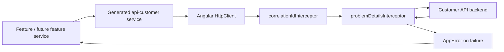

# Phase 3: Runtime Configuration and HTTP Foundation — Learning Guide

This guide explains the current implementation in `talabat-web`. Its purpose is to help you rebuild Phase 3 by hand, understand why each part exists, and recognize when the foundation is being bypassed.

## 1. Phase goal and scope

"Runtime Configuration and HTTP Foundation" means establishing two application-wide rules before feature work begins:

1. The deployed application decides which backend it talks to at startup, without rebuilding the frontend.
2. Every backend request uses one HTTP pipeline that adds shared request metadata and converts transport failures into one application error shape.

This phase comes before real restaurant, cart, profile, or checkout screens because those features need a dependable answer to basic questions: Which API should I call? How do I call it? What error object will I receive if it fails? If every feature answers those questions differently, later work duplicates URLs, error parsing, and troubleshooting logic.

The Phase 3 exit criterion is: deliberately make a generated API request fail and confirm the caller receives a typed `AppError`, with a visible result, rather than raw Angular `HttpErrorResponse` data. The current implementation verified this with a generated `CatalogApiService.getRestaurants()` request against an unused local port. It received an `AppError` with `isNetworkError: true` and then restored the normal runtime URL.

Intentionally not included yet:

- Feature UI or restaurant rendering
- Authentication and token attachment
- New routing work
- Signals-based feature state
- Any Phase 4 vertical-slice work

## 2. Architecture overview

The intended request path is deliberately narrow:



Features use generated services such as `CatalogApiService`; they do not inject `HttpClient` and construct URLs themselves. This keeps endpoint signatures, request parameters, serialization, and response types aligned with the OpenAPI contract. It also guarantees that every request reaches the same interceptors.

The generated client is preserved rather than hand-edited because it can be regenerated when the backend contract changes. Manual edits would be overwritten, difficult to review, and easy to lose. Application behavior belongs around the client: `BASE_PATH` is provided through DI, and cross-cutting HTTP behavior is implemented as interceptors.

## 3. Runtime configuration

### Build-time values versus runtime values

A build-time value is compiled into the JavaScript bundle. Changing it requires another frontend build. A runtime value is read after deployment, so the same bundle can run against development, staging, or production simply by deploying a different configuration file.

This project uses [config.json](../talabat-web/projects/customer/public/assets/config.json) as a deployed asset. The Angular build copies `projects/customer/public` to the application output, so the browser can request `/assets/config.json` when the app starts. The file is not TypeScript source and is not baked into the bundle.

For example, one build can be deployed with a staging file containing a staging API URL, then the same build can be deployed with a production file containing a production API URL. This avoids rebuilding merely to change endpoints, OIDC authority, client ID, or scopes.

### The contract and token

[app-config.ts](../talabat-web/projects/core-config/src/lib/app-config.ts) declares the runtime shape:

```ts
export interface AppConfig {
  readonly identityAuthority: string;
  readonly customerApiBaseUrl: string;
  readonly clientId: string;
  readonly scopes: string;
}

export const APP_CONFIG = new InjectionToken<AppConfig>("APP_CONFIG");
```

`AppConfig` tells TypeScript what values consumers may read. `APP_CONFIG` is an `InjectionToken`: Angular needs a runtime object to identify dependencies, because TypeScript interfaces do not exist in browser JavaScript. A consumer can therefore use `inject(APP_CONFIG)` and get the loaded object.

### Loading before bootstrap continues

[provide-app-config.ts](../talabat-web/projects/core-config/src/lib/provide-app-config.ts) returns `EnvironmentProviders`, which is a grouped set of providers suitable for standalone application setup.

Its important sequence is:

1. `let config: AppConfig | undefined` creates a closure variable private to this call to `provideAppConfig()`.
2. `provideAppInitializer(async () => ...)` tells Angular that startup has asynchronous work. Angular waits for the returned promise before considering application initialization complete.
3. `fetch('/assets/config.json')` loads the deploy-time file.
4. A non-success HTTP response throws `Config load failed: <status>`.
5. `res.json()` parses the document and assigns it to the closure variable.
6. The `APP_CONFIG` factory returns that value later. If it is requested too early, it throws `APP_CONFIG read before initialisation`.

`makeEnvironmentProviders` is useful because it packages both the initializer and the `APP_CONFIG` provider as one reusable unit. The caller cannot accidentally register one without the other.

Failing clearly is safer than a silent default. A fallback URL could boot the app against the wrong backend and turn a deployment mistake into an apparently random later feature failure. A missing file or invalid JSON already fails startup: `fetch` rejects for a network failure, `!res.ok` throws for a failed HTTP response, and `res.json()` rejects for malformed JSON.

Source-of-truth note: the current implementation does **not** validate the shape of syntactically valid JSON. A file such as `{}` parses but would only fail later when a missing property is used. Schema validation is not part of Phase 3 as implemented; it would be a deliberate future improvement, not something to assume exists today.

### Read the implementation in plain language

The imports bring in standalone DI helpers. The function holds the loaded value in a local variable rather than exporting mutable global state. The initializer fills it. The token factory then acts as a guard: it gives consumers the value only after initialization has populated it. This arrangement is why a generated service can be constructed through DI without knowing how configuration was loaded.

### Manual implementation order

When implementing this yourself, do it in this order:

1. Define the `AppConfig` interface and `APP_CONFIG` token.
2. Add a public `assets/config.json` containing the required values.
3. Confirm the application asset configuration copies the public directory.
4. Create `provideAppConfig()` with one closure variable, one async initializer, and one guarded `APP_CONFIG` factory.
5. Export the contract and provider from `core-config`.
6. Add `provideAppConfig()` to the root standalone application providers before relying on `APP_CONFIG` elsewhere.

## 4. `BASE_PATH` and the generated API client

`BASE_PATH` is an injection token exported by the generated `api-customer` library. Generated services inject it when they are constructed and use the resulting value as `configuration.basePath`.

The current generated `CatalogApiService` ultimately builds a request like this conceptually:

```ts
httpClient.request("get", `${configuration.basePath}/api/catalog/restaurants`);
```

The application supplies that base path in [app.config.ts](../talabat-web/projects/customer/src/app/app.config.ts):

```ts
{
  provide: BASE_PATH,
  useFactory: () => inject(APP_CONFIG).customerApiBaseUrl,
}
```

The dependency chain is therefore:

```text
assets/config.json
  → startup loader closure
  → APP_CONFIG
  → BASE_PATH factory
  → generated service configuration.basePath
  → generated API request URL
```

The API URL should appear in the deployed runtime configuration and be consumed through this `BASE_PATH` provider, not be repeated in components or feature services. Hardcoded URLs would make environment changes error-prone, permit different features to call different backends accidentally, and bypass the architectural seam where all generated clients are configured.

Source-of-truth note: generated service files contain a generator fallback of `http://localhost`. Do not rely on or edit it. The root `BASE_PATH` provider overrides it in the application, and generated output must remain regenerable.

## 5. Typed error handling

### Why raw Angular errors are the wrong feature contract

`HttpErrorResponse` exposes Angular transport details: headers, status text, URL, and an untyped `error` body. Asking every feature to inspect that object would spread backend-specific parsing through the application. Features would then need to remember how to handle a missing body, an unexpected error code, and browser network failures.

Instead, [app-error.ts](../talabat-web/projects/core-http/src/lib/app-error.ts) defines a small stable boundary:

```ts
interface AppError {
  readonly status: number;
  readonly code: AppErrorCode;
  readonly title: string;
  readonly detail?: string;
  readonly isNetworkError: boolean;
}
```

Future features can branch on `AppErrorCode` or display `title` and `detail` without knowing how Angular represented the original failure.

### Problem Details and local extensions

RFC 9457 Problem Details is a standard JSON error format with fields such as `type`, `title`, `status`, `detail`, and `instance`. The backend also uses `errorCode` as a root-level extension member. `TalabatProblemDetails` represents that local contract.

`errorCode` belongs in `core-http`, not in generated OpenAPI files, because the generated `ProblemDetails` model lacks that extension. Editing generated code would make the extension disappear on regeneration. Keeping the extension beside the mapper says clearly: this is how the frontend interprets the backend's error envelope.

### The mapping logic

[problem-details.interceptor.ts](../talabat-web/projects/core-http/src/lib/problem-details.interceptor.ts) is a functional interceptor. It passes successful responses through unchanged and uses RxJS `catchError` to replace every `HttpErrorResponse` it observes with `throwError(() => toAppError(e))`.

`toAppError` handles these cases:

| Situation                                                 | Result                                                                |
| --------------------------------------------------------- | --------------------------------------------------------------------- |
| Problem Details contains `errorCode: "ProfileNotCreated"` | Preserve that recognized `AppErrorCode`; use the body title/detail.   |
| Problem Details contains a future or unknown code         | Use `AppErrorCode.Unknown`; preserve a supplied title.                |
| Error body is absent                                      | Use `Unknown`, `Something went wrong`, and no detail.                 |
| HTTP status is `0`                                        | Use `Unknown`, `Cannot reach the server`, and `isNetworkError: true`. |

Status `0` is special: browsers use it when there is no usable HTTP response. Common causes include an unreachable server, a network interruption, a CORS rejection, or an HTTPS certificate the browser does not trust. There is no Problem Details body to parse in this case.

Unknown error codes must not crash the frontend. Backends evolve independently, and a new code can arrive before the frontend supports a specialized branch. Mapping it to `Unknown` retains a safe, predictable feature contract.

Source-of-truth note: the architecture plan includes an earlier illustrative `AppError` example without `isNetworkError` and with an enum form for the codes. The actual Phase 3 implementation and foundation guide use the `as const` code object and include `isNetworkError`; follow the current implementation.

## 6. Correlation ID

[correlation-id.interceptor.ts](../talabat-web/projects/core-http/src/lib/correlation-id.interceptor.ts) adds an `X-Correlation-Id` header to every request:

```ts
req.clone({
  setHeaders: { "X-Correlation-Id": crypto.randomUUID() },
});
```

HTTP requests are immutable in Angular, so the interceptor clones the request. `crypto.randomUUID()` produces a fresh UUID for each request. It is not an authentication token and should not identify a user; it identifies one request journey.

Imagine a customer reports that the restaurant list failed at 10:31. Browser diagnostics show `X-Correlation-Id: 8c4f...`. If backend logging records the same header, an engineer can search server logs for that ID and immediately connect the browser failure to a gateway timeout, controller exception, or downstream dependency problem. Without it, many concurrent requests can look identical.

## 7. Provider and interceptor wiring

The root [app.config.ts](../talabat-web/projects/customer/src/app/app.config.ts) uses standalone providers:

- `provideHttpClient(...)` installs Angular's HTTP client.
- `withInterceptors(...)` registers functional interceptors for that client.
- `inject(APP_CONFIG)` reads a dependency in the `BASE_PATH` factory without constructor injection.
- `provideAppConfig()` installs both startup loading and the config token.

The configured interceptor order is:

```ts
withInterceptors([correlationIdInterceptor, problemDetailsInterceptor]);
```

On the outgoing request, the correlation interceptor runs first and adds the header; the problem-details interceptor then forwards the request. On an error response, the downstream error travels back through `problemDetailsInterceptor`, which maps it before the caller observes it. The correlation interceptor does not handle responses today, so changing the order would not change current error mapping, but order becomes important as interceptors gain response behavior. Keep cross-cutting request enrichment before error normalization unless there is a concrete reason not to.

Provider list order and dependency timing are related but not identical. The `APP_CONFIG` factory is lazy: it is evaluated when something injects the token. The initializer runs at application startup and completes first; the generated service obtains `BASE_PATH` only when Angular constructs that service. Its factory then reads the already-loaded `APP_CONFIG`.

## 8. Manual implementation checklist

Use this hands-on sequence when recreating Phase 3:

1. Replace the placeholder `core-config` API with `AppConfig` and `APP_CONFIG`.
2. Add `projects/customer/public/assets/config.json` with identity and customer API values.
3. Check the Angular build assets include `projects/customer/public`.
4. Write and export `provideAppConfig()` using `makeEnvironmentProviders` and `provideAppInitializer`.
5. Replace the placeholder `core-http` API with `AppErrorCode`, `TalabatProblemDetails`, and `AppError`.
6. Write `problemDetailsInterceptor`; handle status `0` before trying to inspect a body.
7. Write `correlationIdInterceptor` using `crypto.randomUUID()` and a cloned request.
8. Export both interceptors from `core-http`.
9. In the standalone root config, register runtime config, `provideHttpClient(withInterceptors(...))`, and the generated `BASE_PATH` factory using `inject(APP_CONFIG)`.
10. Add tests before beginning feature work.

From `talabat-web`, run:

```bash
npx ng build core-config
npx ng build core-http
npx ng build customer
npx ng test core-config --watch=false
npx ng test core-http --watch=false
npx ng test --watch=false
npm run api:verify
```

For a safe manual exit check, temporarily set `customerApiBaseUrl` to an unused local port, for example `http://127.0.0.1:1`. Use a generated service to make a request and inspect the error received by the caller. Confirm it is an `AppError` with `status: 0` and `isNetworkError: true`, not an `HttpErrorResponse`. Restore the valid URL immediately afterward. Do not leave a failing endpoint in the deployed asset.

## 9. Tests and verification

The current tests prove separate layers of the foundation:

- [provide-app-config.spec.ts](../talabat-web/projects/core-config/src/lib/provide-app-config.spec.ts) stubs `fetch`, starts the initializer, waits for `ApplicationInitStatus.donePromise`, and proves that `APP_CONFIG` equals the loaded object. Waiting for `donePromise` matters because merely configuring TestBed does not prove an asynchronous initializer has finished.
- [problem-details.interceptor.spec.ts](../talabat-web/projects/core-http/src/lib/problem-details.interceptor.spec.ts) proves recognized-code mapping, unknown-code fallback, missing-body defaults, and status-0 network mapping. It uses Angular's HTTP testing backend, so it is a focused unit test of the interceptor contract.
- [correlation-id.interceptor.spec.ts](../talabat-web/projects/core-http/src/lib/correlation-id.interceptor.spec.ts) proves that an outgoing request has an `X-Correlation-Id` matching a UUID v4 pattern.

Unit-testing an interceptor answers: "Given this HTTP failure, does the shared mapper produce the correct `AppError`?" The complete exit verification answers a different question: "Does a real generated API service, configured through `BASE_PATH`, traverse the provider and interceptor chain and expose the mapped failure?" Both are useful; neither replaces the other.

### Final acceptance checklist

- [ ] `config.json` is a public deployed asset and contains all required values.
- [ ] The app waits for config loading and fails clearly if it cannot load it.
- [ ] `BASE_PATH` reads `APP_CONFIG.customerApiBaseUrl` through DI.
- [ ] Application code has no hardcoded customer API URL.
- [ ] Features use generated services, not directly injected `HttpClient`.
- [ ] Every HTTP failure that passes through `HttpClient` reaches `problemDetailsInterceptor` and becomes `AppError`.
- [ ] Status `0` is distinguishable through `isNetworkError`.
- [ ] Every request receives a correlation ID.
- [ ] Builds, focused tests, workspace tests, and generated-client verification pass.
- [ ] Any temporary failing URL has been restored.

## 10. Common mistakes and debugging

| Mistake                                       | Symptom                                                   | Cause                                                                           | Fix                                                                                                                                                                |
| --------------------------------------------- | --------------------------------------------------------- | ------------------------------------------------------------------------------- | ------------------------------------------------------------------------------------------------------------------------------------------------------------------ |
| `config.json` is not copied to assets         | Startup fails with `Config load failed: 404`              | The file is outside the public asset input or the build config does not copy it | Put it under `projects/customer/public/assets` and verify the `angular.json` asset input.                                                                          |
| Browser-relative fetch is used in Node/Vitest | `Failed to parse URL from /assets/config.json`            | Node's `fetch` does not infer the browser application's origin                  | Stub `fetch` in the unit test, or use a browser-served integration harness; do not change the browser runtime path just to satisfy Node.                           |
| `APP_CONFIG` is read too early                | `APP_CONFIG read before initialisation`                   | A provider/service is forcing the token before the initializer completed        | Ensure bootstrap uses `provideAppConfig()` and do not construct consumers outside normal Angular startup. In a test, wait for `ApplicationInitStatus.donePromise`. |
| API URLs are hardcoded in features            | One environment works while another calls the wrong host  | The generated client configuration was bypassed                                 | Remove the URL and call a generated service. Configure the API once through `BASE_PATH`.                                                                           |
| A raw `HttpErrorResponse` reaches a feature   | UI code parses `error.error` or handles status `0` itself | The request bypassed the registered `HttpClient` interceptor chain              | Use the root-provided client through generated services and keep `problemDetailsInterceptor` registered.                                                           |
| Temporary failing URL is not restored         | Local application stays unable to reach the API           | Exit verification changed the runtime asset and left it changed                 | Restore the original value immediately and check `git diff` before handoff.                                                                                        |
| Unknown backend code crashes the feature      | A new backend deployment breaks error handling            | Feature code assumes a closed list of raw strings                               | Map unknown codes to `AppErrorCode.Unknown`; add a specialized code only when the frontend supports it.                                                            |
| Generated API files are manually edited       | Changes disappear after regeneration or contracts diverge | Generated output was treated as application code                                | Keep generated files untouched; use DI, interceptors, and wrapper code around them.                                                                                |

## 11. Learning exercises

Try these without looking at the answers first:

1. Change only a copy of `config.json` for a hypothetical staging deployment. Which values can change without rebuilding the frontend, and why?
2. Trace `CatalogApiService.getRestaurants()` from its method call to the final URL. Identify the exact provider that supplies the host.
3. Add a temporary test case where Problem Details has `errorCode: 'AValueTheFrontendDoesNotKnow'`. Predict the complete `AppError` before running it.
4. Use the HTTP testing controller to inspect one request after the correlation interceptor. Which header should exist, and why must the interceptor clone the request?
5. Temporarily point a test-only `AppConfig.customerApiBaseUrl` at an unused local port and make a generated request. What distinguishes this failure from a backend 500 response?
6. In a config-loader test, remove the wait for `ApplicationInitStatus.donePromise`. What race are you introducing?
7. Imagine a feature injects `HttpClient` directly and calls a full URL. List the architectural guarantees it bypasses.

<details>
<summary>Suggested answers</summary>

1. `identityAuthority`, `customerApiBaseUrl`, `clientId`, and `scopes` can change because the browser fetches them from a deployed asset at startup. The JavaScript bundle is unchanged.
2. The generated method combines its path with `configuration.basePath`. Angular supplies that from `BASE_PATH`, whose factory reads `APP_CONFIG.customerApiBaseUrl`.
3. The result should retain the HTTP status and supplied title/detail, use `AppErrorCode.Unknown`, and set `isNetworkError` to `false`.
4. `X-Correlation-Id` should contain a fresh UUID. Angular `HttpRequest` objects are immutable, so headers can only be changed on a clone.
5. The unused-port request produces status `0` and `isNetworkError: true`; a backend 500 has an HTTP response and normally maps to `isNetworkError: false` with Problem Details or safe defaults.
6. The test can read `APP_CONFIG` before the asynchronous fetch has completed, so it no longer proves startup sequencing.
7. It bypasses the generated OpenAPI contract, central `BASE_PATH` configuration, correlation header, typed error mapping, and the no-hardcoded-URL rule.

</details>
