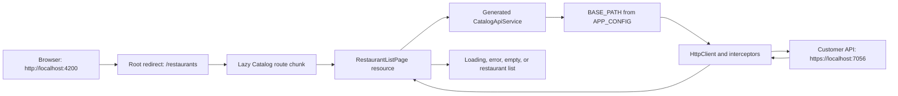

# Phase 4: First Vertical Slice — Learning Guide

## Purpose of this guide

This guide teaches the architectural reasoning behind the completed Phase 4 Catalog slice. It uses the real repository implementation as the source of truth and compares it with:

- <code>talabat-angular-foundation-guide-phases-1-4.md</code>
- <code>talabat-angular-plan-v2.md</code>

The aim is to let you rebuild the slice manually from a completed Phase 3 foundation, not simply recognise working code.

## 1. Goal and importance

### What “first vertical slice” means

A vertical slice is the smallest useful capability that travels through every required layer of an application. It is not merely a component, an API call, or a passing test. In Phase 4, the capability is:

> Open the customer app and see real restaurants supplied by the Customer API.

That outcome crosses routing, lazy loading, dependency injection, runtime configuration, the generated API client, HTTP interceptors, HTTPS, CORS, asynchronous state, and the browser DOM. It is therefore the first proof that the frontend architecture works in reality, rather than only compiling in isolation.

### Phase 4 exit criterion

> Real restaurant data from <code>https://localhost:7056</code> renders at <code>http://localhost:4200</code>.

The completed slice achieves this at <code>/restaurants</code>. It renders the names and descriptions from the public Customer API response.

### Why the UI is deliberately minimal

Phase 4 validates architecture, not product design. A heading and list are enough to make the request path observable. If data is missing, the team can investigate routing, configuration, the client, CORS, or the backend without card styles, responsive layouts, image loading, or design-system abstractions making diagnosis harder.

The following are intentionally outside Phase 4:

- FoodDash styling and Tailwind
- shared UI primitives and design tokens
- authentication and profile gating
- cart and checkout
- restaurant details and menus
- search, broader feature state, and later-phase work

## 2. Complete request and user-flow architecture

The architecture separates responsibilities. Routes own URL-to-feature mapping. The page owns visible async states. The generated client owns the API contract. Runtime configuration owns the deployment URL. Interceptors own cross-cutting HTTP policy.



The full sequence is:

1. The browser opens <code>http://localhost:4200</code>.
2. Angular redirects the empty path to <code>/restaurants</code>.
3. Angular resolves the lazy Catalog route and downloads the feature code only when needed.
4. The route creates <code>RestaurantListPage</code>.
5. The page calls the generated <code>CatalogApiService</code> through its server-data resource.
6. The generated service combines the DI-provided <code>BASE_PATH</code> with its generated catalog path.
7. Angular HttpClient runs the correlation-ID and Problem Details interceptors.
8. The Customer API returns <code>RestaurantListResponse</code>.
9. The resource changes state and the page renders loading, error, empty, or data UI.

Do not collapse these layers. A page that constructs URLs leaks configuration into a feature. A generated client that decides user-facing error copy becomes product code that can be overwritten. An interceptor that renders catalog UI is no longer reusable infrastructure.

## 3. Routing and lazy loading

### Root redirect

The root route in [app.routes.ts](../talabat-web/projects/customer/src/app/app.routes.ts) is:

```ts
{ path: '', pathMatch: 'full', redirectTo: 'restaurants' }
```

The empty path is the application entry point. <code>pathMatch: 'full'</code> ensures the redirect applies only to the complete empty URL rather than matching every route.

### Feature route boundary

The root Catalog route is lazy:

```ts
{
  path: 'restaurants',
  loadChildren: () => import('./features/catalog/routes').then((module) => module.routes),
}
```

The feature-local [routes.ts](../talabat-web/projects/customer/src/app/features/catalog/routes.ts) maps its empty child path to <code>RestaurantListPage</code>. The app route table owns feature boundaries; the feature owns its internal entry route.

### What lazy loading changes

Initial code contains the shell, router, runtime providers, and top-level route definitions. The Catalog page code is fetched only when <code>/restaurants</code> activates. This is a useful habit from the first feature: retrofitting lazy boundaries later requires untangling imports after features already depend on one another.

In a production build, look under “Lazy chunk files” for a chunk named <code>routes</code>. In browser DevTools Network, a JavaScript feature chunk is requested when the route activates. The hash changes between builds; the separate route chunk is the evidence that matters.

### Manual route implementation sequence

1. **Create the Catalog feature folder.** This establishes a feature boundary before adding page logic.
2. **Create <code>features/catalog/routes.ts</code>.** Export a <code>Routes</code> array with <code>RestaurantListPage</code> at the empty child path.  
   Expected result: Catalog has a local routing entry point.
3. **Add the lazy root route.** Use <code>loadChildren</code> from <code>/restaurants</code>.  
   Expected result: Catalog is not part of the eagerly loaded feature code.
4. **Add the root redirect.** Send the empty path to <code>restaurants</code>.  
   Expected result: opening the app reaches the first real capability.
5. **Build and inspect output.** Confirm the separate lazy route chunk before adding API code.

## 4. Catalog feature and page responsibility

Phase 4 adds one small feature because its purpose is to prove the foundation, not to build the final catalog. A public restaurant list is ideal: read-only, typed by the generated contract, and small enough to make failures easy to localise.

[RestaurantListPage](../talabat-web/projects/customer/src/app/features/catalog/pages/restaurant-list.page.ts) is a routed page. Its responsibilities are deliberately narrow:

- start the restaurant read operation;
- translate server-data state into visible UI states;
- render fields from <code>RestaurantListResponse</code>.

It does not decide the API host, construct request URLs, manage tokens, define DTOs, or create shared visual primitives.

### Why it injects the generated client

The page injects <code>CatalogApiService</code>, not <code>HttpClient</code>. The generated client is the typed frontend representation of the OpenAPI contract. Its <code>getRestaurants()</code> operation returns <code>Observable&lt;RestaurantListResponse&gt;</code>.

This prevents duplicated endpoint strings and hand-written response types. Generated client code is replaceable output: change the backend contract, regenerate, and review the generated diff. Never manually edit it, because regeneration will overwrite the change.

## 5. Signals, resources, and asynchronous UI

### Important implementation difference: resource, not httpResource

The reference documents show a direct <code>httpResource(() =&gt; this.api.getRestaurants())</code> example. The completed application uses the generic Angular <code>resource()</code> API:

```ts
readonly restaurants = resource({
  loader: () => this.loadRestaurants(),
});
```

This is intentional and safe. In the installed Angular 22 API, <code>httpResource()</code> accepts a URL or HTTP request descriptor. The generated <code>getRestaurants()</code> method returns an Observable, so passing it directly to <code>httpResource()</code> does not type-check. Supplying a URL descriptor would duplicate the generated endpoint path or bypass the generated client, violating the project rules.

The architecture plan allows both <code>httpResource()</code> and <code>resource()</code> for server data. The page converts the generated Observable to the Promise-shaped resource loader with <code>firstValueFrom()</code>.

This introduces a small adapter. Phase 3 maps failures to the plain <code>AppError</code> interface, while Angular resources expose <code>Error</code> instances. <code>toResourceError()</code> creates an Error and copies the typed AppError fields onto it; <code>restaurantError</code> exposes an AppError-shaped value to the template. The user still sees the Phase 3 safe error title.

This is appropriate for this one-read page. If a future resource is parameter-driven, rapidly reloaded, or requires observable cancellation to propagate, reassess the adapter deliberately instead of copying it automatically.

### Resource lifecycle

On first render, the resource has begun loading but has no server response. Its <code>isLoading()</code> signal is true and <code>value()</code> may be undefined. When the generated service emits, the resource resolves with <code>RestaurantListResponse</code>. If the request rejects, the resource enters its error state.

Undefined before resolution is normal asynchronous behaviour, not an API bug. Ordered template branches make it safe without non-null assertions.

### Four mandatory UI states

| State   | Current implementation                                                        | Why it exists                                                  |
| ------- | ----------------------------------------------------------------------------- | -------------------------------------------------------------- |
| Loading | <code>restaurants.isLoading()</code> renders “Loading...”                     | A user can distinguish active work from a blank page.          |
| Error   | <code>restaurantError()</code> renders an alert with <code>error.title</code> | Failures are expected operating states and need safe language. |
| Empty   | Resolved response with <code>response.items.length === 0</code>               | Successful requests can legitimately have no data.             |
| Success | <code>@for</code> renders each restaurant                                     | Real backend data becomes visible.                             |

The final empty fallback is defensive display behaviour for a missing value outside normal loading/error branches. It does not replace the explicit states.

### Native control flow and tracking

The template uses Angular native control flow:

- <code>@if</code> selects one state in priority order: loading, error, response, fallback.
- A nested <code>@if</code> separates a successful empty response from a successful populated one.
- <code>@for (restaurant of response.items; track restaurant.id)</code> renders rows.

Tracking by <code>restaurant.id</code> gives Angular a stable identity. On a later refresh or reorder, Angular can keep the correct DOM row associated with the correct restaurant. An array index identifies a position, not a restaurant.

### Why not manual subscribe and flags?

A manual approach usually declares item, loading, and error fields, calls <code>subscribe()</code>, and updates each field separately. It is easy to miss a transition, leave stale data visible, or mishandle cleanup.

A resource concentrates the asynchronous state. The page asks whether it is loading, whether it has an error, and what resolved value it contains. The template reads signals directly, which works naturally with the project’s zoneless Angular configuration.

## 6. How Phase 3 is proven by Phase 4

Phase 3 built the runtime and HTTP foundation. Phase 4 proves it through a real public request.

1. [config.json](../talabat-web/projects/customer/public/assets/config.json) is a deployed asset, not an <code>environment.ts</code> value. It supplies <code>customerApiBaseUrl: https://localhost:7056</code> at runtime.
2. <code>provideAppConfig()</code> fetches it during Angular application initialization and exposes it through the <code>APP_CONFIG</code> injection token.
3. [app.config.ts](../talabat-web/projects/customer/src/app/app.config.ts) provides generated <code>BASE_PATH</code> using <code>inject(APP_CONFIG).customerApiBaseUrl</code>.
4. The generated <code>CatalogApiService</code> receives <code>BASE_PATH</code> through DI and combines it with its generated <code>/api/catalog/restaurants</code> path.
5. The same HttpClient request pipeline runs the registered interceptors.
6. The correlation interceptor adds a fresh <code>X-Correlation-Id</code> UUID.
7. The Problem Details interceptor converts <code>HttpErrorResponse</code> failures into <code>AppError</code> before feature code receives them.

One browser interaction therefore verifies runtime config, DI wiring, generated client configuration, interceptors, CORS, HTTPS certificate trust, signals, and browser rendering simultaneously.

## 7. Real browser integration verification

Automated tests do not prove browser security policy or local certificate setup. Verify a real visit to <code>http://localhost:4200/restaurants</code> in Network and Console:

- request URL is <code>https://localhost:7056/api/catalog/restaurants</code>;
- response succeeds and contains an <code>items</code> array;
- request headers contain <code>X-Correlation-Id</code> with a UUID;
- request headers contain no <code>Authorization</code> header, because Catalog is public in Phase 4;
- restaurant data renders and Console has no errors.

The SPA and API are different origins: <code>http://localhost:4200</code> differs from <code>https://localhost:7056</code> in scheme and port. The API CORS policy must therefore allow the exact SPA origin, request method, and correlation header. The .NET development certificate must also be trusted before the browser can establish usable HTTPS.

### Classifying runtime failures

| Symptom                                                        | Likely class of problem                                                          |
| -------------------------------------------------------------- | -------------------------------------------------------------------------------- |
| A 4xx or 5xx response is visible                               | Backend endpoint, validation, or business/API problem.                           |
| Console says blocked by CORS                                   | API CORS policy does not allow the SPA origin, header, or method.                |
| Certificate warning or <code>ERR_CERT_AUTHORITY_INVALID</code> | Development certificate is not trusted.                                          |
| Status 0, timeout, or connection refused                       | Backend is unreachable; CORS and certificate failures can also surface this way. |

## 8. Error and unavailable-backend behaviour

When the backend is stopped or unavailable, the page should display:

```text
Cannot reach the server
```

It must not render a raw <code>HttpErrorResponse</code>, browser error text, or a stack trace. Transport details are not actionable or safe user-facing language.

The Phase 3 Problem Details interceptor is the boundary that makes this work:

| Failure kind                          | Incoming condition                            | Resulting AppError                                                              |
| ------------------------------------- | --------------------------------------------- | ------------------------------------------------------------------------------- |
| Problem Details HTTP error            | 4xx/5xx with title, detail, or errorCode body | Status and safe Problem Details values; known codes remain known.               |
| HTTP error without useful body        | 4xx/5xx with null or unusable body            | Unknown code and “Something went wrong.”                                        |
| Network, CORS, or certificate failure | <code>HttpErrorResponse.status === 0</code>   | Unknown code, <code>isNetworkError: true</code>, and “Cannot reach the server.” |

The page does not branch on raw status numbers. It receives mapped AppError values, preserves them through the resource adapter, and renders <code>title</code> in an alert.

## 9. Manual implementation guide

Begin with a completed Phase 3 project. Each step explains the purpose before the action.

1. **Confirm integration prerequisites.** The goal is a browser request, so start the Customer API and trust the certificate first.

   ```powershell
   dotnet dev-certs https --trust
   dotnet run --project D:\link-dev\talabat\src\Talabat\Talabat.API\Talabat.Customer.API.csproj --launch-profile https
   ```

   Expected result: <code>https://localhost:7056/api/catalog/restaurants</code> returns public restaurant data.

2. **Confirm the Phase 3 runtime boundary.** Inspect config, <code>provideAppConfig()</code>, and app configuration. Ensure <code>BASE_PATH</code> comes from <code>APP_CONFIG</code>, not a literal.  
   Expected result: changing only deployed config can select a different API host.

3. **Create the feature route file.** Add <code>features/catalog/routes.ts</code> and map the empty child path to the page.  
   Expected result: Catalog has an owned route entry point.

4. **Add root redirect and lazy route.** Redirect <code>''</code> to <code>restaurants</code>; load the feature via <code>loadChildren</code>.  
   Expected result: opening the root reaches Catalog and the feature remains lazy.

5. **Create the routed page.** Inject <code>CatalogApiService</code>, then create a <code>resource()</code> whose loader resolves <code>firstValueFrom(api.getRestaurants())</code>. Do not inject HttpClient.  
   Expected result: typed <code>RestaurantListResponse</code> reaches a reactive resource.

6. **Add four template states before styling.** Render loading, typed error alert, empty result, and a success <code>@for</code> tracked by <code>restaurant.id</code>.  
   Expected result: no blank or unsafe state during pending, failure, empty, or success outcomes.

7. **Write focused component tests.** Mock <code>CatalogApiService</code> with a pending subject, typed AppError, empty response, and populated response.  
   Expected result: every visible async state is protected from regression.

8. **Run workspace checks.** From <code>talabat-web</code>:

   ```powershell
   npx ng test customer --watch=false
   npx ng test core-config --watch=false
   npx ng test core-http --watch=false
   npx ng build customer
   npm run api:verify
   npx prettier --check "projects/customer/src/**/*.{ts,html,css}"
   git diff --check
   ```

   Expected result: tests, production build, generated-client verification, formatting, and whitespace checks pass.

9. **Perform browser verification.** Run <code>npx ng serve customer</code>, open Network, then visit <code>http://localhost:4200/restaurants</code>.  
   Expected result: lazy feature chunk, public catalog request, correlation header, no Authorization header, restaurant data, and no Console errors.

10. **Prove unavailable-server handling.** Stop the Customer API, reload, confirm the safe network message, then restart the API and confirm success again.  
    Expected result: the architecture handles both success and failure without leaking transport internals.

## 10. Tests and acceptance criteria

### Relevant tests

| Test location                  | What it proves                                                                                        |
| ------------------------------ | ----------------------------------------------------------------------------------------------------- |
| RestaurantListPage page spec   | Loading, typed network error, empty, and success states while the generated service is mocked.        |
| correlationIdInterceptor spec  | Each Angular HTTP request receives a UUID-shaped correlation header.                                  |
| problemDetailsInterceptor spec | Known codes, unknown codes, missing bodies, and status-0 failures become predictable AppError values. |
| provideAppConfig spec          | Runtime config is loaded before APP_CONFIG is read.                                                   |
| Root app spec                  | The standalone root component can be created with router infrastructure.                              |

These forms of verification answer different questions:

- **Unit/component tests** isolate page and infrastructure behaviour using mocks.
- **Angular application verification** with build and test commands proves the workspace compiles and executes automated tests.
- **Real browser/backend integration verification** proves configuration, certificate trust, CORS, headers, API connectivity, interceptors, and visible rendering work together.

### Final checklist

- [ ] Root redirects to <code>/restaurants</code>.
- [ ] Catalog routes load lazily.
- [ ] Restaurant data comes from CatalogApiService, never direct feature HttpClient.
- [ ] No feature code hardcodes an API URL.
- [ ] Loading, error, empty, and success states are explicit.
- [ ] BASE_PATH comes from APP_CONFIG runtime configuration.
- [ ] Requests contain X-Correlation-Id.
- [ ] Public catalog requests contain no Authorization header.
- [ ] A stopped backend displays “Cannot reach the server.”
- [ ] Tests, build, API verification, formatting, and whitespace checks pass.
- [ ] No Phase 5 or later work was introduced.

The exact Phase 4 exit criterion is: **real restaurant data from <code>https://localhost:7056</code> renders at <code>http://localhost:4200</code>.**

## 11. Common mistakes and troubleshooting

| Issue                              | Symptoms                                                   | Diagnose                                                              | Fix                                                                     |
| ---------------------------------- | ---------------------------------------------------------- | --------------------------------------------------------------------- | ----------------------------------------------------------------------- |
| Backend not running                | Loading becomes “Cannot reach the server.”                 | Open API Swagger or call the catalog endpoint.                        | Start Customer API using its HTTPS launch profile.                      |
| Port 7056 already in use           | API cannot start, or requests reach an unexpected process. | Inspect <code>Get-NetTCPConnection -LocalPort 7056</code>.            | Stop only the identified conflicting process; restore the intended API. |
| Untrusted HTTPS certificate        | Certificate warning; often status 0.                       | Visit API Swagger and inspect browser security.                       | Run <code>dotnet dev-certs https --trust</code>.                        |
| CORS failure                       | Console says cross-origin request was blocked.             | Compare exact SPA origin and inspect preflight response.              | Fix Customer API CORS policy; do not hide it behind a frontend proxy.   |
| Wrong runtime API URL              | Request targets wrong host or port.                        | Open <code>/assets/config.json</code> and inspect customerApiBaseUrl. | Correct the deployed config asset.                                      |
| Hardcoded API URL                  | Works locally but deployment needs rebuild.                | Search feature code for localhost, https, or direct catalog paths.    | Use generated client plus BASE_PATH.                                    |
| Generated client ignores BASE_PATH | Request uses generator fallback host.                      | Inspect generated service constructor and app providers.              | Provide BASE_PATH from APP_CONFIG.customerApiBaseUrl.                   |
| HttpClient injected in a feature   | Transport/path details leak into page code.                | Search Catalog feature for HttpClient.                                | Inject CatalogApiService instead.                                       |
| Lazy route fails                   | Blank page or chunk-load error.                            | Inspect Console and Network for lazy chunk failure.                   | Confirm relative import, exported routes symbol, and file path.         |
| No restaurant data                 | Empty state after successful request.                      | Inspect response items in Network.                                    | Fix backend data/query conditions; empty UI is correct.                 |
| Resource value undefined           | Happens on first render.                                   | Check isLoading and resource state.                                   | Keep ordered branches; do not add unsafe non-null assertions.           |
| Raw HTTP error leaks               | Status text/object/stack shown to user.                    | Trigger failure and inspect interceptor registration.                 | Register Problem Details interceptor and display AppError.title.        |
| Temporary config was not restored  | Later verification fails.                                  | Reopen config and inspect diff.                                       | Restore real customerApiBaseUrl before final checks.                    |
| Styling added too early            | Phase 4 changes include Tailwind or design-system work.    | Review changed files against scope.                                   | Keep semantic HTML; move styling to Phase 5.                            |

## 12. Learning exercises

Try these on a disposable branch before reading the answers.

1. Add a <code>/catalog</code> redirect to <code>/restaurants</code>. Explain why a redirect is better than a duplicate page route.
2. Build the app, find the Catalog lazy chunk, then compare direct <code>/restaurants</code> navigation with opening the root URL.
3. Point the runtime API URL to an unused port. Identify which layer produces the visible safe message.
4. Prove with search and DevTools that the page uses only <code>CatalogApiService.getRestaurants()</code>, not direct HttpClient.
5. Extend the page test to three restaurants. Explain why identity should be the API id rather than the array index.
6. Inspect the CORS preflight and explain why the correlation header causes it.
7. Stop the backend, reload, restart it, and compare that failure with a real HTTP 500 Problem Details response.
8. Follow the template branches from first render until a populated response is displayed.

<details>
<summary>Suggested answers</summary>

1. A redirect creates one canonical restaurant URL and avoids duplicate route ownership.
2. The build lists a lazy routes chunk; direct navigation loads it too, while root navigation performs the redirect first.
3. The Problem Details interceptor maps status 0 to AppError, and the page resource adapter preserves the title for the alert.
4. The page injects CatalogApiService. The generated service owns the endpoint path and uses configured HttpClient internally.
5. Id is stable across reorder and refresh; an index describes only a position.
6. X-Correlation-Id is not CORS-safelisted, so the browser sends OPTIONS asking whether the API allows that header from the SPA origin.
7. An unreachable backend has no usable response and becomes isNetworkError true. An HTTP 500 reaches the browser and becomes a non-network AppError using Problem Details or a safe fallback.
8. First the loading branch wins. After resolve there is no error, a response exists, items are non-empty, and @for renders rows tracked by id.

</details>
