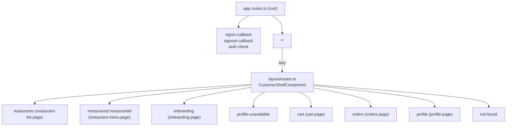
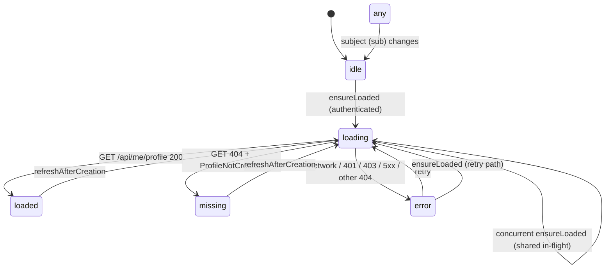
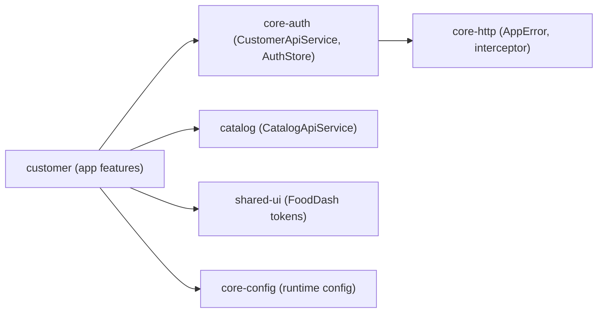

# Phase 7 Learning Guide: Customer Shell, Profile Gate, Onboarding, and Restaurant Menu

A beginner-friendly walkthrough of every change in the Phase 7 working tree.
Read this alongside the shorter `docs/phase-7-customer-shell-onboarding-menu-implementation-report.md`.

- **Branch**: `master`
- **Baseline commit**: `35cd0ce` (`docs: confirm Phase 6 OIDC acceptance baseline`)
- **Date of analysis**: 2026-08-06
- **Scope**: The full uncommitted working tree on top of the Phase 6 baseline.

---

## 1. What This Phase Is About

Phase 7 turns the customer app from a "public restaurant list" into a **real customer shell** with three connected ideas:

1. **Customer shell** — a persistent layout (header + content area + a floating cart entry button) that wraps every page.
2. **Profile gate** — a "profile store" that knows whether the signed-in user has completed onboarding, plus route guards that send the user to the right screen automatically.
3. **Onboarding + Restaurant Menu** — a profile-creation form and a full restaurant menu page with a working product card.

Everything in this guide is about **what the working tree contains**, not about what the spec "wants". Wherever we describe a behavior, we point at the file and line where it lives.

---

## 2. Starting Point (Baseline)

Before Phase 7, the customer app (from Phase 6) had:

- PKCE sign-in, sign-in callback, and sign-out callback pages.
- A public restaurant list page loaded from the generated `CatalogApiService`.
- The `App` root component rendering a header + `<router-outlet>` directly.
- No profile concept, no onboarding, no menu page, no cart concept.

The verified baseline command results were:

| Check | Result |
|---|---|
| `npm run test:openapi-tools` | PASS (1 test) |
| `npm run api:verify` | PASS (6 services, 25 models, 39 TypeScript files) |
| `npx ng test core-auth` | PASS (5 files, 54 tests) |
| Generated API diff | CLEAN |

---

## 3. Change Summary (the 30-second version)

| Category | Count |
|---|---|
| Modified tracked files | 9 |
| New untracked customer app files | 31 |
| New untracked spec/planning files | 9 |
| New untracked tooling/misc files | 8 |
| Deleted / renamed tracked files | 0 |
| Staged files | 0 |
| Tracked lines added (`git diff --numstat`) | 106 |
| Tracked lines deleted | 81 |

The working tree is intentionally **not committed** — the task explicitly said not to create a commit.

---

## 4. Files in the Working Tree

### 4.1 Modified files (9)

| File | What changed | Why |
|---|---|---|
| `talabat-web/projects/core-http/src/lib/app-error.ts` | Added 3 error codes: `InvalidCustomerProfile`, `ProfileAlreadyExists`, `RestaurantNotFound` | The profile and menu features need typed errors |
| `talabat-web/projects/customer/src/app/app.config.ts` | Added `withComponentInputBinding()` | Lets routes pass params/data as component `@Input()`-style inputs |
| `talabat-web/projects/customer/src/app/app.html` | Removed the header (moved into the shell) | The shell owns the header now |
| `talabat-web/projects/customer/src/app/app.routes.ts` | `**` now loads lazy `layout/routes`; callback routes stay at root | The shell wraps all feature routes |
| `talabat-web/projects/customer/src/app/app.ts` | Slimmed to a single `<router-outlet>` | Root just hosts the lazy shell |
| `talabat-web/projects/customer/src/app/features/catalog/routes.ts` | Added lazy `:restaurantId` menu route | New menu feature |
| `talabat-web/projects/customer/src/app/features/catalog/components/restaurant-card.component.ts` | Whole card is now an `<a>` with `routerLink` | Accessibility + click targets |
| `talabat-web/projects/customer/src/app/features/catalog/pages/restaurant-list.page.spec.ts` | Updated for the new card | Tests follow the component |
| `talabat-web/projects/customer/src/app/features/catalog/components/restaurant-card.component.spec.ts` | 35 new lines covering the anchor card | Regression coverage |

### 4.2 New files — core infrastructure (11)

| File | Purpose |
|---|---|
| `core/profile/profile.store.ts` | Root profile state service |
| `core/profile/profile.store.spec.ts` | 14 tests for the store |
| `core/profile/index.ts` | Barrel export |
| `core/guards/profile.guard.ts` | Functional guard: loaded → allow, missing → onboarding, error → unavailable |
| `core/guards/profile.guard.spec.ts` | 3 tests |
| `core/guards/onboarding.guard.ts` | Inverse guard: missing → allow, loaded → redirect |
| `core/guards/onboarding.guard.spec.ts` | 4 tests |
| `core/guards/index.ts` | Barrel export |
| `core/cart-entry/cart-entry-coordinator.service.ts` | Deferred cart entry coordinator |
| `core/cart-entry/cart-entry-coordinator.service.spec.ts` | 3 tests |
| `app.routes.spec.ts` | Route-level integration test harness |

### 4.3 New files — layout (5)

`layout/customer-shell.component.ts`, `layout/header.component.ts`, `layout/header.component.spec.ts`, `layout/cart-entry-bar.component.ts`, `layout/routes.ts`.

### 4.4 New files — features (12)

- **Onboarding**: `features/onboarding/routes.ts`, `features/onboarding/pages/onboarding.page.ts`, `features/onboarding/pages/onboarding.page.spec.ts`, `features/onboarding/components/onboarding-form.component.ts`, `features/onboarding/components/onboarding-form.component.spec.ts`
- **Catalog (menu)**: `features/catalog/pages/restaurant-menu.page.ts`, `features/catalog/pages/restaurant-menu.page.spec.ts`, `features/catalog/components/menu-header.component.ts`, `features/catalog/components/menu-product-card.component.ts`, `features/catalog/components/menu-product-card.component.spec.ts`
- **Auth**: `features/auth/pages/profile-unavailable.page.ts`
- **Placeholder pages**: `features/cart/pages/cart.page.ts`, `features/orders/pages/orders.page.ts`, `features/profile/pages/profile.page.ts`, `features/not-found/not-found.page.ts`

---

## 5. Architecture (with diagrams)

### 5.1 High-level dependency flow

```mermaid
graph TD
    App[App (root)<br/>router-outlet only]
    Shell[CustomerShellComponent<br/>layout/routes]
    Header[HeaderComponent]
    CartBar[CartEntryBarComponent]
    Outlet[(router-outlet)]
    ProfileGuard[profile.guard]
    OnboardingGuard[onboarding.guard]
    ProfileStore[ProfileStore]
    CartCoord[CartEntryCoordinator]
    MenuPage[RestaurantMenuPage]
    OnbPage[OnboardingPage]
    Api[Generated API services<br/>core-http]

    App -->|loads lazy| Shell
    Shell --> Header
    Shell --> CartBar
    Shell --> Outlet
    Outlet --> MenuPage
    Outlet --> OnbPage
    MenuPage --> Api
    OnbPage --> ProfileStore
    OnbPage --> Api
    ProfileGuard --> ProfileStore
    OnboardingGuard --> ProfileStore
    MenuPage -->|CartEntryRequest| CartCoord
```

### 5.2 Routing tree



### 5.3 Profile state machine



---

## 6. The Profile Store (the heart of the phase)

File: `talabat-web/projects/customer/src/app/core/profile/profile.store.ts`

It is a root (`providedIn: 'root'`) Angular service using **signals**. It answers one question: *"Does the currently signed-in user have a customer profile yet?"*

Key ideas, explained one at a time:

1. **Status signal** — a single `signal<ProfileStatus>` where `ProfileStatus = 'idle' | 'loading' | 'loaded' | 'missing' | 'error'`. Components read this to decide what to render.

2. **Data signals** — `profile` (the loaded `ProfileResponse` or `null`) and `error` (a typed `AppError` or `null`). These are what the header and guards read.

3. **Subject scoping** — the store remembers which authentication subject (`sub`) it fetched for. When the subject changes, it resets to `idle` immediately. This prevents showing "Alice's profile" to "Bob" after a sign-out/sign-in switch.

4. **In-flight dedupe** — if three components all call `ensureLoaded()` at once, only **one** network request happens; the others share the same in-flight promise. This is the "concurrency" protection.

5. **`ensureLoaded()`** — the main entry point. If status is `idle`/`error` and there is an authenticated subject, it calls `getProfile()` and updates the status based on the typed error:
   - `200` → `loaded`
   - `404` with `ProfileNotCreated` → `missing`
   - anything else → `error`

6. **`retry()`** — re-runs the load after an error (used by the profile-unavailable page's Retry button).

7. **`refreshAfterCreation()`** — after onboarding `POST /api/me/profile` succeeds, the store deliberately calls `GET /api/me/profile` again so the cached object is the **canonical server response** (never a client-constructed copy). This is a constitution-driven decision: the backend stays the authority.

8. **`reset()`** — forces the store back to `idle` and clears data (used on sign-out).

The dependency is one-way: the store talks to the generated `CustomerApiService` from `core-auth`, which talks to `core-http`. Nothing outside the store mutates profile state.

---

## 7. The Guards

File: `talabat-web/projects/customer/src/app/core/guards/profile.guard.ts` and `onboarding.guard.ts`

Both are **functional guards** (`CanActivateFn`) — plain functions, no classes. They call `ProfileStore.ensureLoaded()` and read the status:

**`profileGuard`** (protects profile-required screens):
- `loaded` → `true` (allow navigation)
- `missing` → `UrlTree('/onboarding', { returnUrl: <current URL> })` (send to onboarding)
- `error` → `UrlTree('/profile-unavailable', { returnUrl: <current URL> })`

**`onboardingGuard`** (protects the onboarding screen — the inverse):
- `missing` → `true` (allow — this is exactly who belongs on onboarding)
- `loaded` → redirect back to `returnUrl`, or `/restaurants` if none
- `error` → redirect to `/profile-unavailable`

Using a `UrlTree` return (instead of `Router.navigate`) is the Angular-recommended declarative way for guards to redirect; it also makes the guards trivial to unit test.

### Guard matrix

| Route | Guard array | Loaded | Missing | Error |
|---|---|---|---|---|
| `/auth-check` | `[authGuard, profileGuard]` | allow | → `/onboarding?returnUrl=` | → `/profile-unavailable?returnUrl=` |
| `/onboarding` | `[authGuard, onboardingGuard]` | → returnUrl or `/restaurants` | allow | → `/profile-unavailable` |
| `/profile-unavailable` | `[authGuard]` | allow | allow | allow |

There is **no redirect loop** between `/onboarding` and `/auth-check`: onboarding's guard never sends a user back to onboarding, and profile-unavailable is intentionally not guarded by `profileGuard`.

---

## 8. The Customer Shell and Header

File: `talabat-web/projects/customer/src/app/layout/customer-shell.component.ts` and `header.component.ts`

The shell is the persistent frame. In its template:

- `<a class="skip-link" href="#main">` — a **skip link** for keyboard users to jump past navigation (accessibility).
- `<app-header>` — brand, nav links, sign-in/sign-out, and the profile greeting.
- `<main id="main">` — the routed page goes here via `<router-outlet>`.
- `<app-cart-entry-bar>` — the floating bottom bar.

The header component is **presentation-only**: it reads `AuthStore` (authenticated subject) and `ProfileStore` (profile name) as signals and renders either a **Sign in** button (anonymous) or a **Sign out** button + greeting (authenticated). It emits nothing — navigation is delegated to router links and the auth store.

The shell is loaded lazily via `layout/routes.ts`, which is the target of the root `**` route. That is why `app.ts` and `app.html` shrank: the header that used to live at the root now lives in the shell.

---

## 9. The Cart Entry Boundary (no fake cart!)

File: `talabat-web/projects/customer/src/app/core/cart-entry/cart-entry-coordinator.service.ts`

Phase 8 owns the real cart. Phase 7 must **not** invent cart state. The coordinator therefore has exactly two outcomes:

- `'authentication-started'` — an anonymous user clicked "Add to order"; the app starts sign-in with a validated return URL.
- `'deferred'` — an authenticated user clicked "Add to order"; the cart-entry bar opens a small CDK dialog explaining the cart arrives in Phase 8.

The `CartEntryRequest` type carries exactly `{ restaurantId, productId }` — no fake quantities, no fake totals, no badge counts. This keeps the "backend authority" constitution principle intact.

---

## 10. Onboarding

Files: `features/onboarding/routes.ts`, `pages/onboarding.page.ts`, `components/onboarding-form.component.ts`

- The route is lazy and guarded by `[authGuard, onboardingGuard]`.
- The form uses **Signal Forms** (Angular 22 experimental API): `form()` creates a field group, `required()` and `validate()` add rules, `FormField` links labels to native inputs.
- Fields: `fullName` (trimmed, non-blank), `age` (positive integer), `phoneNumber` (optional).
- On valid submit, the page calls `CustomerApiService.createProfile({ fullName, age, phoneNumber })`, then `ProfileStore.refreshAfterCreation()` (canonical GET refetch), then navigates to the safe `returnUrl` (falling back to `/restaurants`).
- On failure, the form keeps its values and shows a typed server-error summary. The page deliberately rejects non-`safeReturnUrl` destinations.

---

## 11. The Restaurant Menu Page

Files: `features/catalog/pages/restaurant-menu.page.ts`, `components/menu-header.component.ts`, `components/menu-product-card.component.ts`

The menu page has **six** render states, all driven by a local signal:

| State | When | What renders |
|---|---|---|
| `loading` | request in flight | skeleton / loading copy |
| `populated` | `MenuResponse` with products | header + product cards |
| `empty` | response with zero products | "no items" message |
| `not-found` | valid-looking restaurant ID, but API 404 | not-found copy |
| `invalid-parameter` | restaurant ID is not a positive base-10 safe integer | not-found copy, **and no API request is made at all** |
| `error-retryable` | network / 5xx | retry button that re-runs the request |

The ID validation is a single utility: only canonical positive base-10 safe integers pass. `"abc"`, `"-3"`, `"1.5"`, and `"99999999999999999999"` all land in `invalid-parameter` with zero network traffic.

The page uses an Observable stream with `switchMap` + `takeUntilDestroyed`: when the route param or component changes, the previous request is cancelled and the subscription is cleaned up on destroy.

`menu-product-card.component.ts` renders only fields that exist on the generated `MenuProductDto` (`id`, `name`, `description`, `price`, `isAvailable`). When `isAvailable === false` the card shows "Unavailable" and disables the action. For available products, the card emits `CartEntryRequest` with the current `restaurantId` and the product's `id`.

---

## 12. Async, State, and UI Patterns (beginner glossary)

| Pattern | Where | What it means |
|---|---|---|
| Signal state | `profile.store.ts`, menu page | `signal()` holds a value; components recompute reactively |
| `computed` | header greeting | Derived value that updates when its inputs change |
| Functional guards | `profile.guard.ts`, `onboarding.guard.ts` | Guards are plain functions returning `boolean \| UrlTree` |
| `withComponentInputBinding` | `app.config.ts` | Route params automatically become component inputs |
| Lazy routes | `layout/routes.ts` and all feature routes | A chunk is downloaded only when the route is first visited |
| `switchMap` + `takeUntilDestroyed` | menu page | Cancel stale requests; clean up on destroy |
| Signal Forms | onboarding form | Reactive form built on signals, not `FormControl` |
| CDK Dialog | cart-entry-bar | Lightweight accessible modal for the deferred cart message |
| `provideRouter` + `RouterTestingHarness` | `app.routes.spec.ts` | Test routing without a real browser |

---

## 13. Accessibility Highlights

- Skip link to `<main id="main">` in the shell.
- Restaurant card is a real `<a>` (focusable, keyboard-navigable, announced by screen readers).
- Onboarding inputs use native `<label>` bound via `[formField]` (not placeholder-only).
- "Unavailable" products are disabled, not hidden, so screen readers still announce them.
- The deferred cart dialog is a CDK dialog (focus-trapped, dismissible with Escape).
- The cart-entry bar uses safe-area padding for mobile devices with home indicators.

---

## 14. Test Evidence (verified commands)

| Suite | Command | Result |
|---|---|---|
| OpenAPI tools | `npm run test:openapi-tools` | PASS (1 test) |
| API generation | `npm run api:verify` | PASS (6 services, 25 models, 39 TS files) |
| core-http | `npx ng test core-http --watch=false` | PASS (2 files, 5 tests) |
| **customer** | `npx ng test customer --watch=false` | **16 files, 64 tests passed; 1 unhandled teardown error (see Finding M1)** |
| core-auth | `npx ng test core-auth --watch=false` | PASS (5 files, 54 tests) |
| core-config | `npx ng test core-config --watch=false` | PASS (1 test) |
| shared-ui | `npx ng test shared-ui --watch=false` | PASS (5 tests) |
| shared-util | `npx ng test shared-util --watch=false` | PASS (2 tests) |
| Production build | `npx ng build customer --configuration=production` | PASS |
| core-auth build | `npx ng build core-auth` | PASS |

Total automated tests passed: **132** (64 customer + 54 core-auth + 5 core-http + 1 core-config + 5 shared-ui + 2 shared-util + 1 openapi-tools).

### Production bundle (verified)

- `main-3GYXAYJU.js`: 390.05 kB raw / 97.92 kB transfer
- Styles: 21.16 kB
- Initial total: **411.21 kB** — well under the 1 MB error budget
- Lazy chunks created: `onboarding-page` (64.63 kB), `restaurant-menu-page`, `restaurant-list-page`, `routes`, `profile-page`, `auth-check-page`, `signin-callback-page`, `cart-page`, `signout-callback-page`, `orders-page`

### Test coverage matrix

| Test file | Covers | Status |
|---|---|---|
| `profile.store.spec.ts` | 200/404/network/401/403/500, cache, concurrency, retry, subject change, refetch | implemented + tested |
| `profile.guard.spec.ts` | allow on loaded, redirect on missing, redirect on error | implemented + tested |
| `onboarding.guard.spec.ts` | redirect with/without returnUrl, allow on missing, redirect on error | implemented + tested |
| `cart-entry-coordinator.service.spec.ts` | outcomes | implemented + tested |
| `restaurant-menu.page.spec.ts` | loading/populated/not-found(×2)/empty/retryable | implemented + tested |
| `menu-product-card.component.spec.ts` | product card states incl. unavailable + CartEntryRequest emission | implemented + tested |
| `onboarding-form.component.spec.ts` | field validation | implemented + tested |
| `onboarding.page.spec.ts` | create success/failure, navigation | implemented + tested |
| `header.component.spec.ts` | anonymous vs authenticated rendering | implemented + tested |
| `restaurant-card.component.spec.ts` | anchor card | implemented + tested |
| `app.routes.spec.ts` | route wiring, guards composition | implemented + tested |
| `restaurant-list.page.spec.ts`, `app.spec.ts` | regression | implemented + tested |
| Cart/Orders/Profile placeholder pages | render-only | without tests |
| Manual browser (OIDC, keyboard, 320/768/1280 px, 200% zoom, reduced motion) | end-to-end | unable to verify (PENDING) |

### Traceability matrix (spec → implementation → test)

| Spec requirement (summary) | Implementation | Test | Status |
|---|---|---|---|
| Authenticated shell with persistent header | `layout/customer-shell.component.ts`, `header.component.ts` | `header.component.spec.ts` | implemented + tested |
| Profile presence known before profile screens | `core/profile/profile.store.ts` | `profile.store.spec.ts` | implemented + tested |
| Missing profile → onboarding, error → unavailable | `profile.guard.ts` | `profile.guard.spec.ts` | implemented + tested |
| Onboarding only for users without a profile | `onboarding.guard.ts` | `onboarding.guard.spec.ts` | implemented + tested |
| Profile creation form | `onboarding-form.component.ts` | `onboarding-form.component.spec.ts` | implemented + tested |
| Canonical refetch after create | `onboarding.page.ts` + `refreshAfterCreation()` | `profile.store.spec.ts` (refetch) | implemented + tested |
| Menu page with typed states | `restaurant-menu.page.ts` | `restaurant-menu.page.spec.ts` | implemented + tested |
| Invalid restaurant ID → no API request | ID validation utility in `restaurant-menu.page.ts` | `restaurant-menu.page.spec.ts` (invalid) | implemented + tested |
| Product card with availability | `menu-product-card.component.ts` | `menu-product-card.component.spec.ts` | implemented + tested |
| No fake cart state | `cart-entry-coordinator.service.ts` | `cart-entry-coordinator.service.spec.ts` | implemented + tested |
| Safe return navigation after onboarding | `onboarding.page.ts` `safeReturnUrl` | `onboarding.page.spec.ts` | implemented + tested |
| Responsive/keyboard/OIDC manual checks | — | — | unable to verify (PENDING) |

---

## 15. Findings (by severity)

### M1 — Medium: unhandled NG0205 during customer test teardown
During `npx ng test customer --watch=false`, 64 tests passed but the run emitted `NG0205: Injector has already been destroyed` while tearing down a late `describe` block in `restaurant-card.component.spec.ts` (a test created without the `provideRouter` beforeEach). The suite still exited `0`, but the error should be fixed (ensure every spec has its own `TestBed` setup) before declaring the suite clean.

### L1 — Low: trailing blank lines at EOF
`git diff --check HEAD` flags `app.html:7` and `app.ts:14` (a blank line at end of file). Cosmetic; fix with a final newline without trailing whitespace.

### L2 — Low: Signal Forms API is experimental
The onboarding form relies on Angular 22.1 Signal Forms (`form()`, `required()`, `validate()`, `FormField`). Minor API drift is possible on upgrade; the form is isolated so migration is cheap.

### L3 — Low: per-subject cache race note
The store's generation counter resets the cache when `sub` changes. A theoretical race exists if two different subjects call `ensureLoaded` concurrently in the same tick; in practice sign-in transitions are serialized by the auth flow.

### N1 — Note: generated model naming
The generated `MenuResponse` model uses `restaurantId` while `RestaurantSummaryDto` carries `imageUrl` but `MenuProductDto` has no image field. This is external API surface (generated code is not hand-edited); menu rendering deliberately uses only existing DTO fields.

### P1 — Pending: manual browser verification
Automated gates pass, but live OIDC, onboarding round-trip, invalid-restaurant handling, and responsive/keyboard checks still need manual evidence.

---

## 16. Security Review (PASS/FAIL)

| Area | Verdict | Evidence |
|---|---|---|
| Profile endpoint access | PASS | Guarded by `authGuard`; guards check auth before profile |
| Return URLs | PASS | Onboarding only navigates to a validated `safeReturnUrl`; sign-in uses validated return URL |
| No secrets committed | PASS | `.gitignore` added; no keys/tokens in the working tree |
| Typed error handling | PASS | New `AppErrorCode` values used to distinguish 404-profile vs network |
| No client-authoritative state | PASS | No fake cart totals/counts; `refreshAfterCreation` keeps server canonical |
| Token handling | PASS (unchanged) | Phase 6 PKCE/in-memory token flow untouched |
| Route injection | PASS | Guards return `UrlTree`; no `Router.navigate` side effects in guards |

---

## 17. Dependency Boundaries



- Profile state lives in the **customer app**, not `core-auth` — `core-auth` stays domain-neutral.
- The app boundary is enforced by the generated API layer (constitution principle II).
- Feature code never imports `core-http` directly; it consumes typed errors from the API services.

---

## 18. Verification Commands (copy-paste)

```powershell
# from talabat-web
npm run test:openapi-tools
npm run api:verify
npx ng test core-http --watch=false
npx ng test customer --watch=false
npx ng test core-auth --watch=false
npx ng test core-config --watch=false
npx ng test shared-ui --watch=false
npx ng test shared-util --watch=false
npx ng build customer --configuration=production
npx ng build core-auth
git diff --check HEAD
```

---

## 19. Beginner Concepts Glossary

- **Signal**: a reactive container for a value; reads via `signal()`, writes via `signal.set()`.
- **Functional guard**: a function that decides whether navigation is allowed; returns `true`, `UrlTree`, or `false`.
- **UrlTree**: a serializable description of a URL; returning one from a guard redirects.
- **Lazy loading**: a route's component is in its own chunk, fetched on first visit.
- **SwitchMap**: an RxJS operator that cancels the previous inner request when a new value arrives.
- **TakeUntilDestroyed**: an RxJS operator that completes a stream when the component is destroyed.
- **Signal Forms**: Angular 22's signals-based form API (experimental).
- **CDK Dialog**: Angular CDK's accessible dialog primitive.
- **OnPush**: change-detection strategy that only re-renders when inputs/signals change.
- **Zoneless**: app runs without Zone.js; signals drive change detection.

---

## 20. Final Result (summary)

- 9 tracked files modified (+106/−81 lines), 48 new untracked files (31 customer app, 9 specs, 8 misc/tooling).
- No files deleted or renamed, nothing staged, no commit created.
- All automated suites pass: **132 tests green** across 8 suites.
- One Medium finding (NG0205 teardown error), three Low findings, one pending manual verification.
- Production build PASS; initial bundle 411.21 kB (well under the 1 MB budget).
- No application source file was modified by this analysis; only the two Phase 7 documents were written.

---

## 21. Next Phase (Phase 8) Readiness

Phase 8 (server cart) can begin after manual verification. It must:

1. Replace `CartEntryCoordinator` with generated server cart mutations.
2. Derive count, line state, and totals from a server `CartResponse`.
3. Replace the deferred dialog with success/error feedback from the mutation outcome.
4. Preserve the `CartEntryRequest { restaurantId, productId }` event shape.

---

## 22. Appendices

### A. New `AppErrorCode` values
`InvalidCustomerProfile`, `ProfileAlreadyExists`, `RestaurantNotFound` (added to `core-http/src/lib/app-error.ts`).

### B. `CartEntryRequest` shape
```ts
{ restaurantId: string; productId: string }
```

### C. Guard return values
`profileGuard`: `true | UrlTree('/onboarding', {returnUrl}) | UrlTree('/profile-unavailable', {returnUrl})`
`onboardingGuard`: `true | UrlTree(returnUrl ?? '/restaurants') | UrlTree('/profile-unavailable')`

### D. Full untracked file inventory (customer app)
`app.routes.spec.ts`, `core/profile/{index.ts,profile.store.ts,profile.store.spec.ts}`, `core/guards/{index.ts,profile.guard.ts,profile.guard.spec.ts,onboarding.guard.ts,onboarding.guard.spec.ts}`, `core/cart-entry/{cart-entry-coordinator.service.ts,cart-entry-coordinator.service.spec.ts}`, `layout/{customer-shell.component.ts,header.component.ts,header.component.spec.ts,cart-entry-bar.component.ts,routes.ts}`, `features/onboarding/{routes.ts,pages/onboarding.page.ts,pages/onboarding.page.spec.ts,components/onboarding-form.component.ts,components/onboarding-form.component.spec.ts}`, `features/catalog/pages/restaurant-menu.page.{ts,spec.ts}`, `features/catalog/components/{menu-header.component.ts,menu-product-card.component.ts,menu-product-card.component.spec.ts}`, `features/auth/pages/profile-unavailable.page.ts`, `features/cart/pages/cart.page.ts`, `features/orders/pages/orders.page.ts`, `features/profile/pages/profile.page.ts`, `features/not-found/not-found.page.ts`.
