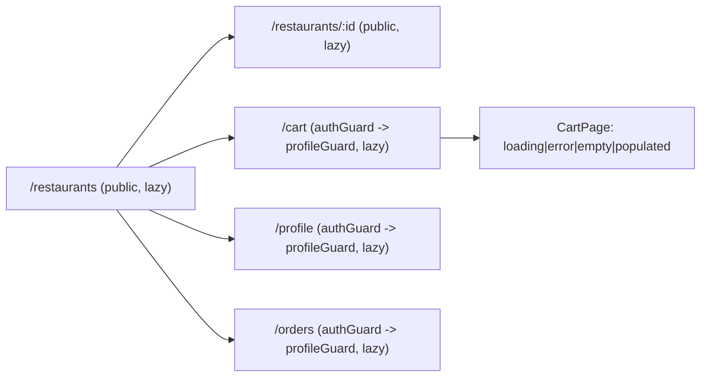
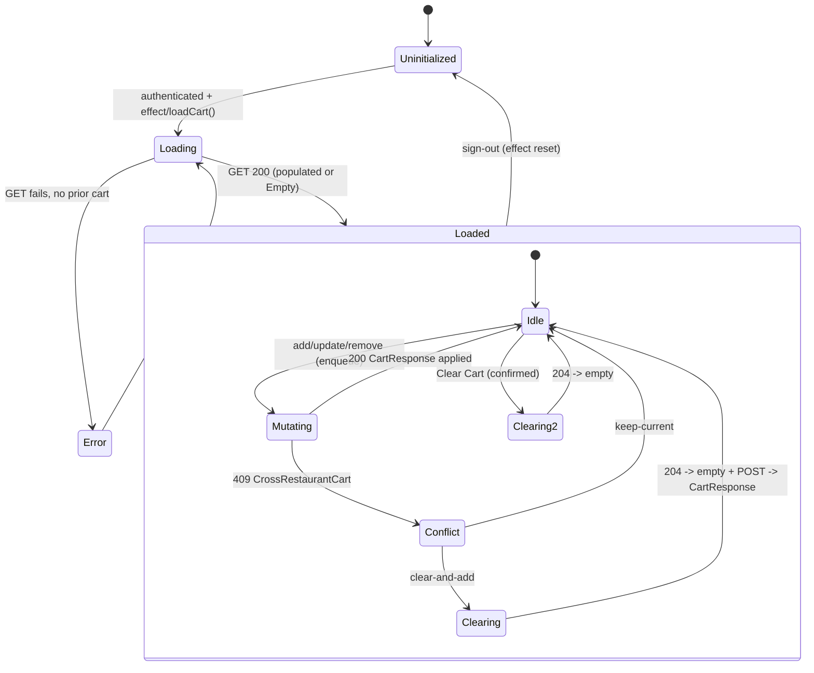
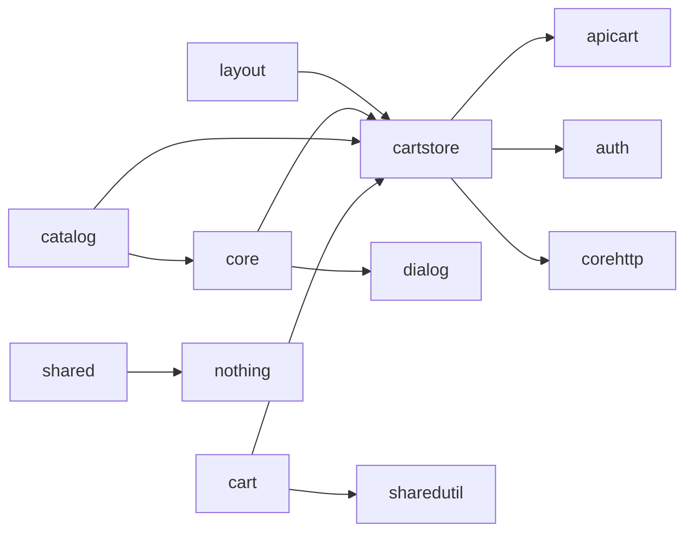

# Phase 8 Implementation Report: Server-Backed Customer Cart

**Branch**: `master`
**Commit (HEAD)**: `61a07da0862497eb3c01c33eda78043f76a81844` — `feat(customer): add profile-gated shell and restaurant menu`
**Date**: 2026-08-06
**Scope**: Full uncommitted working tree above the Phase 7 baseline (read-only analysis; no commit created).
**Status**: Analysis and documentation only. No application source file was modified during this report.

---

## 1. Purpose of the Phase

Phase 8 delivers the **server-backed customer shopping cart** for the Talabat Angular customer application (`talabat-web/projects/customer`). It replaces the Phase 7 placeholder cart boundary (`CartDeferredDialogComponent`, the placeholder `CartPage`, and the `'deferred'` outcome of `CartEntryCoordinator`) with a real, server-authoritative cart.

The phase's stated goals (from `specs/002-server-backed-customer-cart/spec.md` and `plan.md`):

- Fetch and display the active server cart (`GET /api/me/cart`) and treat it as the **sole source of truth** for prices, line totals, grand totals, and item counts (FR-001, FR-002).
- Synchronize a persistent cart badge in the header and the mobile cart entry bar (FR-003).
- Enforce the server single-restaurant rule and present an accessible **cross-restaurant decision dialog** (FR-004, FR-005).
- Allow quantity increments/decrements, line removal, and a **confirmed clear-cart** action (FR-006, FR-007).
- Render loading / error / empty / populated states on the `/cart` page (FR-008).
- Disable add-to-cart for unavailable products (FR-009).
- Clear all in-memory cart state on logout / session expiry (FR-010).
- Serialize mutation requests to prevent out-of-order responses overwriting newer state (FR-011).
- Map RFC 9457 `ProblemDetails.errorCode` values to typed `AppErrorCode` values and give recoverable feedback (FR-012).
- Meet accessibility and 42px touch-target standards (FR-013, FR-014, FR-015).

Phase 9 (checkout) is explicitly out of scope.

---

## 2. Starting Point Before the Phase

The previous commit (`61a07da`) ended Phase 7 with:

- A `CartEntryCoordinator` that returned only `'authentication-started' | 'deferred'`.
- A `CartDeferredDialogComponent` (co-located in `cart-entry-bar.component.ts`) that told users "Cart coming in Phase 8".
- A placeholder `CartPage` that showed static copy and a "View Phase 8 preview" button.
- A `CartEntryBarComponent` that displayed the static text "Available in Phase 8".
- An `AppErrorCode` set containing only `ProfileNotCreated`, `InvalidCustomerProfile`, `ProfileAlreadyExists`, `RestaurantNotFound`, and `Unknown` — no cart domain codes.
- A `/cart` route already configured as `canActivate: [authGuard, profileGuard]` with a lazy `CartPage`.

The generated `CartApiService` in `@talabat/api-customer` already contained all five cart endpoints (`getCart`, `addCartItem`, `clearCart`, `removeCartItem`, `updateCartItemQuantity`) — no generated-client changes were needed.

---

## 3. Git Baseline and Analysis Method

Baseline HEAD commit: `61a07da0862497eb3c01c33eda78043f76a81844`.

Read-only Git commands executed:

- `git status --short` / `git status`
- `git branch --show-current` → `master`
- `git rev-parse HEAD`
- `git log -5 --oneline`
- `git diff --stat HEAD`, `git diff --name-status HEAD`, `git diff --summary HEAD`, `git diff --numstat HEAD`, `git diff --find-renames HEAD`
- `git diff --check HEAD`
- `git diff HEAD`, `git diff --cached`
- `git ls-files --others --exclude-standard`, `git ls-files --deleted`, `git ls-files --modified`

No destructive Git command was run. `git add`, `git commit`, `git reset`, `git restore`, `git checkout`, `git clean`, `git stash`, `git rebase`, and `git merge` were **not** executed.

**Important note about the baseline**: `plan.md` required a clean working tree at phase start (T001). The working tree is currently dirty because it contains the Phase 8 implementation itself plus untracked planning artifacts. Whether the tree was clean *before* Phase 8 started cannot be verified retroactively from Git history alone; this is recorded as an unverified assumption (see Appendix D).

---

## 4. Complete Change Summary

| Metric | Count |
|---|---|
| Modified tracked files | 14 |
| New untracked files (total) | 17 |
| — customer cart source/test files | 7 |
| — phase spec/planning artifacts | 9 |
| — implementation placeholder (`implement-phase8.txt`) | 1 |
| Deleted tracked files | 0 |
| Renamed / moved files | 0 |
| Staged files | 0 |
| Unstaged (modified) files | 14 |
| Tracked lines added (`git diff --numstat HEAD`) | 571 |
| Tracked lines deleted (`git diff --numstat HEAD`) | 100 |
| Untracked customer source/test lines | 1,198 |
| Untracked spec/planning lines | 1,047 |

The change is one cohesive feature: **a root-provided signal store (`CartStore`) wired into the shell, the catalog menu page, the cart page, and the shared HTTP error pipeline.**

### Where files live and who owns them

| Owner | Files |
|---|---|
| `@talabat/core-http` (shared core library) | `app-error.ts`, `problem-details.interceptor.spec.ts` |
| customer app — layout | `header.component.ts`, `header.component.spec.ts`, `cart-entry-bar.component.ts` |
| customer app — core | `core/cart-entry/cart-entry-coordinator.service.ts` + spec |
| customer app — cart feature (new) | `features/cart/cart.store.ts`, `cart.store.spec.ts`, `components/*` (4 new), `pages/cart.page.ts`, `cart.page.spec.ts` |
| customer app — catalog feature | `components/menu-product-card.component.ts`, `pages/restaurant-menu.page.ts`, `restaurant-menu.page.spec.ts`, `restaurant-card.component.spec.ts` |
| customer app — routing tests | `app.routes.spec.ts` |
| Spec kit | `.specify/feature.json` |
| Spec Kit planning | `specs/002-server-backed-customer-cart/*` (9 untracked docs) |

---

## 5. New Files

All new files are untracked.

### 5.1 `talabat-web/projects/customer/src/app/features/cart/cart.store.ts` (344 lines)

The heart of the phase: a root-provided (`@Injectable({ providedIn: 'root' })`) signal store.

Responsibilities:

- Owns cart state (`cart`, `status`, `error`, `notice`, `isMutating`, `mutatingProductId`, `conflictAddRequest`).
- Exposes derived readonly signals `items`, `total`, `totalItemCount`, `isEmpty`, `restaurantId`.
- Performs all cart HTTP via the generated `CartApiService` (`getCart`, `addCartItem`, `updateCartItemQuantity`, `removeCartItem`, `clearCart`).
- Reacts to `AuthStore.isAuthenticated()` through a constructor `effect`: loads the cart when a user signs in, calls `reset()` when they sign out.
- Serializes all mutations through a promise queue (`enqueue`) so responses cannot overwrite newer state.
- Maps typed domain errors (`CrossRestaurantCart`, `ProductUnavailable`, `RestaurantClosed`, `RestaurantInactive`, `CartExpired`, `CartNotActive`, `InvalidQuantity`, `CartItemNotFound`) to a user-facing `CartNotice` and/or recovery action.
- Exposes the conflict contract: `conflictAddRequest` + `resolveConflict(choice)`.

### 5.2 `talabat-web/projects/customer/src/app/features/cart/cart.store.spec.ts` (433 lines)

Vitest unit tests for the store (17 test cases). See Section 18 for a full breakdown.

### 5.3 `talabat-web/projects/customer/src/app/features/cart/components/cart-item-row.component.ts` (68 lines)

Presentational line-item row: product name, unit price, quantity, line total, and three controls — `-`, `+`, `Remove`. Emits `increment`, `decrement`, `remove` outputs; accepts a `busy` input used to disable controls while a mutation is in flight.

### 5.4 `talabat-web/projects/customer/src/app/features/cart/components/cart-summary.component.ts` (30 lines)

Presentational grand-total card. Reads `store.total()` and formats it with the shared `MoneyPipe` (`talMoney`). Deliberately performs **no arithmetic** — the server's `CartResponse.total` is displayed verbatim (FR-002).

### 5.5 `talabat-web/projects/customer/src/app/features/cart/components/clear-cart-dialog.component.ts` (33 lines)

CDK `DialogRef`-based confirmation sheet: "Clear your cart?" with `Cancel` and destructive `Clear Cart`. Closes with `true` / `false`.

### 5.6 `talabat-web/projects/customer/src/app/features/cart/components/cross-restaurant-dialog.component.ts` (34 lines)

CDK `DialogRef`-based modal for the single-restaurant conflict: "Clear Cart & Add New Item?" with `Keep Current Cart` / `Clear Cart & Add`. Closes with `'keep-current'` / `'clear-and-add'`.

### 5.7 `talabat-web/projects/customer/src/app/features/cart/pages/cart.page.spec.ts` (256 lines)

Vitest component tests for `CartPage` using a signal-based store harness (11 test cases). See Section 18.

### 5.8 Spec Kit artifacts (`specs/002-server-backed-customer-cart/`)

Planning/documentation only: `spec.md`, `plan.md`, `research.md`, `data-model.md`, `quickstart.md`, `tasks.md`, `contracts/cart-api-contract.md`, `checklists/requirements.md`, `checklists/phase-8-requirements-quality.md`. These document intent; the actual code is the source of truth verified in this report.

### 5.9 `implement-phase8.txt`

Empty placeholder file at repo root. Contains no content and has no functional effect.

---

## 6. Modified Files

All modified files are unstaged. Grouped by owner:

| File | Change type | What changed |
|---|---|---|
| `.specify/feature.json` | modified | Points `feature_directory` to `specs/002-server-backed-customer-cart` |
| `core-http/src/lib/app-error.ts` | modified | +8 cart `AppErrorCode` entries |
| `core-http/src/lib/problem-details.interceptor.spec.ts` | modified | +1 parametrized test for 8 cart codes |
| `customer/src/app/app.routes.spec.ts` | modified | Adds a `CartStore` mock provider so routing tests can render shell components |
| `customer/src/app/core/cart-entry/cart-entry-coordinator.service.ts` | modified | Replaces `'deferred'` with real `addItem` delegation and conflict dialog orchestration |
| `customer/src/app/core/cart-entry/cart-entry-coordinator.service.spec.ts` | modified | Rewritten for async outcomes, dialog flow, auth + error paths |
| `customer/src/app/features/cart/pages/cart.page.ts` | modified | Placeholder → 4-state cart page |
| `customer/src/app/features/catalog/components/menu-product-card.component.ts` | modified | `busy` / `justAdded` inputs, success feedback, 42px touch target, unavailable label alignment |
| `customer/src/app/features/catalog/components/restaurant-card.component.spec.ts` | modified | Cleaned up href assertion; **removed** the `preventDefault` teardown workaround (see finding Q-02) |
| `customer/src/app/features/catalog/pages/restaurant-menu.page.ts` | modified | Delegates adds to `CartStore` via coordinator; per-card busy/success state |
| `customer/src/app/features/catalog/pages/restaurant-menu.page.spec.ts` | modified | +6 tests for coordinator delegation, success feedback, auth start, unavailable disable |
| `customer/src/app/layout/cart-entry-bar.component.ts` | modified | Removes `CartDeferredDialogComponent`; live count badge / empty text; 42px touch target |
| `customer/src/app/layout/header.component.ts` | modified | New `Cart` link with reactive count badge; 42px touch targets on all nav links |
| `customer/src/app/layout/header.component.spec.ts` | modified | +2 tests for badge rendering |

---

## 7. Deleted, Renamed, or Moved Files

**None tracked.** However, the `CartDeferredDialogComponent` *symbol* (previously exported from `cart-entry-bar.component.ts`) was deleted in place. Verified via `git grep` that no file references `CartDeferredDialogComponent` or `CartDeferredDialog` anymore. Its behavioural responsibility (inform users that cart was coming) was fully replaced by the real cart implementation.

---

## 8. File-by-File Detailed Walkthrough

### 8.1 `core-http/src/lib/app-error.ts` (modified, +8/−0)

**File identity**: shared core library `@talabat/core-http`; the centralized catalogue of typed application error codes.

**Problem solved**: `problemDetailsInterceptor` only maps a `ProblemDetails.errorCode` string to `AppError.code` when the key already exists in `AppErrorCode` (`raw in AppErrorCode`). Without the eight cart codes, every cart domain error would have fallen through to `AppErrorCode.Unknown`, and `CartStore` could not branch on typed codes (FR-012). Before this phase, the interceptor would have produced `code: 'Unknown'` for a 409 `CrossRestaurantCart`.

**Behavioural effect**: any backend ProblemDetails whose root `errorCode` is `CrossRestaurantCart`, `CartExpired`, `CartNotActive`, `CartItemNotFound`, `ProductUnavailable`, `RestaurantClosed`, `RestaurantInactive`, or `InvalidQuantity` now maps to that typed code. Other codes still map to `Unknown`. No runtime behaviour of unrelated codes changes.

### 8.2 `core-http/src/lib/problem-details.interceptor.spec.ts` (modified, +28/−0)

Adds a parametrized `it.each` over all eight cart codes, each with the documented HTTP status (`CrossRestaurantCart`→409, `CartExpired`→409, `CartNotActive`→409, `CartItemNotFound`→404, `ProductUnavailable`→422, `RestaurantClosed`→422, `RestaurantInactive`→422, `InvalidQuantity`→400). Each case flushes a ProblemDetails body carrying the `errorCode` and asserts the rejected `AppError` carries that typed code with `isNetworkError: false`. This is the contract-level guarantee that `CartStore` can branch on typed codes.

### 8.3 `customer/src/app/features/cart/cart.store.ts` (new) — full walkthrough

**File identity**: customer application feature store, placed under `features/cart/` as required by the plan and Constitution Principle III ("Customer-domain state belongs inside the customer application … in features"). Root-provided so the shell (header + FAB) and multiple pages share one instance.

**Problem solved**: the application previously had no cart state at all. The store is the single reactive owner of cart data, server-fetch lifecycle, mutations, concurrency, session reset, and typed error notices.

**Key mechanics**:

- **Private writable signals** (lines 52–58) back every public readonly signal (lines 63–69). This is the constitution's writable-private/readonly-public pattern.
- **Derived signals** (lines 71–77): `items` (flatten `cart.items` to `[]`), `total` (`cart.total` or `null`), `totalItemCount` (sum of quantities — this is a *count of items*, not a price calculation, so it does not violate FR-002/server-price authority), `isEmpty`, `restaurantId`.
- **Auth effect** (lines 79–87): reacts to `auth.isAuthenticated()`. On becoming authenticated → `loadCart()`; on logout → `reset()`. This implements FR-010 automatically without any layout component needing to know.
- **Generation counter** (line 60, used at lines 96/104/107 and 241): each `reload()` increments `loadGeneration`; stale responses (where the captured generation differs from the current one) are discarded. This is a second, load-path-specific stale-response guard.
- **Mutation queue** (lines 61, 251–258): `enqueue` chains every mutation onto `mutationQueue`, so mutations run strictly sequentially. FR-011.
- **`addItem`** (lines 122–159): guards unauthenticated calls (returns typed 401 error), refuses a second add while a conflict is pending, sets busy signals, runs the POST through the queue, applies the returned authoritative `CartResponse`, and — on `CrossRestaurantCart` — stashes the request in `conflictAddRequest` and returns `{kind:'conflict'}`.
- **`resolveConflict`** (lines 161–183): `'keep-current'` or a null pending request just clears the pending state (no mutation). `'clear-and-add'` runs `clearCart()` then `addCartItem(pending)` sequentially through the queue, applying the final server cart.
- **`updateQuantity`** (lines 185–209): quantity `< 1` short-circuits to `removeItem` (FR-006 edge case); otherwise PUTs and applies the response.
- **`removeItem`** (lines 211–225) and **`clearCart`** (lines 227–238): call the generated clients. `clearCart` handles the `204 No Content` `Observable<void>` by applying a client-constructed empty cart (`applyEmptyCart`, lines 269–281) rather than expecting a body.
- **`reset`** (lines 240–249): bumps the generation and clears every signal — the FR-010 logout wipe.
- **`handleMutationError`** (lines 283–343): typed switch on `AppError.code`. `ProductUnavailable`/`InvalidQuantity`/`CartItemNotFound` set a notice and re-fetch the cart (`reload(true)`); `CartExpired`/`CartNotActive` set the empty state + notice; `RestaurantClosed`/`RestaurantInactive` set notices; network/unknown errors map to `network`/`general`.

### 8.4 `customer/src/app/features/cart/components/cart-item-row.component.ts` (new)

**Problem solved**: renders one server line item and lets the user change its quantity or remove it. It is presentational: it receives `CartLineItemDto` and a `busy` flag, emits `increment`/`decrement`/`remove` events, and never calls the API itself (boundary rule: presentational components do not inject domain services).

**Behavioural effect**: each control is a native `<button>` with `min-h-[42px] min-w-[42px]`, an explicit `aria-label` (e.g. "Increase quantity of Super Chicken Burger"), `disabled` while `busy`, and the quantity readout carries `aria-live="polite"`. Decrementing at quantity 1 still emits `decrement`; the parent (store) converts `< 1` into a remove call.

### 8.5 `customer/src/app/features/cart/components/cart-summary.component.ts` (new)

**Problem solved**: the authoritative grand total. It reads `store.total()` and formats with `MoneyPipe`. It explicitly renders a visually-hidden "Grand total:" label (`tal-visually-hidden`) with `aria-live="polite"`, and a "All prices in {currency}" caption. No client-side math — FR-002.

### 8.6 `customer/src/app/features/cart/components/clear-cart-dialog.component.ts` (new)

**Problem solved**: FR-007 confirmation before destructive `DELETE /api/me/cart`. Injects `DialogRef<boolean>`; `confirm()` closes with `true`, `cancel()` with `false`. `variant="destructive"` on the confirm button.

### 8.7 `customer/src/app/features/cart/components/cross-restaurant-dialog.component.ts` (new)

**Problem solved**: FR-005. Closes with `'clear-and-add'` or `'keep-current'`; the coordinator and store turn those into the clear-then-add pipeline or a no-op.

### 8.8 `customer/src/app/features/cart/pages/cart.page.ts` (modified, +133/−21)

**Problem solved**: replaces the placeholder with the four required states (FR-008).

Walkthrough of the template:

- **Notice banner** (`store.notice()`) with `role="alert"`, shown above all states; a "Try again" button appears only for `network` notices and calls `store.reload()`.
- **Loading**: `tal-spinner` with label "Loading your cart".
- **Error**: `tal-error-state` with `errorTitle()`/`errorDetail()` from `store.error()` and `(retry)="store.reload()"`.
- **Empty**: `tal-empty-state` with "Browse restaurants" action calling `goToRestaurants()` (`router.navigateByUrl('/restaurants')`).
- **Populated**: `@for` over `store.items()` with `track item.productId`, each row bound to `isItemBusy(productId)`; then `tal-cart-summary`; then `Clear Cart` (secondary, `[busy]="store.isMutating()"`) and a **disabled** "Proceed to Checkout" button with `title="Checkout arrives in Phase 9"` (explicit Phase 9 boundary).

Class logic:

- Constructor (lines 67–70): if `store.status() === 'uninitialized'` it triggers `store.loadCart()` (covers direct `/cart` URL navigation).
- `increment`/`decrement` call `store.updateQuantity(item.productId, item.quantity ± 1)`.
- `remove` calls `store.removeItem(item.productId)`.
- `confirmClearCart` opens the `ClearCartDialogComponent` via `DialogService.openSheet`, awaits `ref.closed`, and calls `store.clearCart()` only when the dialog confirmed `true`.

### 8.9 `customer/src/app/features/catalog/components/menu-product-card.component.ts` (modified, +13/−4)

Adds `busy` and `justAdded` inputs (with `booleanAttribute` transform), a 42px min-height on the add button, `[attr.aria-busy]`, a "Adding to cart" label while busy, a `role="status"` "Added to your cart" confirmation, and aligns the unavailable button to 42px. `CartEntryRequest` interface is unchanged.

### 8.10 `customer/src/app/features/catalog/pages/restaurant-menu.page.ts` (modified, +25/−7)

- Removes the `CartDeferredDialogComponent` import and `DialogService` (no longer needed).
- Injects `CartStore` (line 80) and binds `[busy]` and `[justAdded]` on each product card (lines 62–66).
- `onCartEntry` now awaits `cartEntryCoordinator.handle(request)` (async, no auth boolean argument anymore).
- On `'authentication-started'` it starts OIDC sign-in with the current URL as return URL (pre-existing behaviour).
- On `'added'` or `'conflict-resolved'` it shows the 2-second "Added to your cart" feedback via `markRecentlyAdded` (a signal + `window.setTimeout`).
- On `'error'` or `'conflict-kept-current'` it intentionally does nothing visible (see finding Q-03).

### 8.11 `customer/src/app/layout/header.component.ts` (modified, +21/−3)

Adds a `Cart` nav link (visible only when authenticated, lines 24–39) whose badge shows `cart.totalItemCount()` when greater than 0; the badge is `aria-hidden` and the link carries `aria-label="View cart"`. Applies `min-h-[42px]` to all nav links (touch target).

### 8.12 `customer/src/app/layout/cart-entry-bar.component.ts` (modified, +13/−42)

Removes the entire `CartDeferredDialogComponent` (42 lines) and the `DialogService`/`DialogRef` imports. The FAB now renders the live count badge when `cart.totalItemCount() > 0` (with an `aria-label`), "Your cart is empty" otherwise, and a 42px "View cart" link to `/cart`.

### 8.13 `customer/src/app/core/cart-entry/cart-entry-coordinator.service.ts` (modified, +49/−6)

The old coordinator returned `'deferred'` for authenticated users. Now:

- `handle(request)` is async and accepts no `isAuthenticated` argument — it reads `this.auth.isAuthenticated()` internally.
- Anonymous → `'authentication-started'`.
- Authenticated → `cartStore.addItem({ restaurantId, productId, quantity: 1 })`.
  - `'added'` → outcome `'added'`.
  - `'conflict'` → opens `CrossRestaurantDialogComponent` via `DialogService.openModal`, awaits the choice, calls `cartStore.resolveConflict(choice)`, and maps to `'conflict-resolved'` / `'conflict-kept-current'`.
  - anything else → `'error'`.
- `openConflictDialog` uses `firstValueFrom(ref.closed.pipe(take(1)))` with a `keep-current` fallback if the dialog is dismissed without a choice.

### 8.14 Test-file modifications (`app.routes.spec.ts`, `header.component.spec.ts`, `cart-entry-coordinator.service.spec.ts`, `restaurant-menu.page.spec.ts`, `restaurant-card.component.spec.ts`)

All add/fix mocks and coverage for the new behaviour — detailed in Section 18. The `app.routes.spec.ts` change is required because the shell/header now inject `CartStore`, so every routing test renders components that need a provided store.

### 8.15 `.specify/feature.json` (modified, +1/−1)

Switches the active Spec Kit feature directory from `specs/001-customer-shell-onboarding-menu` to `specs/002-server-backed-customer-cart`. Tooling metadata only.

---

## 9. Line-by-Line Code Explanation

### 9.1 `cart.store.ts` — the most important lines

| Line(s) | Code | Syntax and meaning | Why it was added | Dependencies and effects |
|---|---|---|---|---|
| 47 | `@Injectable({ providedIn: 'root' })` | Decorator registering `CartStore` as a singleton app-wide | One shared instance for shell badge + pages (FR-003) | Injected by `HeaderComponent`, `CartEntryBarComponent`, `RestaurantMenuPage`, `CartPage`, `CartEntryCoordinator` |
| 49–50 | `private readonly cartApi = inject(CartApiService); private readonly auth = inject(AuthStore);` | Function-based DI into private fields | Store needs the generated client and auth state; no constructor DI (Constitution V) | Generated API client + auth store |
| 52–58 | `private readonly statusState = signal(...)` … | Seven private writable signals | Backing state; public surface is readonly (Constitution III) | Read by all derived/public signals |
| 63–69 | `readonly status = this.statusState.asReadonly();` … | Public readonly aliases | Template-safe reactive reads | Consumed by components/templates |
| 71 | `readonly items = computed<CartLineItemDto[]>(() => this.cartState()?.items ?? []);` | Derived memoized signal | Safe empty default | `CartPage` `@for` |
| 73–75 | `readonly totalItemCount = computed(() => this.cartState()?.items.reduce((sum, item) => sum + item.quantity, 0) ?? 0);` | Sums *quantities*, not money | Badge count (FR-003) without violating price-authority (FR-002) | Header + FAB badges |
| 79–87 | `constructor() { effect(() => { if (this.auth.isAuthenticated()) { void this.loadCart(); } else { this.reset(); } }); }` | Reactive side effect on auth | Auto-init on sign-in, wipe on sign-out (FR-010) | Runs on any change of `isAuthenticated()` |
| 93–120 | `async reload(preserveNotice = false)` | Fetch with generation guard + state branching | FR-001 loading/error/retry; preserves a prior confirmed cart on refresh errors | `getCart` |
| 96 | `const generation = ++this.loadGeneration;` | New generation per reload | Stale-response guard | Used at 104/107 |
| 97–99 | `if (this.statusState() !== 'loaded') this.statusState.set('loading');` | Only show spinner when there is nothing yet | Keeps prior cart visible during refetch (spec US4) | CartPage loading state |
| 103–105 | `const cart = await firstValueFrom(this.cartApi.getCart()); if (generation !== this.loadGeneration) return;` | Await generated GET; drop stale result | No overwrite by old requests | `applyCart` |
| 109–118 | error branch | If no cart yet → error state; if a cart exists → notice, keep it | 4-state error handling | `status`/`error`/`notice` |
| 122–159 | `async addItem(request: AddCartItemRequest): Promise<AddItemOutcome>` | POST pipeline | FR-004/FR-005/FR-009/FR-012 | `addCartItem` |
| 123–133 | unauthenticated guard returning `{kind:'error', error:{status:401, code:AppErrorCode.Unknown, ...}}` | Defensive typed rejection | Prevents API call when session dropped | Coordinator outcome `'error'` |
| 135–137 | `if (this.conflictAddRequestState() !== null) return { kind: 'conflict' };` | Re-entrancy guard while a conflict is pending | Only one conflict at a time | Coordinator re-opens dialog path |
| 139–140 | `this.isMutatingState.set(true); this.mutatingProductIdState.set(request.productId);` | Busy signals | Drives per-card busy state (FR-013, US4) | Menu cards + cart rows |
| 142–144 | `const cart = await this.enqueue(() => firstValueFrom(this.cartApi.addCartItem({ addCartItemRequest: request })));` | Serialized POST via generated client | FR-011; no direct HttpClient (Constitution VII) | `addCartItem` |
| 145–146 | `this.applyCart(cart); return { kind: 'added' };` | Apply server response verbatim | FR-002 | Badge updates |
| 148–152 | `if (appError.code === AppErrorCode.CrossRestaurantCart) { this.conflictAddRequestState.set(request); return { kind: 'conflict' }; }` | Typed 409 mapping | FR-004/FR-005 — trigger dialog, keep prior cart | Coordinator dialog |
| 161–183 | `resolveConflict(choice)` | Clear-then-add or keep-current | FR-005 | `clearCart` + `addCartItem` |
| 164 | `if (choice === 'keep-current' || pending === null) return Promise.resolve();` | No-op paths | Keep-current must not mutate (spec) | — |
| 168–175 | enqueued clear → empty → add → apply | Sequential pipeline | FR-005 acceptance 4 | `clearCart`, `addCartItem` |
| 185–209 | `updateQuantity(productId, quantity)` with `< 1 → removeItem` | PUT or remove | FR-006 / edge case (quantity 0 = remove) | `updateCartItemQuantity`, `removeItem` |
| 211–225 | `removeItem` | DELETE line | FR-006 | `removeCartItem` |
| 227–238 | `clearCart` | DELETE whole cart, then `applyEmptyCart()` | FR-007 + 204 handling (clarification #2) | `clearCart` |
| 240–249 | `reset()` | Bump generation + clear all signals | FR-010 logout wipe | Auth effect |
| 251–258 | `enqueue` promise chain | Serialization primitive | FR-011 | All mutations |
| 260–267 | `applyCart(cart, keepNotice)` | Set cart/loaded/clear error, optionally keep notice | FR-002 | All success paths |
| 269–281 | `applyEmptyCart()` | Build empty `CartResponse` locally after 204 | 204 has no body (clarification #2) | `clearCart` |
| 283–343 | `handleMutationError(appError)` | Typed switch over codes | FR-012 | All catch paths |

### 9.2 `cart-entry-coordinator.service.ts`

| Line(s) | Code | Meaning | Why |
|---|---|---|---|
| 5–10 | `export type CartEntryOutcome = 'authentication-started' \| 'added' \| 'conflict-kept-current' \| 'conflict-resolved' \| 'error';` | Typed union | Replace `'deferred'`; truthful outcomes for menu page |
| 12–15 | `inject(CartStore)`, `inject(AuthStore)`, `inject(DialogService)` | DI | New responsibilities |
| 24 | `if (!this.auth.isAuthenticated())` | Internal auth check | No longer needs caller to pass auth |
| 31–35 | `const result = await this.cartStore.addItem({...quantity: 1})` | Delegation | FR-004/FR-005 |
| 40–48 | conflict branch → `openConflictDialog()` → `resolveConflict(choice)` | Dialog orchestration | FR-005 |
| 57–69 | `openConflictDialog()` via `DialogService.openModal`, `firstValueFrom(ref.closed.pipe(take(1)))`, default `'keep-current'` | Awaits user choice safely | Escape/backdrop dismissal is treated as keep-current |

### 9.3 `cart.page.ts` — template highlights

| Line(s) | Code | Meaning | Why |
|---|---|---|---|
| 14–31 | notice banner `@if (store.notice(); as notice)` with `role="alert"` and a "Try again" button for `kind === 'network'` | Recoverable-domain-error surface | FR-012 |
| 33–35 | `@if (store.status() === 'loading')` → `tal-spinner label="Loading your cart"` | Loading state | FR-008 |
| 37–43 | `@else if (store.status() === 'error')` → `tal-error-state` with retry | Error state | FR-008 |
| 45–50 | `@else if (store.status() === 'loaded' && store.isEmpty())` → empty state with browse action | Empty state | FR-008 |
| 52–74 | `@else if (... 'loaded' && !store.isEmpty())` → rows + summary + clear/checkout buttons | Populated state | FR-008, FR-006, FR-007 |
| 53–60 | `@for (item of store.items(); track item.productId)` with `tal-cart-item-row` inputs/outputs | Server lines with busy per item | FR-006 |
| 61–63 | `[busy]="isItemBusy(item.productId)"` | Disable controls during that item's mutation | FR-011/US4 |
| 66–68 | `tal-button variant="secondary" [busy]="store.isMutating()" (pressed)="confirmClearCart()"` | Confirmed clear entry | FR-007 |
| 70–72 | disabled `Proceed to Checkout` with title "Checkout arrives in Phase 9" | Explicit phase boundary | Scope guard |
| 84–88 | `constructor() { if (this.store.status() === 'uninitialized') { void this.store.loadCart(); } }` | Init on direct navigation | FR-001 / edge case |
| 104–108 | `increment`/`decrement` → `updateQuantity(productId, quantity±1)` | Quantity controls | FR-006 |
| 110–111 | `remove` → `removeItem(productId)` | Line removal | FR-006 |
| 113–122 | `confirmClearCart()` — `openSheet(ClearCartDialogComponent, { ariaLabel: 'Clear cart confirmation' })`, await `ref.closed`, clear only if `confirmed` | Confirmation gate | FR-007 |

### 9.4 `header.component.ts` — cart link block

| Line(s) | Code | Meaning | Why |
|---|---|---|---|
| 23 | `@if (auth.initialized() && auth.isAuthenticated())` | Auth gate | Anonymous users never see the cart link |
| 24–39 | Cart anchor with `routerLink="/cart"`, `aria-label="View cart"`, badge `@if (cart.totalItemCount() > 0)` | Reactive badge | FR-003 |
| 31–38 | badge `<span ... aria-hidden="true">{{ cart.totalItemCount() }}</span>` | Count chip | Count is decorative (link already labelled); avoids double-announcement |
| 71 | `protected readonly cart = inject(CartStore);` | Store injection | FR-003 |

### 9.5 `menu-product-card.component.ts`

| Line(s) | Code | Meaning | Why |
|---|---|---|---|
| 75–76 | `busy`/`justAdded` inputs with `booleanAttribute` transform | Attribute-style binding from parent | US2 busy/success states |
| 46 | `min-h-[42px]` on add button | Touch target | FR-015 |
| 47 | `[attr.aria-busy]="busy() ? 'true' : null"` | Busy semantics | FR-013 |
| 48 | `[disabled]="busy()"` | Prevent double-add | FR-011/US4 |
| 51 | `{{ busy() ? 'Adding to cart' : 'Add to cart' }}` | Progress label | US2 feedback |
| 53–57 | `@if (justAdded())` → `role="status"` confirmation | Success feedback | US2 acceptance 1 |
| 59–66 | unavailable branch button, disabled + `aria-disabled` | FR-009 | — |

### 9.6 `restaurant-menu.page.ts`

| Line(s) | Code | Meaning | Why |
|---|---|---|---|
| 62–66 | `[busy]="cartStore.isMutating() && cartStore.mutatingProductId() === product.id"`, `[justAdded]="recentlyAddedProductId() === product.id"` | Per-card busy/success | US2 |
| 120–122 | `onCartEntry` → `void this.runCartEntry(request)` | Fire-and-forget async | Avoids blocking the click handler |
| 124–135 | `runCartEntry`: await coordinator; auth start OR success feedback | Orchestration | US2 |
| 137–143 | `markRecentlyAdded` with 2s timeout | Timed success message | US2 acceptance 1 |

### 9.7 `app-error.ts` (lines 6–13)

```ts
CrossRestaurantCart: 'CrossRestaurantCart',
CartExpired: 'CartExpired',
CartNotActive: 'CartNotActive',
CartItemNotFound: 'CartItemNotFound',
ProductUnavailable: 'ProductUnavailable',
RestaurantClosed: 'RestaurantClosed',
RestaurantInactive: 'RestaurantInactive',
InvalidQuantity: 'InvalidQuantity',
```

These keys are what make `raw in AppErrorCode` in `problem-details.interceptor.ts:22` succeed, letting `CartStore.handleMutationError` branch on typed codes instead of raw HTTP statuses (the 409 status is shared by `CrossRestaurantCart` and `CartExpired`, so status branching alone would be ambiguous — research.md §4).

---

## 10. Application Architecture After the Phase

### 10.1 Dependency diagram

```mermaid
graph TD
    subgraph App["projects/customer (app)"]
        subgraph Layout
            Header["HeaderComponent"] --> CartStore
            CartBar["CartEntryBarComponent"] --> CartStore
            Shell["CustomerShellComponent"] --> Header
            Shell --> CartBar
        end
        subgraph Core["core/"]
            Coord["CartEntryCoordinator"] --> CartStore
            Coord --> AuthStore
            Coord --> DialogService
            Coord --> CrossDialog["CrossRestaurantDialogComponent"]
        end
        subgraph Catalog["features/catalog"]
            MenuPage["RestaurantMenuPage"] --> Coord
            MenuPage --> CartStore
            MenuPage --> AuthStore
            ProductCard["MenuProductCardComponent"]
            MenuPage --> ProductCard
        end
        subgraph Cart["features/cart"]
            CartStore
            CartPage["CartPage"] --> CartStore
            CartPage --> DialogService
            Row["CartItemRowComponent"]
            Summary["CartSummaryComponent"] --> CartStore
            CartPage --> Row
            CartPage --> Summary
            ClearDialog["ClearCartDialogComponent"]
            CartPage --> ClearDialog
        end
    end
    subgraph Libraries
        AuthStore["@talabat/core-auth AuthStore"]
        DialogService["@talabat/shared-ui DialogService"]
        CartStore --> CartApi["@talabat/api-customer CartApiService"]
        CartStore --> AuthStore
        CartStore --> AppError["@talabat/core-http AppErrorCode"]
        CartStore --> MoneyPipe["@talabat/shared-util MoneyPipe"]
        Summary --> MoneyPipe
    end
```



### 10.2 Route-flow diagram



The `/cart` route was already wired in `layout/routes.ts` (lines 21–26) before this phase — unchanged by Phase 8, but now backed by the real page. Guard order `[authGuard, profileGuard]` is preserved (Constitution IV).

### 10.3 State flow diagram



---

## 11. Routing and Navigation

No route *definitions* changed in this phase (`layout/routes.ts`, `app.routes.ts`, `catalog/routes.ts` are untouched). The behaviours that did change:

- `/cart` now renders the full four-state page instead of a placeholder.
- `CartEntryBarComponent` "View cart" link navigates to `/cart` (the link already existed; the count now renders live).
- Header gained a `/cart` link (authenticated users only) with `routerLinkActive` highlighting.
- The empty-cart "Browse restaurants" action navigates to `/restaurants` via `router.navigateByUrl('/restaurants')` (`cart.page.ts:127`).
- Unauthenticated add-to-cart still calls `auth.signIn(this.router.url)` (return-URL preserved by `safeReturnUrl` in `core-auth`).

---

## 12. State and Data Flow

**CartStore is the single owner of cart state.** Data flows in two directions:

1. **Read (UI → store → template):** components read readonly signals (`cart`, `items`, `total`, `totalItemCount`, `isEmpty`, `status`, `error`, `notice`, `isMutating`, `mutatingProductId`). Because they are signals, the header badge and FAB badge update reactively the moment `applyCart` sets `cartState`.
2. **Write (UI event → store → API → store):** mutations (`addItem`, `updateQuantity`, `removeItem`, `clearCart`, `resolveConflict`) run through the serialization queue and apply only the server's `CartResponse`.

Session coupling: the constructor `effect` binds cart lifetime to `AuthStore.isAuthenticated()`. Sign-in → `loadCart()`; sign-out/session-expiry → `reset()` (FR-010). Because `AuthStore` also reacts to session expiry via OIDC lifecycle handlers, a dropped session clears cart memory without any cart-specific code.

Concurrency: two independent stale-guards exist —
- `loadGeneration` for fetches, and
- the `enqueue` promise queue for mutations (FR-011).

---

## 13. Forms and Validation

**Not applicable to this phase.** Phase 8 introduces no forms. Quantity input is limited by the UI to discrete `+`/`-` buttons; decrementing below 1 triggers removal (`cart.store.ts:186–188`). Server validation errors arrive as typed `AppError`s and are mapped to notices (FR-012). The plan's Signal Forms decision therefore has no Phase 8 expression.

---

## 14. User Interface Implementation

- **Header badge** (`header.component.ts:24–39`): red pill count, hidden at zero, `aria-hidden` (the labelled "View cart" link announces the cart).
- **FAB / cart entry bar** (`cart-entry-bar.component.ts`): live count pill with `aria-label`, or "Your cart is empty".
- **Cart page** (`cart.page.ts`): stacked card list; each row shows unit price, qty, line total from the server DTO, with `-`/`+`/`Remove` controls; summary card; `Clear Cart` + disabled `Proceed to Checkout`.
- **Menu cards** (`menu-product-card.component.ts`): "Add to cart" with busy/"Adding to cart" label, then a 2-second `role="status"` confirmation; unavailable products show a disabled "Unavailable" button.
- **Dialogs**: `CrossRestaurantDialogComponent` (modal) and `ClearCartDialogComponent` (sheet) both use `DialogService` CDK primitives (`ariaModal`, `autoFocus: 'first-heading'`, `restoreFocus`, `closeOnNavigation`, block scroll strategy).

---

## 15. Error and Async States

**CartStore-level:**

- Load failure with no prior cart → `status: 'error'` + `error` signal → `tal-error-state` with retry.
- Load/refresh failure with a prior cart → notice (`network`/`general`), prior cart preserved (US4 acceptance 2).
- Mutation domain errors → typed notices via `handleMutationError`:
  - `ProductUnavailable`, `InvalidQuantity`, `CartItemNotFound` → notice + automatic `reload(true)` refetch.
  - `CartExpired`, `CartNotActive` → empty state + notice.
  - `RestaurantClosed`, `RestaurantInactive` → notice.
  - network/unknown → `network`/`general` notice.
- `CrossRestaurantCart` → not a notice; it is surfaced as the conflict dialog via `conflictAddRequest` (FR-005).

**CartPage-level:** notice banner (`role="alert"`) with a "Try again" button for `network` notices; otherwise 4-state rendering.

**Gap (see Q-03):** menu page shows no feedback for the `'error'` outcome and does not render `store.notice()`.

---

## 16. Accessibility and Responsive Design

Evidence in code (FR-013/014/015):

- All cart controls and nav links use `min-h-[42px]` (touch targets).
- Quantity/remove buttons carry descriptive `aria-label`s; quantity readout and grand total use `aria-live="polite"`; add button uses `aria-busy`; success feedback uses `role="status"`; notice banner uses `role="alert"`.
- `tal-visually-hidden` is used for the "Grand total:" label in `cart-summary.component.ts:16`.
- Dialogs inherit CDK focus-trap, `autoFocus`, `restoreFocus`, `Escape` dismissal, and block scroll from `DialogService`.
- Global `button/input/a:focus-visible` box-shadow uses `--tal-focus-ring` (defined in `styles.css:32,64–68`).
- Responsive classes are logical (`ms-*`, `ps-*`) and use `sm:`/`lg:` breakpoints; the bottom bar preserves `env(safe-area-inset-bottom)` padding.
- `html`/`body` enforce `min-width: 320px`.

Note: the visual/interaction quality at 320px, 768px, 1280px, and 200% zoom (T030) and keyboard walkthrough (T029) are **manual** checks documented in `quickstart.md`; they were not automatable here.

---

## 17. Runtime User Flows

### 17.1 Anonymous customer on the menu clicks "Add to cart"

1. Click on available product → `MenuProductCardComponent.onAddToCart()` emits `CartEntryRequest`.
2. `RestaurantMenuPage.onCartEntry` → `CartEntryCoordinator.handle(request)`.
3. Coordinator reads `auth.isAuthenticated()` → false → outcome `'authentication-started'`.
4. Menu page calls `auth.signIn(this.router.url)`.
5. OIDC redirect starts; cart untouched.

### 17.2 Authenticated customer adds an item (single restaurant)

1. Click → coordinator → `CartStore.addItem({restaurantId, productId, quantity:1})`.
2. Store sets busy signals; POST runs through `enqueue`.
3. Server returns updated `CartResponse` → `applyCart`.
4. Badge in header + FAB updates reactively; coordinator outcome `'added'`; menu card shows "Added to your cart" for 2s.

### 17.3 Cross-restaurant conflict

1. `addItem` POST for Restaurant B returns 409 `CrossRestaurantCart`.
2. Store keeps the prior cart, stashes `conflictAddRequest`, returns `'conflict'`.
3. Coordinator opens `CrossRestaurantDialogComponent`.
4. **Clear Cart & Add** → `resolveConflict('clear-and-add')` → `clearCart()` (204 → empty state) → `addCartItem(pending)` → final cart applied; outcome `'conflict-resolved'`.
5. **Keep Current Cart** → `resolveConflict('keep-current')` → no mutation; outcome `'conflict-kept-current'`. Prior cart intact.

### 17.4 Cart page quantity adjustment and removal

1. `/cart` loads → page constructor calls `loadCart()` if `uninitialized` (also the auth effect may have loaded it).
2. `+` → `updateQuantity(productId, qty+1)` → PUT → `applyCart` → row/summary/badge update.
3. `-` at qty > 1 → same with qty−1.
4. `-` at qty 1, or `Remove` → `removeItem(productId)` → DELETE line → `applyCart`.
5. Rows are disabled via `isItemBusy` while that item's mutation is in flight.

### 17.5 Clear cart with confirmation

1. `Clear Cart` → `DialogService.openSheet(ClearCartDialogComponent)`.
2. Confirm (`true`) → `store.clearCart()` → DELETE `/api/me/cart` → 204 → `applyEmptyCart()` → empty state + badge 0.
3. Cancel/`Escape` → no mutation.

### 17.6 Logout / session expiry

1. `auth.isAuthenticated()` flips false (sign-out, expiry, or refresh failure).
2. `CartStore` constructor effect fires → `reset()` → all signals cleared, generation bumped.
3. Badge hidden (header) / "Your cart is empty" (FAB).

### 17.7 Load error and network recovery

1. `reload()` fails with `status: 0` and no prior cart → `status: 'error'`, `error` set.
2. CartPage shows `tal-error-state`; "Try again" → `store.reload()` → back to loading → loaded or error again.
3. If a cart was already shown, failure produces a `network` notice banner with "Try again" and the prior cart stays visible.

---

## 18. Tests and What Each Test Proves

### 18.1 `cart.store.spec.ts` (17 tests)

| Test | Proves |
|---|---|
| "starts uninitialized with empty derived signals" | Initial state contract (all derived signals safe before load) |
| "does not load cart when unauthenticated" | Auth gate on load (FR-001) |
| "loads cart into loaded state with derived badge count" | `getCart` → `loaded`, `totalItemCount` = sum of quantities, server `total` verbatim (FR-001/002/003) |
| "treats an empty server cart as a loaded empty state" | Empty `CartResponse` (200, not 404) is a valid loaded-empty state (clarification #1) |
| "stores a retryable error state when load fails without a prior cart" | `status:error` + error preserved for retry (FR-008) |
| "adds an item and applies the authoritative server cart" | `addItem` payload shape, server cart applied, busy flags reset (FR-002/004) |
| "exposes a cross-restaurant conflict and keeps the prior cart intact" | 409 → `conflictAddRequest`, prior cart untouched (FR-004/005) |
| "resolves a conflict with clear-and-add by clearing then adding" | Sequential `clearCart` → `addCartItem`; final server cart wins (FR-005) |
| "keeps the current cart when conflict resolution keeps current" | Keep-current performs no mutation (FR-005) |
| "updates quantity with the server response as authority" | PUT payload + server totals displayed (FR-006/002) |
| "removes a line item through removeCartItem" | DELETE line + derived count updates (FR-006) |
| "decrements below 1 by removing the item instead" | qty 0 → remove, no PUT (FR-006 edge case) |
| "handles a 204 clear cart by transitioning to the empty state" | 204 no-body handling → empty state (FR-007, clarification #2) |
| "surfaces a product-unavailable error and refetches the cart" | Typed 422 → notice + `reload` refetch (FR-012) |
| "clears the cart on an expired-cart domain error" | `CartExpired` → empty + notice (FR-012) |
| "serializes mutations so a stale earlier response cannot overwrite a newer one" | Concurrency queue prevents out-of-order overwrite (FR-011) |
| "resets all in-memory state on sign-out" | `reset()` wipes cart/items/count/status/error/notice (FR-010, SC-006) |

### 18.2 `cart.page.spec.ts` (11 tests, signal harness)

| Test | Proves |
|---|---|
| "renders the loading state" | Spinner present (FR-008) |
| "renders the error state with a retry action" | Error text + retry calls `store.reload()` (FR-008) |
| "renders the empty state with a browse action" | Empty copy + browse navigates to `/restaurants` (FR-008) |
| "renders the populated state with authoritative line and grand totals" | Product name, "Order total", server `300`, checkout stub (FR-008/002) |
| "increments / decrements / removes via the store" | `updateQuantity(101, 3)`, `updateQuantity(101, 1)`, `removeItem(101)` fired (FR-006) |
| "clears the cart only after dialog confirmation" / "keeps the cart when the clear confirmation is dismissed" | Confirmation gate; `true` → clear, `false` → no clear (FR-007) |
| "renders an informational notice banner for recoverable domain errors" | `role="alert"` banner shows typed notice (FR-012) |
| "triggers an initial cart load when uninitialized" | Direct navigation init (FR-001) |

### 18.3 `cart-entry-coordinator.service.spec.ts` (6 tests)

Auth start, delegation payload `{restaurantId:5, productId:101, quantity:1}`, keep-current dialog flow (opens modal with `ariaLabel`, `resolveConflict('keep-current')`), clear-and-add flow, error outcome (no dialog), reset.

### 18.4 `restaurant-menu.page.spec.ts` (+6 tests)

Coordinator delegation on click; success feedback on `'added'` and `'conflict-resolved'`; **no** feedback on `'error'`; sign-in triggered when anonymous; unavailable product disabled.

### 18.5 `header.component.spec.ts` (+2 tests)

Badge hidden at count 0 (and "Cart" link present); badge renders count 3 reactively.

### 18.6 `problem-details.interceptor.spec.ts` (+8 parametrized cases)

Each cart `errorCode` maps to the typed `AppError.code` at its documented HTTP status with `isNetworkError: false`.

### 18.7 `app.routes.spec.ts` (+mock only)

Adds `CartStore` provider so the routing harness can render the header/shell; existing route tests still pass.

### 18.8 Test-coverage matrix

| Requirement | Production file | Test file | Test case | Coverage status |
|---|---|---|---|---|
| FR-001 fetch on access | `cart.store.ts`, `cart.page.ts` | `cart.store.spec.ts`, `cart.page.spec.ts` | loads cart; load when uninitialized | Fully covered |
| FR-002 server price authority | `cart.store.ts`, `cart-summary.component.ts` | `cart.store.spec.ts`, `cart.page.spec.ts` | server totals asserted | Fully covered |
| FR-003 badge sync | `header.component.ts`, `cart-entry-bar.component.ts` | `header.component.spec.ts` | badge count 3 / hidden at 0 | Partially covered (FAB count has no dedicated spec) |
| FR-004 single-restaurant | `cart.store.ts` | `cart.store.spec.ts` | conflict exposed / keep-current | Fully covered |
| FR-005 cross-restaurant dialog | `cart.store.ts`, `cart-entry-coordinator.service.ts`, `cross-restaurant-dialog.component.ts` | `cart.store.spec.ts`, `cart-entry-coordinator.service.spec.ts` | clear-and-add / keep-current flows | Partially covered (dialog component itself untested) |
| FR-006 quantity/remove | `cart.store.ts`, `cart-item-row.component.ts`, `cart.page.ts` | `cart.store.spec.ts`, `cart.page.spec.ts` | update/remove/decrement-to-remove | Fully covered |
| FR-007 clear confirmation | `cart.page.ts`, `clear-cart-dialog.component.ts` | `cart.page.spec.ts` | confirm/dismiss | Fully covered at page level; dialog component untested |
| FR-008 4-state page | `cart.page.ts` | `cart.page.spec.ts` | loading/error/empty/populated | Fully covered |
| FR-009 unavailable disable | `menu-product-card.component.ts`, `restaurant-menu.page.ts` | `menu-product-card.component.spec.ts`, `restaurant-menu.page.spec.ts` | disabled + no emit | Fully covered |
| FR-010 logout reset | `cart.store.ts` | `cart.store.spec.ts` | sign-out reset | Fully covered |
| FR-011 serialization | `cart.store.ts` | `cart.store.spec.ts` | stale-response test | Fully covered |
| FR-012 typed errors | `app-error.ts`, `cart.store.ts`, `cart.page.ts` | `problem-details.interceptor.spec.ts`, `cart.store.spec.ts`, `cart.page.spec.ts` | code mapping; product-unavailable; expired; banner | Partially covered (RestaurantClosed/RestaurantInactive/CartNotActive/InvalidQuantity/CartItemNotFound branches have no direct store test) |
| FR-013 keyboard/ARIA | cart components, dialogs | partial via `cart.page.spec.ts` (aria-label selectors) | — | Partially covered (manual keyboard walkthrough still required) |
| FR-014 responsiveness | layout/classes | — | — | Production code exists but no test (manual T030) |
| FR-015 42px targets | classes | — | — | Production code exists but no test (manual T031) |

---

## 19. Requirement and Task Traceability

### 19.1 FR traceability

| Requirement | Implementing file(s) | Relevant symbol(s) | Test evidence | Status |
|---|---|---|---|---|
| FR-001 | `cart.store.ts`, `cart.page.ts` | `loadCart`, `reload`, constructor init | `cart.store.spec.ts`, `cart.page.spec.ts` | Implemented and tested |
| FR-002 | `cart.store.ts`, `cart-summary.component.ts`, `cart-item-row.component.ts` | `applyCart`, `total`, `MoneyPipe` | store/page specs assert server values | Implemented and tested |
| FR-003 | `header.component.ts`, `cart-entry-bar.component.ts` | `totalItemCount` | `header.component.spec.ts` | Implemented; FAB badge test missing |
| FR-004 | `cart.store.ts` | `addItem`, `conflictAddRequest`, `resolveConflict` | store specs | Implemented and tested |
| FR-005 | coordinator, `cross-restaurant-dialog.component.ts`, `cart.store.ts` | `openConflictDialog`, `resolveConflict` | coordinator/store specs | Implemented and tested (dialog component itself untested) |
| FR-006 | `cart.store.ts`, `cart-item-row.component.ts`, `cart.page.ts` | `updateQuantity`, `removeItem` | store/page specs | Implemented and tested |
| FR-007 | `cart.page.ts`, `clear-cart-dialog.component.ts` | `confirmClearCart` | page specs | Implemented and tested (dialog component itself untested) |
| FR-008 | `cart.page.ts` | 4-state template | page specs | Implemented and tested |
| FR-009 | `menu-product-card.component.ts` | `isAvailable` branch | card + menu page specs | Implemented and tested |
| FR-010 | `cart.store.ts` | constructor `effect`, `reset` | store spec | Implemented and tested |
| FR-011 | `cart.store.ts` | `enqueue`, `loadGeneration` | store spec | Implemented and tested |
| FR-012 | `app-error.ts`, `cart.store.ts`, `cart.page.ts` | `AppErrorCode`, `handleMutationError`, notice banner | interceptor + store + page specs | Partially implemented (some code branches lack direct tests; menu-page feedback missing) |
| FR-013 | cart components/dialogs | aria-labels, `aria-live`, dialog config | partial selector-based tests | Partially implemented; manual verification required |
| FR-014 | layout + cart classes | responsive utilities | none | Implemented (code); manual verification required |
| FR-015 | buttons/links | `min-h-[42px]` | none | Implemented (code); manual verification required |

### 19.2 Task traceability (tasks.md)

| Task | Verified in code/tests |
|---|---|
| T001 clean baseline | Unable to verify retroactively (Appendix D) |
| T002 `CartApiService` signatures | PASS — all 5 methods present (read at `cart-api.service.ts`) |
| T003 `AppErrorCode` expansion | PASS — 8 new keys |
| T004 interceptor spec for cart codes | PASS — `it.each` ×8 |
| T005 root `CartStore` | PASS — `providedIn:'root'` |
| T006 store unit tests | PASS |
| T007 `CartSummaryComponent` | PASS |
| T008 header badge | PASS |
| T009 FAB count + `/cart` | PASS (code); FAB count test missing |
| T010 `CartPage` 4 states | PASS |
| T011 `cart.page.spec.ts` | PASS |
| T012 test gate | PASS (see Q-02 unhandled error) |
| T013 `CrossRestaurantDialogComponent` | PASS |
| T014 `addItem` + 409 conflict | PASS |
| T015 coordinator + menu delegation | PASS |
| T016 unavailable disable | PASS |
| T017 menu page tests | PASS |
| T018 `CartItemRowComponent` | PASS |
| T019 `ClearCartDialogComponent` | PASS |
| T020 update/remove/clear in store | PASS |
| T021 integrate rows + dialog into page | PASS |
| T022 store quantity/removal/clear tests | PASS |
| T023 US3 test gate | PASS |
| T024 auth effect | PASS |
| T025 session reset test | PASS |
| T026 serialization | PASS |
| T027 typed error + notice recovery | PARTIAL — banner exists; some branches untested; menu page silent on errors |
| T028 session/concurrency gate | PASS |
| T029 focus/ARIA | PARTIAL — code present; manual keyboard verification required |
| T030 responsive verification | NOT VERIFIED (manual, backend/browser needed) |
| T031 42px touch targets | PASS (code inspection); manual confirmation required |
| T032 full customer suite | PASS (with 1 unhandled error, see Q-02) |
| T033 production build | PASS |
| T034 manual live acceptance | NOT VERIFIED (needs running backend/identity/browser) |

---

## 20. Security Boundary Review

| Rule | Result | Evidence |
|---|---|---|
| No `localStorage`/`sessionStorage` token or cart storage | PASS | New code uses only in-memory signals; no Storage API usage anywhere in `features/cart` |
| Generated API clients not manually modified | PASS | `projects/api-customer` untouched (`git status` shows no changes; `cart-api.service.ts` matches generated template) |
| Bearer tokens only to configured API origin | PASS (unchanged) | `authInterceptor` in `core-auth` with exact-prefix matching; Phase 8 adds no transport |
| Public routes remain public | PASS | `/restaurants` and `/restaurants/:id` route config untouched |
| Protected routes require auth | PASS | `/cart` retains `[authGuard, profileGuard]` |
| Guards don't replace backend authorization | PASS | Frontend cart state is display-only; server enforces pricing/availability/single-restaurant (429/422 codes) |
| Guards return `UrlTree` not imperative nav | PASS (unchanged) | `authGuard`/`profileGuard` unchanged from Phase 7 |
| Internal return URLs validated | PASS (unchanged) | `safeReturnUrl` in `core-auth` |
| Raw protocol errors not displayed | PASS | Errors surface as typed `AppError` titles/details, never raw responses |
| Tokens never logged/rendered | PASS | No logging of tokens in new code |
| Identity credentials not collected by SPA | PASS | No login forms added |
| API URLs not hardcoded | PASS | `BASE_PATH` from `APP_CONFIG.customerApiBaseUrl` (`app.config.ts:34–36`); cart store uses `CartApiService` only |
| Client-side state not treated as authorization authority | PASS | Cart UI never gates authorization; backend enforces all rules |

One caveat: `applyEmptyCart()` (lines 269–281) fabricates an empty `CartResponse` (`customerId: current?.customerId ?? 0`, `total: {amount:0, currency:'EGP'}`) after a 204. This is a local representation of an empty cart and is only shown as "empty"; it is never claimed to be an authoritative total display (the summary is not rendered in the empty state). Low-risk, but the `?? 0` fallback is technically fabricated data. See Q-04.

---

## 21. Dependency Boundary Review



| Rule | Result | Evidence |
|---|---|---|
| core libraries don't import app features | PASS | `core-auth`/`core-http`/`core-config` untouched |
| shared libraries domain-neutral | PASS | `shared-ui`/`shared-util` unchanged; new app code only consumes them |
| generated API depends on nothing app-side | PASS | `api-customer` untouched |
| **Features must not import other features** | **CONCERN** | `features/catalog/pages/restaurant-menu.page.ts:13` imports `../../cart/cart.store`; `core/cart-entry/cart-entry-coordinator.service.ts:6-7` imports `features/cart/cart.store` and `features/cart/components/cross-restaurant-dialog.component` |
| presentational components don't inject domain services | PASS | `CartItemRowComponent`, `CartSummaryComponent` (injects store for read-only total), dialogs — no domain services injected; `CartSummaryComponent` reads the store which is a read-only presentation need |
| Feature code doesn't inject `HttpClient` directly | PASS | Only generated `CartApiService` used (`cart.store.ts:49`) |
| Runtime API config instead of hardcoded URLs | PASS | `BASE_PATH` via `APP_CONFIG` |
| Writable signals private / public readonly | PASS | `cart.store.ts` (52–69) |
| No prices/totals fabricated client-side | PASS with caveat | `applyEmptyCart` fabricates an empty cart object; no display of fabricated prices in populated states |
| Later-phase behaviour not implemented prematurely | PASS | "Proceed to Checkout" is disabled with Phase 9 title |

**Discussion (see Q-01):** The plan asserts compliance (plan §Constitution Check, research.md §1) and deliberately placed `CartStore` in `features/cart` with root scope so the shell and other features can share it. However, the literal text of Constitution Principle III ("Features MUST NOT import from other features") is not satisfied by `features/catalog → features/cart` and `core/cart-entry → features/cart|features/catalog`. The project's own precedent is `core/profile` (Phase 7), where app-owned shared state lives under `core/` rather than inside a feature. Moving `CartStore` to `core/cart/` would make the dependency graph strictly constitutional without behaviour change. This is a documented tension, not a runtime defect.

---

## 22. Verification Commands and Results

| Command | Result | Duration | Notes |
|---|---|---|---|
| `git diff --check HEAD` | PASS | <1s | Only LF→CRLF warnings on modified files; no whitespace errors |
| `git diff --find-renames HEAD` | PASS (no renames) | <1s | 14 modified, 0 renamed/deleted |
| `npx ng test customer --watch=false` | **PASS with 1 unhandled error** | ~32s | 18 files / 103 tests passed; 1 unhandled NG0205 error attributed to `restaurant-card.component.spec.ts` (see Q-02) |
| `npx ng test core-http --watch=false` | PASS | ~20s | 2 files / 13 tests passed |
| `npx ng build customer --configuration=production` | PASS | ~44s | Initial 413.52 kB (< 1 MB budget); lazy `cart-page` chunk 9.72 kB |

### Verification categories

1. **Automatically verified**: all unit tests above; production build; `git diff --check`.
2. **Manually verified from existing evidence**: typed error mapping (code + tests), ARIA labels and 42px touch targets (code inspection), dependency directions (code inspection).
3. **Manual verification still required**: T030 responsive/200% zoom, T031 device touch-target audit, keyboard walkthrough, and the live acceptance journeys in `quickstart.md` (require running `Talabat.API`, `Talabat.Identity`, and `ng serve customer`).
4. **Unable to verify**: T034 live acceptance (no backend/identity/browser available in this session).

---

## 23. Problems, Risks, and Missing Coverage

### Findings register

| ID | Severity | File / symbol | Finding |
|---|---|---|---|
| Q-01 | Medium | `features/catalog → features/cart`, `core/cart-entry → features/*` | Feature-to-feature and core-to-feature imports against the literal wording of Constitution III (see Section 21). Plan documents the decision; no circular dependency at runtime. Recommend moving `CartStore` to `core/cart/` or amending the constitution. |
| Q-02 | Medium | `restaurant-card.component.spec.ts` (removed `preventDefault` workaround) | The suite passes but Vitest reports **1 unhandled NG0205** ("Injector has already been destroyed") originating from this file. Phase 8 removed the previous teardown mitigation and the `RouterLink` navigation fires post-teardown. Tests pass but the run is not clean. |
| Q-03 | Medium | `restaurant-menu.page.ts` `runCartEntry` / `CartStore.notice` | On the menu page, an `'error'` outcome (e.g. a product that became unavailable server-side) produces **no visible feedback**; the `notice` signal is set in the store but only the cart page renders it. US4 acceptance 3 ("surfaces an informative error message") is only partially met at the menu page. |
| Q-04 | Low | `cart.store.ts` `applyEmptyCart` | Fabricates an empty `CartResponse` after 204 including `customerId: current?.customerId ?? 0` and hardcoded `currency: 'EGP'`. Harmless (only rendered as empty state) but technically client-fabricated server-shaped data. |
| Q-05 | Low | `restaurant-menu.page.ts` `recentlyAddedTimer` | `window.setTimeout` is never cleared on component destroy; a late timer set is harmless but is a lifecycle smell. |
| Q-06 | Low | `cart.page.ts` `store.reload()` in template | `reload` returns a Promise; binding it to an event is safe but unawaited promise rejections could surface; `reload` internally catches all errors. |
| Q-07 | Informational | `cart.store.spec.ts`, `cart.page.spec.ts` | No test for `RestaurantClosed` / `RestaurantInactive` / `CartNotActive` / `InvalidQuantity` / `CartItemNotFound` store branches; dialog components (`cross-restaurant`, `clear-cart`) have no component specs; FAB badge has no dedicated spec. |
| Q-08 | Informational | `tasks.md` T034, T030 | Manual acceptance and responsive/zoom checks are unchecked in this session (requires live backend + browser). |

**Positive risk mitigations observed**: stale-response guards on both load and mutation paths; busy-state disabling; typed error branching; session reset on auth change; clear-cart confirmation; no direct `HttpClient`; no client-side price math in populated states.

---

## 24. Manual Testing Guide

From `quickstart.md`, adapted to this implementation:

1. **Cart sync**: authenticated profiled customer → open `/restaurants/:id` → "Add to cart" → header badge and FAB show 1; card shows "Added to your cart".
2. **Cross-restaurant conflict**: with Restaurant A items, open Restaurant B's menu and add → `CrossRestaurantDialogComponent` appears. "Keep Current Cart" leaves A intact; "Clear Cart & Add" replaces with B and badge = 1.
3. **Quantity + removal**: on `/cart`, `+`/`-` update server totals; `-` at qty 1 or `Remove` deletes the line.
4. **Clear cart**: `Clear Cart` → confirmation sheet → confirm → empty state + badge 0.
5. **Logout reset**: sign out with items in cart → badge hidden / "Your cart is empty"; re-sign-in reloads server cart.
6. **Error recovery**: turn off the network during a quantity update → prior cart preserved + notice with "Try again".
7. **Unavailable product**: menu card shows disabled "Unavailable".
8. **Direct URL**: navigate to `/cart` with no cart → empty state; `+` a reload at 320px / 768px / 1280px and 200% zoom for layout; tab through controls to verify focus rings.

---

## 25. Concepts a Beginner Must Learn

1. **Signals and readonly state** — `cart.store.ts:52–77`. `signal()` holds state, `computed()` derives, `.asReadonly()` hides write access. Prevents the "state mutated from anywhere" bug.
2. **`effect()` for cross-store reactions** — `cart.store.ts:79–87`. A constructor `effect` watches `auth.isAuthenticated()` and loads/resets cart automatically. Keeps session coupling in one place.
3. **`inject()` instead of constructor injection** — `cart.store.ts:49–50`, `cart-entry-coordinator.service.ts:12–15`. Angular 22 function DI; Constitution V.
4. **`providedIn: 'root'`** — a singleton store shared by header, FAB, menu, and cart page without `NgModule`.
5. **Stale-response prevention** — generation counter (`loadGeneration`) and a promise mutation queue (`enqueue`). Prevents "old server response overwrites newer state".
6. **Server-authoritative data** — totals come from `CartResponse` verbatim; the client only counts quantities for the badge. Constitution I/FR-002.
7. **Typed `AppErrorCode` from RFC 9457 `ProblemDetails`** — `problemDetailsInterceptor` maps `errorCode` → typed code so features branch on semantics, not raw HTTP status (409 means two different things).
8. **Generated API clients** — `CartApiService` methods return Observables; `firstValueFrom` converts to promises inside the async store. Never edit `api-customer`.
9. **CDK Dialog / Overlay** — `DialogService.openModal`/`openSheet` give focus trap, `ariaModal`, `autoFocus`, `restoreFocus`, `Escape`, scroll blocking for free.
10. **`@if`/`@for` with `track`** — the 4-state page (`@if loading / @else if error / @else if empty / @else populated`) and item lists.
11. **Signal inputs/outputs** — `input()`, `output()` on presentational components (`CartItemRowComponent`, `MenuProductCardComponent`) keep them decoupled.
12. **`@Input` transform `booleanAttribute`** — lets `busy`/`justAdded` be bound as `[busy]="expr"` and normalised to `boolean`.
13. **Vitest + `TestBed`** — test store logic with mocked API services, and components with signal harnesses (`cart.page.spec.ts` `createStoreHarness`).

---

## 26. Final Phase Result

- The Phase 8 cart feature is **implemented** in the working tree: `CartStore` + 4 components + 4-state `CartPage`, header/FAB badges, cross-restaurant dialog, clear-cart confirmation, typed error handling, session reset, and mutation serialization.
- Unit tests: **103 customer tests + 13 core-http tests pass**.
- Production build: **passes** (initial 413.52 kB, within 1 MB budget).
- The phase is **not yet committed** — the plan's exit criterion #9 (clean tree + single focused commit) is still pending.
- Findings that should be addressed before or alongside commit: the **NG0205 unhandled error (Q-02)** in the test run, the **menu-page silent error feedback (Q-03)**, and the **dependency-direction tension (Q-01)**.

---

## 27. What the Next Phase Will Add

Phase 9 (per `spec.md` scope boundary and the disabled button in `cart.page.ts:71–72`): **checkout** — order placement, delivery address selection, payment gateway integration, and tip calculations. The `CartPage` already exposes a disabled "Proceed to Checkout" placeholder. Coupons/promo codes and multi-restaurant carts remain out of scope per the spec's explicit exclusions.

---

## 28. Appendix A — Full Changed-File Inventory

### Modified tracked (14) — all unstaged

| Path | Category | Owner |
|---|---|---|
| `.specify/feature.json` | configuration | Spec Kit |
| `talabat-web/projects/core-http/src/lib/app-error.ts` | source | `@talabat/core-http` |
| `talabat-web/projects/core-http/src/lib/problem-details.interceptor.spec.ts` | test | `@talabat/core-http` |
| `talabat-web/projects/customer/src/app/app.routes.spec.ts` | test | customer app routing |
| `talabat-web/projects/customer/src/app/core/cart-entry/cart-entry-coordinator.service.ts` | source | customer app core |
| `talabat-web/projects/customer/src/app/core/cart-entry/cart-entry-coordinator.service.spec.ts` | test | customer app core |
| `talabat-web/projects/customer/src/app/features/cart/pages/cart.page.ts` | source | customer app cart feature |
| `talabat-web/projects/customer/src/app/features/catalog/components/menu-product-card.component.ts` | source | customer app catalog feature |
| `talabat-web/projects/customer/src/app/features/catalog/components/restaurant-card.component.spec.ts` | test | customer app catalog feature |
| `talabat-web/projects/customer/src/app/features/catalog/pages/restaurant-menu.page.spec.ts` | test | customer app catalog feature |
| `talabat-web/projects/customer/src/app/features/catalog/pages/restaurant-menu.page.ts` | source | customer app catalog feature |
| `talabat-web/projects/customer/src/app/layout/cart-entry-bar.component.ts` | source | customer app layout |
| `talabat-web/projects/customer/src/app/layout/header.component.spec.ts` | test | customer app layout |
| `talabat-web/projects/customer/src/app/layout/header.component.ts` | source | customer app layout |

### Untracked (17)

| Path | Category |
|---|---|
| `implement-phase8.txt` | placeholder (empty) |
| `specs/002-server-backed-customer-cart/spec.md` | specification |
| `specs/002-server-backed-customer-cart/plan.md` | planning |
| `specs/002-server-backed-customer-cart/research.md` | planning |
| `specs/002-server-backed-customer-cart/data-model.md` | planning |
| `specs/002-server-backed-customer-cart/quickstart.md` | verification guide |
| `specs/002-server-backed-customer-cart/tasks.md` | tasks |
| `specs/002-server-backed-customer-cart/contracts/cart-api-contract.md` | contract |
| `specs/002-server-backed-customer-cart/checklists/requirements.md` | checklist |
| `specs/002-server-backed-customer-cart/checklists/phase-8-requirements-quality.md` | checklist |
| `talabat-web/projects/customer/src/app/features/cart/cart.store.ts` | source |
| `talabat-web/projects/customer/src/app/features/cart/cart.store.spec.ts` | test |
| `talabat-web/projects/customer/src/app/features/cart/components/cart-item-row.component.ts` | source |
| `talabat-web/projects/customer/src/app/features/cart/components/cart-summary.component.ts` | source |
| `talabat-web/projects/customer/src/app/features/cart/components/clear-cart-dialog.component.ts` | source |
| `talabat-web/projects/customer/src/app/features/cart/components/cross-restaurant-dialog.component.ts` | source |
| `talabat-web/projects/customer/src/app/features/cart/pages/cart.page.spec.ts` | test |

Deleted: 0. Renamed/moved: 0. Staged: 0.

---

## 29. Appendix B — Git Diff Statistics

Tracked diff (HEAD → working tree), `git diff --numstat HEAD`:

| File | Added | Deleted |
|---|---|---|
| `.specify/feature.json` | 1 | 1 |
| `core-http/.../app-error.ts` | 8 | 0 |
| `core-http/.../problem-details.interceptor.spec.ts` | 28 | 0 |
| `customer/.../app.routes.spec.ts` | 20 | 0 |
| `customer/.../cart-entry-coordinator.service.spec.ts` | 108 | 10 |
| `customer/.../cart-entry-coordinator.service.ts` | 49 | 6 |
| `customer/.../features/cart/pages/cart.page.ts` | 133 | 21 |
| `customer/.../menu-product-card.component.ts` | 13 | 4 |
| `customer/.../restaurant-card.component.spec.ts` | 1 | 4 |
| `customer/.../restaurant-menu.page.spec.ts` | 121 | 2 |
| `customer/.../restaurant-menu.page.ts` | 25 | 7 |
| `customer/.../cart-entry-bar.component.ts` | 13 | 42 |
| `customer/.../header.component.spec.ts` | 30 | 0 |
| `customer/.../header.component.ts` | 21 | 3 |
| **Total** | **571** | **100** |

Untracked line counts: customer cart source/tests 1,198; spec/planning markdown 1,047; `implement-phase8.txt` 0.

---

## 30. Appendix C — Symbols Added or Changed

**New (untracked files):**
- `CartStore` (class), `CartStatusState`, `CartNoticeKind`, `CartNotice`, `CartStoreState`, `AddItemOutcome`, `ConflictResolution` — `cart.store.ts`
- `CartItemRowComponent` — `cart-item-row.component.ts`
- `CartSummaryComponent` — `cart-summary.component.ts`
- `ClearCartDialogComponent` — `clear-cart-dialog.component.ts`
- `CrossRestaurantDialogComponent` — `cross-restaurant-dialog.component.ts`

**Changed in place:**
- `AppErrorCode` + 8 keys — `app-error.ts`
- `CartEntryOutcome` now `'authentication-started' | 'added' | 'conflict-kept-current' | 'conflict-resolved' | 'error'`; `handle(request)` async, no `isAuthenticated` arg; new private `openConflictDialog()` — coordinator
- `CartPage` rewritten (4-state); new members `store`, `router`, `errorTitle`, `errorDetail`, `isItemBusy`, `increment`, `decrement`, `remove`, `confirmClearCart`, `goToRestaurants`
- `MenuProductCardComponent` + `busy`, `justAdded` inputs
- `HeaderComponent` + `cart` store injection, `Cart` link + badge
- `CartEntryBarComponent` — removed `CartDeferredDialogComponent` and `onCartEntry`; + `cart` store injection
- `RestaurantMenuPage` + `cartStore`, `recentlyAddedProductId`, `runCartEntry`, `markRecentlyAdded`; removed `DialogService`

**Removed symbols:**
- `CartDeferredDialogComponent` (deleted; no remaining references)

---

## 31. Appendix D — Unverified Assumptions

| # | Assumption | Why unverified |
|---|---|---|
| 1 | The working tree was clean before Phase 8 started (T001) | Cannot be proven from Git history; tree is currently dirty with the phase's own changes |
| 2 | Live acceptance journeys (T034) pass | Requires running `Talabat.API`, `Talabat.Identity`, and a browser; not available in this session |
| 3 | Responsive rendering at 320/768/1280 px and 200% zoom (T030) | Manual; not automatable in this session |
| 4 | Device touch-target sizing (T031) | Manual; code inspection shows `min-h-[42px]` but physical verification requires a device/browser |
| 5 | Backend semantics (200 empty cart, 204 clear, 409 `CrossRestaurantCart`, 422 codes) | Trusted from `contracts/cart-api-contract.md` and `research.md` (backend source references); no live backend was hit |
| 6 | The `it.each` status-code table matches the backend contract exactly | Only unit-tested against the contract document; no contract test against the live API exists in the repo |
| 7 | The NG0205 unhandled error (Q-02) is caused by the removed `preventDefault` workaround | The error "originated in" `restaurant-card.component.spec.ts` and the workaround was removed in this phase; root-cause attribution is circumstantial |
