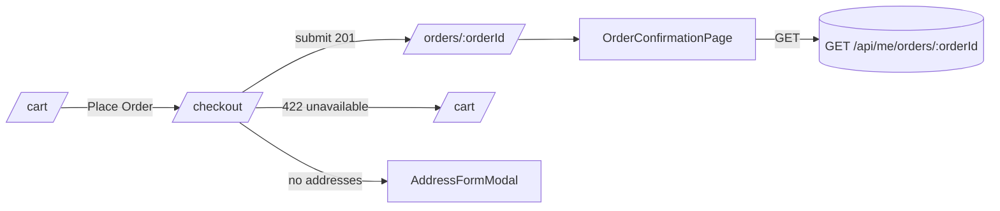
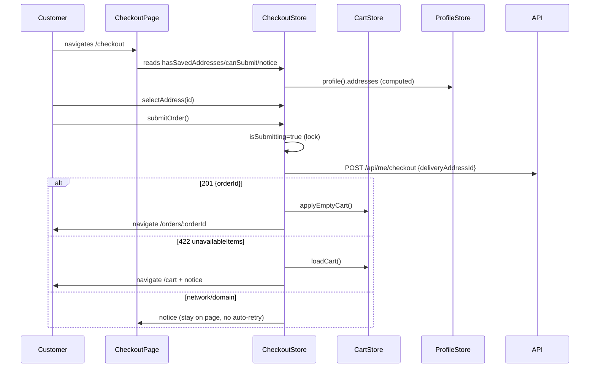
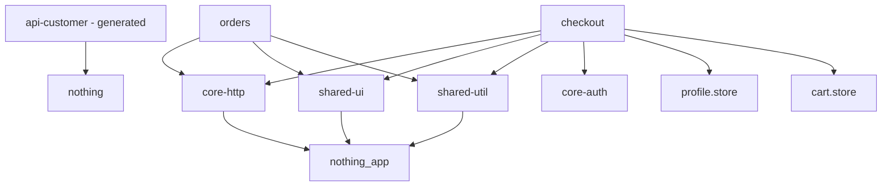

# Phase 9 — Checkout and Order Confirmation: Implementation Learning Guide

> **Beginner-friendly, evidence-based learning guide** produced from the real Git working tree and source code, not from plans alone.
>
> - **Feature path:** `specs/003-checkout-order-confirmation`
> - **Application:** `projects/customer` inside the `talabat-web` Angular 22.1 workspace
> - **Baseline HEAD:** `72355f3` `feat(checkout): place orders with unavailable-item recovery`
> - **Branch:** `main`
> - **Guide date:** 2026-08-07

---

## 1. Purpose of the Phase

Phase 9 completes the order-commitment journey for a customer: review the server-backed cart, choose a saved delivery address, place a "Cash on Delivery" order through the backend, and view a reload-safe order confirmation page.

Three backend contracts drive the phase:

| Action | Endpoint | Result on success | Result on failure |
|---|---|---|---|
| Create an address inline | `POST /api/me/addresses` | `201` `AddressResponse` | Problem Details |
| Submit the order | `POST /api/me/checkout` | `201` `{ orderId }` | `422` typed `CheckoutUnavailableResponse`, or Problem Details |
| Read order details | `GET /api/me/orders/{orderId}` | `200` `OrderDetailResponse` | `404`, or Problem Details |

The phase deliberately does **not** add payments, price calculations, order history listing, or tracking. Prices, line items, and totals are always rendered from server data.

The work sits on top of the Phase 8 server-backed cart (`CartStore`) and the Phase 6/7 authentication and profile gate (`authGuard`, `profileGuard`, `ProfileStore`).

---

## 2. Starting Point Before the Phase

The committed baseline before Phase 9 (`07329bc`) contained:

- A verified Phase 8 server-backed cart: `CartStore` in `projects/customer/src/app/features/cart/cart.store.ts` with readonly signals, serialized mutations, and `AppError`-based error notices. The Phase 9 `tasks.md` prerequisite states the baseline ran **103/103** tests.
- `authGuard` and `profileGuard` (from `@talabat/core-auth` and `projects/customer/src/app/core/profile/profile.store.ts`), the customer shell (`layout/customer-shell.component.ts`), and a cart FAB/cart-entry bar.
- `AppError` in `@talabat/core-http` with codes for cart/profile/restaurant domain errors, but **without** any raw-error body capture.

Missing before this phase (the problems Phase 9 solves):

1. No way to reach a cart summary with an address choice and a "Place Order" action — the cart page had a checkout handoff button but no checkout route.
2. No way to submit an order to `POST /api/me/checkout` and prevent duplicate submissions.
3. No way to create a saved delivery address inline (a customer with zero addresses was stuck).
4. No order confirmation route that re-fetches order details safely on refresh.
5. The 422 `CheckoutUnavailableResponse` body was lost by the global error pipeline because `AppError` only kept `status`, `code`, `title`, `detail`.

---

## 3. Git Baseline and Analysis Method

This guide is read-only. No source, test, spec, or config file was modified to produce it, and no tests were executed **by this documentation step**.

### Commands used for inspection

```powershell
git status --short
git branch --show-current
git rev-parse HEAD
git log --oneline -12
git diff --stat HEAD
git diff --numstat HEAD
git diff HEAD
git diff -- .agents/skills/phase-implementation-documenter/SKILL.md
git show --stat 72355f3
git show --name-status 72355f3
git ls-files --others --exclude-standard
```

### Evidence rules

- Everything below under "committed phase" describes code that is **already committed at `72355f3`** and was verified by reading the current source files.
- Everything under "uncommitted working tree" describes the diff between `HEAD` and the current working tree at the time of writing.
- **Test runtime evidence:** the customer test suite was run twice earlier in the same working session, *before* this documentation skill was loaded. Those results are reported in Section 22 as pre-existing runtime evidence with the exact commands. This skill itself did not execute any test.

---

## 4. Complete Change Summary

### 4.1 Committed phase (`72355f3`) — 71 files, +5,223 / −328

The commit contains the Phase 9 checkout + order confirmation feature **and** a related "fooddash UI consistency" sweep (styles, catalog cards, header, cart rows, button primitive). Categories:

| Category | Count | Examples |
|---|---|---|
| Phase 9 spec artifacts | 8 | `specs/003-checkout-order-confirmation/{spec,plan,tasks,research,data-model,quickstart,checklists/requirements,contracts/checkout-api-contract}.md` |
| Docs / prompts | 6 | `docs/fooddash-ui-consistency-repair-report.md`, `phase-9-fooddash-ui-alignment-prompt.md`, `implement-phase9.txt`, 4 `docs/ui-images/*.png` |
| `core-http` change | 2 | `app-error.ts` (+`rawError`), `problem-details.interceptor.ts` (+`rawError`), plus spec update |
| New checkout feature | 14 | `checkout.routes.ts`, `checkout.store.ts`, `checkout.page.ts`, `address-selector`, `checkout-summary`, `address-form-modal`, + specs |
| New orders feature | 3 | `orders.routes.ts`, `order-confirmation.page.ts`, + spec; `orders.page.ts` restyled |
| Guards | 2 | `checkout.guard.ts` + spec |
| UI-consistency sweep | ~30 | `styles.css`, `header.component`, `cart-entry-bar`, `cart-item-row`, catalog cards, `button.component.ts`, onboarding/profile pages, etc. |

### 4.2 Uncommitted working tree (this session) — 6 paths

| Path | Status | Change type | Purpose |
|---|---|---|---|
| `talabat-web/projects/customer/src/app/features/orders/pages/order-confirmation.page.ts` | modified (unstaged) | +1/−1 | Fix: give the `orderIdParam` input the alias `orderId` so the router binds the `:orderId` param to it |
| `talabat-web/projects/customer/src/app/features/orders/pages/order-confirmation.page.spec.ts` | modified (unstaged) | +22/−1 | Update `setInput` to the public input name; add a route-level binding test |
| `talabat-web/angular.json` | modified (unstaged) | +4/−1 | Wire `runnerConfig` for the customer test target (see Section 23) |
| `talabat-web/projects/customer/vitest.config.ts` | untracked | +8 | Single-worker Vitest config to avoid worker OOM on this machine |
| `.agents/skills/phase-implementation-documenter/SKILL.md` | modified (unstaged) | +108/−50 | Skill docs: add "absolute test-execution prohibition" and pre-existing-evidence rules |
| `.opencode/skills/phase-implementation-documenter/SKILL.md` | modified (unstaged) | +108/−50 | Identical copy of the same skill change |

> The `angular.json` + `vitest.config.ts` pair was introduced earlier in this working session as an environment workaround because the default multi-worker Vitest pool crashed on this low-RAM machine. The user was asked whether to keep or revert it; the question was dismissed, so it remains in the working tree **with a decision still pending** (see Section 23, finding R1).

---

## 5. New Files (committed in the phase)

The genuinely new feature files:

| File | Responsibility |
|---|---|
| `projects/customer/src/app/features/checkout/checkout.routes.ts` | Lazy route `'' → CheckoutPage` |
| `projects/customer/src/app/features/checkout/checkout.store.ts` | Signal store: address selection, submit lock, `orderId`, notices, unavailable items |
| `projects/customer/src/app/features/checkout/pages/checkout.page.ts` | `/checkout` page: assembles selector + summary + Place Order |
| `projects/customer/src/app/features/checkout/components/address-selector.component.ts` | Radio list of saved addresses |
| `projects/customer/src/app/features/checkout/components/checkout-summary.component.ts` | Server cart lines + grand total + COD badge |
| `projects/customer/src/app/features/checkout/components/address-form-modal.component.ts` | Inline address creation dialog (Signal Forms + `AddressesApiService.addAddress()`) |
| `projects/customer/src/app/features/orders/orders.routes.ts` | Lazy routes `'' → OrdersPage`, `':orderId' → OrderConfirmationPage` |
| `projects/customer/src/app/features/orders/pages/order-confirmation.page.ts` | `/orders/:orderId` reload-safe confirmation |
| `projects/customer/src/app/core/guards/checkout.guard.ts` | Empty-cart / missing-profile / error redirects before `/checkout` |

Plus one spec per feature file and `checkout.guard.spec.ts`.

**Untracked this session:** `talabat-web/projects/customer/vitest.config.ts` (test infra, Section 23).

---

## 6. Modified Files (uncommitted + phase)

### Uncommitted tail — the only code changes in the working tree

1. `order-confirmation.page.ts` (line 116):

```ts
// before
readonly orderIdParam = input.required<string>();
// after
readonly orderIdParam = input.required<string>({ alias: 'orderId' });
```

- **Why:** the route is `orders/:orderId` (see `orders.routes.ts`). With `withComponentInputBinding()` enabled in `app.config.ts`, the router binds route params to component inputs by **name**. Without the alias, the router looked for an input named `orderId` but the component only had `orderIdParam`, so the param was silently never bound and the page stayed in the loading/error state. The alias `'orderId'` tells Angular "this input's *public* name is `orderId`" while the field stays `orderIdParam`.

2. `order-confirmation.page.spec.ts`:
   - `setInput('orderIdParam', orderId)` → `setInput('orderId', orderId)`. `ComponentRef.setInput` also uses the **public** input name, so it needed the same correction.
   - Added the `binds route parameter orderId when navigated via router` test (Section 18).

### Modified in the committed phase (most relevant to checkout)

- `projects/core-http/src/lib/app-error.ts` — added `readonly rawError?: unknown;` to `AppError`.
- `projects/core-http/src/lib/problem-details.interceptor.ts` — `toAppError` now returns `rawError: e.error ?? undefined`.
- `projects/core-http/src/lib/problem-details.interceptor.spec.ts` — new cases for 422 body survival.
- `projects/customer/src/app/features/cart/cart.store.ts` — added `applyEmptyCart()` (public) and `showNotice()` for the post-checkout reset and the unavailable-item recovery notice.
- `projects/customer/src/app/layout/routes.ts` — registered `/checkout` and `/orders` under the shell with `authGuard, profileGuard` (and `checkoutGuard` for `/checkout`).
- `projects/customer/src/app/core/guards/index.ts` — exported `checkoutGuard`.
- `projects/shared-ui/src/lib/button/button.component.ts` — added `[disabled]` handling/busy styling used by Place Order.
- `projects/customer/src/styles.css` — FoodDash token/utility additions used by the new pages.
- A UI-consistency sweep touching header, cart-entry-bar, cart-item-row, catalog cards, onboarding/profile/auth pages, and not-found (visual polish, out of the strict Phase 9 spec but included in the commit).

---

## 7. Deleted, Renamed, or Moved Files

None in the uncommitted working tree.

Within commit `72355f3` there are no renames; the new `features/checkout/` and `features/orders/` trees were created fresh. Earlier phases' files that were restyled (not deleted) are listed in Section 6.

---

## 8. File-by-File Detailed Walkthrough

### 8.1 `checkout.guard.ts` (new, `projects/customer/src/app/core/guards/`)

Functional `CanActivateFn`. Full flow:

```ts
export const checkoutGuard: CanActivateFn = async (_route, state) => {
  const store = inject(ProfileStore);
  const cartStore = inject(CartStore);
  const router = inject(Router);

  const result = await store.ensureLoaded();

  if (result.kind === 'missing') {
    return router.createUrlTree(['/onboarding'], {
      queryParams: { returnUrl: safeReturnUrl(state.url) },
    });
  }
  if (result.kind === 'error') {
    return router.createUrlTree(['/profile-unavailable'], {
      queryParams: { returnUrl: safeReturnUrl(state.url) },
    });
  }
  if (cartStore.status() !== 'loaded') {
    await cartStore.loadCart();
  }
  if (cartStore.isEmpty()) {
    return router.createUrlTree(['/cart']);
  }
  return true;
};
```

Key points:

- It is the third guard on `/checkout`, after `authGuard` and `profileGuard` (Section 11). It re-probes the profile (`ensureLoaded()`) defensively even though `profileGuard` already ran.
- Returns `UrlTree` objects, never imperative `router.navigate()` — the router handles the redirect declaratively, which prevents double-navigation and works with the auth return-URL flow.
- `safeReturnUrl(state.url)` (from `@talabat/core-auth`) ensures the `returnUrl` query param is an internal URL, blocking open-redirect bugs.
- Empty cart → `/cart`. This is spec **FR-002**.

### 8.2 `checkout.store.ts` (new)

Root-provided `@Injectable({ providedIn: 'root' })` signal store. Responsibilities:

- **Derive the address list** from `ProfileStore.profile()?.addresses` (computed `addresses`).
- **Default address selection**: `defaultAddressId` prefers `isDefault`, else the first address, else `null`.
- **User override**: `overrideAddressIdState` is a private writable signal; `selectedAddressId` = `override ?? default`.
- **Submission lock**: `isSubmittingState`.
- **Order outcome**: `orderIdState`.
- **Recovery state**: `noticeState` and `unavailableItemsState`.

The three publics used by templates: `hasSavedAddresses`, `canSubmit`, `isSubmitting`, `notice`, plus `selectAddress()`, `submitOrder()`, `clearSubmission()`.

`canSubmit` is `selectedAddressId !== null && !isSubmitting && !cartStore.isEmpty()` — the Place Order button stays disabled until everything is valid.

### 8.3 `checkout.page.ts` (new)

Inline-template page. It **injects `CheckoutStore` and `DialogService` only** — no HTTP, no cart math. Template regions:

1. Heading.
2. `notice` banner (`role="alert"`).
3. `tal-address-selector` **or** a "You need a saved delivery address" panel (`@if hasSavedAddresses`).
4. `Add Delivery Address` secondary button → `dialog.openModal(AddressFormModalComponent, …)`.
5. `tal-checkout-summary`.
6. Place Order button: `[busy]="store.isSubmitting()"`, `[disabled]="!store.canSubmit()"`, label swaps to "Placing order…".
7. Visually hidden `role="status" aria-live="polite"` announcing "Placing your order…".

`submit()` is `void this.store.submitOrder()` — fire-and-forget; the store owns all state transitions and navigation.

### 8.4 `address-selector.component.ts` (new)

Renders one radio `<label>` per address with a **minimum 42px touch target** (`min-h-[42px]`), a `Default` badge when `isDefault`, and selected-state border/tint classes. Radios are disabled while `isSubmitting`. `change` event calls `store.selectAddress(id)`. Uses a `fieldset`/`legend` for radio-group semantics.

### 8.5 `checkout-summary.component.ts` (new)

Reads `CartStore` readonly signals (`items`, `total`) and renders line items (`quantity × unitPrice | talMoney`, `lineTotal | talMoney`) and the grand total — all server data, never client-recalculated. Includes the static "Cash on Delivery" badge (spec **FR-006**). The grand total `dd` uses `aria-live="polite"` with a visually hidden "Grand total:" label.

### 8.6 `address-form-modal.component.ts` (new)

A CDK `DialogRef`-hosted form. Uses **Angular Signal Forms** (`form()`, `required()`, `validate()`, `FormField`, `FieldTree`) rather than `FormGroup`. Fields: `street`, `buildingNumber`, `floor` (optional), `city`, `makeDefault` checkbox.

Submission flow:

1. `preventDefault()`, ignore if `busy()`.
2. `form().markAsTouched()`; if invalid, stop (per-field `role="alert"` messages render).
3. Trim values; blank `floor` becomes `null`.
4. `busy = true`; call `addressesApi.addAddress({ addAddressRequest: request })`.
5. On success: `await profileStore.refreshAfterCreation()` → `checkoutStore.selectAddress(created.id)` → `dialogRef.close()`.
6. On error: store `serverError` (rendered in an `role="alert"` box); form values stay intact; modal stays open.
7. `finally`: `busy = false`.

This satisfies spec **FR-005** (inline address creation, field preservation, duplicate-submit prevention, auto-select, keep-on-checkout).

### 8.7 `orders.routes.ts` (new)

```ts
{ path: '', loadComponent: () => import('./pages/orders.page').then((m) => m.OrdersPage) },
{ path: ':orderId', loadComponent: () => import('./pages/order-confirmation.page').then((m) => m.OrderConfirmationPage) },
```

The `:orderId` param is the one bound to the `orderId` input alias.

### 8.8 `order-confirmation.page.ts` (new; one line changed this session)

See Section 9 for the line-by-line. Core design:

- `orderIdParam` input with `alias: 'orderId'` (the uncommitted fix).
- A constructor `effect()` parses the param into a positive integer (`null` if invalid), writes `orderId`, and calls `load(id)`.
- `load()` uses a `generation` counter so stale responses from a previous param value are discarded (reload/param-change safety).
- State machine `viewState: 'loading' | 'loaded' | 'error'` with a `@switch` template: spinner, error state, or the order card.
- `canRetry()` is `false` only for a 404 (order not found is terminal; network/5xx offers retry).
- `placedAt`, `errorTitle`, `errorDetail` are pure functions over state.
- Rendering: `#{{ order.id }}` in mono font, `placedAt` formatted with `formatDateTime`, address snapshot, line items, total via `talMoney`, "Order confirmed" status chip + COD badge, and a "Back to restaurants" `RouterLink`.

### 8.9 `orders.page.ts` (restyled)

Static "No orders yet" empty state + "Browse restaurants" button. This is intentional: order *history* is a Phase 10 exclusion, so `/orders` currently shows an empty-state landing page.

---

## 9. Line-by-Line Code Explanation

### 9.1 The uncommitted change (`order-confirmation.page.ts:116`)

| Line | Code | Meaning |
|---|---|---|
| 116 | `readonly orderIdParam = input.required<string>({ alias: 'orderId' });` | Declares a required string input whose **public name** is `orderId` (matching the route param) while the class field stays `orderIdParam`. Without `{ alias: 'orderId' }`, Angular's `withComponentInputBinding()` never matched the param, so `orderIdParam` stayed `''` (falsy → parse → `null` → permanent "Order not found"). |

The template and the effect reference `this.orderIdParam()`; the alias only affects how the router/tests address the input.

### 9.2 `order-confirmation.page.ts` state and effect

| Lines | Code | Syntax and meaning | Why it exists |
|---|---|---|---|
| 120–122 | private `viewStateState`, `orderState`, `errorState` signals | Private writable signals; `asReadonly()` publics on 125–126 | Keeps writes private, reads public |
| 123 | `private generation = 0;` | Monotonic counter | Discards stale GET results when the param changes before a response arrives |
| 128 | `readonly orderId = signal<number | null>(null);` | Parsed numeric id | Drives error titles and `retry()`; **note:** this is a publicly writable signal — see finding Q1 |
| 130–138 | `constructor() { effect(() => { const raw = this.orderIdParam(); const parsed = Number(raw); const id = Number.isInteger(parsed) && parsed > 0 ? parsed : null; this.orderId.set(id); void this.load(id); }); }` | Zone-less reactive side effect: whenever the input changes, parse and (re)load | Makes the page reload-safe and param-change-safe; re-runs automatically on `orderIdParam` change |
| 140–141 | `placedAt` | `formatDateTime(orderState()?.placedAt ?? null)` | "—" for null, else medium date + short time |
| 143–146 | `canRetry()` | `error === null || error.status !== 404` | 404 is terminal; anything else retryable |
| 148–161 | `errorTitle` / `errorDetail` | Branch on `orderId() === null` (invalid link) and 404 | Human, non-raw messages (no protocol dumps) |
| 163–165 | `retry()` | Calls `load(this.orderId())` | Manual retry from `tal-error-state` |
| 167–193 | `load(orderId)` | If `null`: error state, no request. Else increment generation, set `loading`, `firstValueFrom(getOrderDetails({ orderId }))`, guard `generation !== this.generation`, then `loaded`. On error: guard generation, store `AppError`, set `error`; for 404 or `ProfileNotCreated` also clear `order` | Generation guard prevents a late response for an old id overwriting the new state — the reload-safety core (spec **FR-011**) |

### 9.3 `checkout.store.ts` key lines

| Lines | Code | Meaning |
|---|---|---|
| 23–45 | `isCheckoutUnavailableResponse(value)` | User-defined **type guard** that validates the shape of `CheckoutUnavailableResponse` (`unavailableItems` present, array of `{productId: number, productName: string, reason: string}`) so an untrusted 422 body can never crash parsing |
| 60–61 | `addresses = computed(() => profileStore.profile()?.addresses ?? [])` | Single source of address truth = profile cache |
| 61–68 | `defaultAddressId` | `isDefault` first, else `addresses[0]`, else `null` |
| 69–71 | `selectedAddressId = computed(() => overrideAddressIdState() ?? defaultAddressId())` | User pick wins; otherwise default |
| 83–88 | `canSubmit` | `selectedAddressId !== null && !isSubmitting && !cartStore.isEmpty()` |
| 90–93 | `selectAddress(id)` | Ignores changes during flight (lock) |
| 102–126 | `submitOrder()` | Guard clauses → `isSubmitting = true` → `checkoutApi.checkout({ checkoutRequest: { deliveryAddressId } })` → on success `orderIdState.set(response.orderId)`, `cartStore.applyEmptyCart()`, `router.navigateByUrl('/orders/<id>')` → `finally isSubmitting = false` |
| 128–159 | `handleSubmitError(appError)` | (1) `status === 422` + guard passes → set `unavailableItems`, set `unavailable-items` notice with `name (reason)` list, `cartStore.loadCart()`, navigate `/cart`. (2) network / `Unknown` → "could not confirm" notice **without navigating and without auto-retry** (spec FR-012 / roadmap "never auto-resubmit"). (3) anything else → generic notice with `appError.title/detail` |

### 9.4 `checkout.page.ts`

| Lines | Code | Meaning |
|---|---|---|
| 85–86 | `store = inject(CheckoutStore); dialog = inject(DialogService);` | Page is a thin orchestrator; no feature imports another feature's *components* |
| 88–90 | `submit()` → `void store.submitOrder()` | Fire-and-forget; template derives everything from signals |
| 92–97 | `addAddress()` → `dialog.openModal(AddressFormModalComponent, { ariaLabel, maxWidth })` | Reuses the CDK `DialogService` modal from shared-ui |
| 19–29 | notice `role="alert"` banner | Unavailable-item / network / domain messages |
| 59–74 | submit button busy/disabled + label swap | Duplicate-prevention UI (spec FR-008) |
| 76–80 | `role="status" aria-live="polite"` visually hidden | Screen-reader announcement during flight |

### 9.5 `address-form-modal.component.ts` — Signal Forms

| Lines | Code | Meaning |
|---|---|---|
| 157–179 | `form: FieldTree<AddressFormModel> = form(this.model, (f) => { required(...); validate(...) })` | Declarative schema: required fields + blank-trim checks with messages |
| 190–221 | `handleSubmit` | Lock → mark touched → invalid? stop → trim + `floor === '' ? null : floor` → call `addAddress` → refresh profile → auto-select → close; error → render server error, keep values |

### 9.6 `core-http` change

`app-error.ts`:

```ts
export interface AppError {
  readonly status: number;
  readonly code: AppErrorCode;
  readonly title: string;
  readonly detail?: string;
  readonly isNetworkError: boolean;
  readonly rawError?: unknown;   // NEW
}
```

`problem-details.interceptor.ts` `toAppError()` now returns `rawError: e.error ?? undefined`. This lets `CheckoutStore` read the 422 body (`appError.rawError`) through the standard error pipeline instead of bypassing it — the plan's "422 payload architecture".

---

## 10. Application Architecture After the Phase

```mermaid
flowchart TD
  Shell[CustomerShellComponent] --> CartFAB[CartEntryBar + Header (cart count)]
  Shell -->|routes| R1[restaurants]
  Shell -->|authGuard profileGuard| Cart[/cart/]
  Shell -->|authGuard profileGuard checkoutGuard| Checkout[/checkout/]
  Shell -->|authGuard profileGuard| Orders[/orders/:orderId/]

  Checkout --> CS[CheckoutStore]
  Checkout --> AS[AddressSelectorComponent]
  Checkout --> SUMM[CheckoutSummaryComponent]
  Checkout --> DIALOG[DialogService -> AddressFormModalComponent]
  AS --> CS
  SUMM --> CartStore
  AddressFormModal --> ProfileStore
  AddressFormModal --> AddressesApiService
  CS --> CheckoutApiService
  CS --> CartStore
  CS --> ProfileStore
  Confirmation[OrderConfirmationPage] --> OrdersApiService
```

Dependency direction: `features/checkout` and `features/orders` sit **above** `core/*`, `core-http`, `shared-ui`, `shared-util`, and the generated `api-customer` library. They never import each other's components or internals. `checkout` reads `CartStore` (an app-feature store) through its public readonly API, which the Phase 9 plan explicitly documents as allowed.

---

## 11. Routing and Navigation



- `/checkout` = `authGuard` → `profileGuard` → `checkoutGuard` (empty cart → `/cart`; missing profile → `/onboarding?returnUrl=/checkout`; profile error → `/profile-unavailable`).
- `/orders/:orderId` = `authGuard` → `profileGuard`; `withComponentInputBinding()` binds `:orderId` to the `orderId` input alias.
- The checkout store navigates with `navigateByUrl('/orders/<id>')`; the confirmation page then does a fresh **GET** — so refresh/bookmark/deep-link always re-fetches and never re-submits (spec FR-011).

---

## 12. State and Data Flow



`CartStore` and `CheckoutStore` are both root-provided singletons, so the header/cart badge and the checkout page always see the same cart; `applyEmptyCart()` on success immediately zeroes the badge.

---

## 13. Forms and Validation

Only one form exists in this phase: the address modal. It uses **Angular Signal Forms**:

- `model = signal<AddressFormModel>(...)` is the source of truth.
- `form(...)` builds a `FieldTree` with `required()` for `street`, `buildingNumber`, `city` and `validate()` blank-trim rules.
- `FormField` directive links each `<input>` to a field signal.
- Per-field `role="alert"` messages render `errors()[0]?.message`.
- Server errors are kept separately (`serverError`) and never overwrite the user's typed values.
- `makeDefault` is a plain checkbox updating `model.update(...)`.
- Duplicate submissions are blocked by the `busy()` lock.

Validation messages shown: "Street is required.", "Enter a street address.", "Building number is required.", "Enter a building number.", "City is required.", "Enter a city."

---

## 14. User Interface Implementation

- The two pages share a centered `max-w-2xl` container, `font-display` headings, `rounded-food` cards, and the FoodDash token set from `styles.css`.
- Address selector uses real `<input type="radio">` inside a `<fieldset>/<legend>` for accessible radio semantics (spec FR-004 / plan 3.2).
- Submit button is pill-shaped, `size="lg"`, shows a spinner via the shared `tal-button` busy state, and is disabled while `!canSubmit`.
- Confirmations use a mono font for the order id (`font-mono`), a `tal-status-chip` "Order confirmed" (success tone), and a COD badge.
- The "Your Orders" landing is an `tal-empty-state` (history is Phase 10).
- UI-consistency sweep adjusted header/cart FAB/catalog cards against the design tokens; those are visual-only changes outside the strict spec.

---

## 15. Error and Async States

| Screen | States |
|---|---|
| `/checkout` | notice banner (`role="alert"`) for unavailable-items, network, general; button busy; radios disabled during flight |
| `/orders/:orderId` | `loading` (spinner with label), `error` (via `tal-error-state`), `loaded` (order card) |
| Address modal | per-field validation alerts; server-error alert; busy buttons |

Error-to-action mapping (no raw status in UI):

| Condition | UI |
|---|---|
| 404 order not found | "We could not find this order for your account." no retry |
| invalid/empty param | "The order link is invalid…" |
| 422 unavailable items | notice listing `name (reason)`, cart reloaded, redirect to `/cart` |
| network / ambiguous | "We could not confirm your order… check order history before placing again", no auto-retry |
| other domain errors | `appError.title` / `detail` |

---

## 16. Accessibility and Responsive Design

- `role="alert"` for dynamic errors/notices; `role="status"` + `aria-live="polite"` for submission progress (spec FR-014).
- Radios: native inputs in a fieldset; `aria-invalid` + `aria-describedby` on invalid address fields; `aria-label` on sections.
- Focus: the CDK dialog (`DialogService.openModal`) handles focus trap, initial focus on the heading, restoreFocus, and Escape/backdrop close.
- Touch targets: address rows `min-h-[42px]`, buttons ≥ 42px, radios `size-[20px]` (spec FR-016).
- Responsive: `max-w-2xl` center, `sm:flex-row` stacks collapse on mobile; `break-words` on long product names; 320px safe by layout audit (spec FR-015).
- `prefers-reduced-motion` and focus rings come from the Phase 5 `styles.css` baseline.

---

## 17. Runtime User Flows

### Flow A — Standard checkout → confirmation

1. User taps the cart FAB → `/cart`.
2. Cart has items → "Place Order" → `/checkout`.
3. Guards pass; `checkoutGuard` loads cart if needed and confirms non-empty.
4. Page shows default address pre-selected (or the first), summary lines + total, COD badge.
5. "Place Order" → busy/locked (`isSubmitting`), `POST /checkout`.
6. 201 `{orderId}` → `applyEmptyCart()` (badge resets) → navigate `/orders/:orderId`.
7. Confirmation page GETs details and renders order id, placed time, address, items, total.

### Flow B — Refresh/deep-link at confirmation

Direct `/orders/1042` or F5 → guards → `withComponentInputBinding` binds `:orderId` to the `orderId` input → effect parses → GET → renders. No POST is ever triggered by this page.

### Flow C — Item becomes unavailable (422)

Submit → `422 CheckoutUnavailableResponse` → guard validates shape → `unavailableItems` stored → notice shown → `loadCart()` → redirect `/cart`; the user reviews the refreshed cart.

### Flow D — No saved addresses

`/checkout` shows the "You need a saved delivery address" panel + "Add Delivery Address" → modal → fill + save → `addAddress()` → profile refresh → auto-select new address → modal closes → user can Place Order.

### Flow E — Network drop mid-submit

`AppError` network → "could not confirm" notice; page stays put; **no automatic retry** (avoids duplicate orders); user can check order history manually.

---

## 18. Test Code and What Each Test Is Intended to Prove

*Static inspection only for this section; runtime results are in Section 22.*

| Spec file | Behaviour protected | Type |
|---|---|---|
| `checkout.guard.spec.ts` (98 lines) | activates when profile loaded + cart non-empty; loads cart before deciding; empty cart → `/cart` UrlTree; missing profile → `/onboarding?returnUrl=%2Fcheckout`; profile error → `/profile-unavailable` | unit (injection context) |
| `checkout.store.spec.ts` (318 lines) | default/first/none address derivation; explicit select; select blocked during flight; submit no-ops without address/empty cart; lock + payload `{checkoutRequest:{deliveryAddressId}}`; 201 → orderId + `applyEmptyCart` + navigate; second submit ignored; typed 422 → unavailableItems + notice + `loadCart` + `/cart`; malformed 422 → safe "network" fallback; network → ambiguous notice, no navigation; domain error → general notice; `clearSubmission`; type-guard matrix (valid/empty/null/non-array/bad fields) | unit |
| `checkout.page.spec.ts` (159 lines) | heading/selector/summary render; no-address prompt; button disabled; `aria-busy` + disabled + label while submitting; submit fires once; live region announces; notice alert; Add Address opens modal; single-column responsive root | component (store fakes) |
| `address-selector.component.spec.ts` (133 lines) | every address card; no-floor render; Default badge; radio pre-selection; change → `selectAddress(id)`; disabled during submit; `min-h-[42px]` | component |
| `checkout-summary.component.spec.ts` (68 lines) | server line items with quantity/unit price; line totals; grand total; COD badge | component |
| `address-form-modal.component.spec.ts` (206 lines) | required controls render; blank validation blocks submit; trimmed payload with null floor; floor+makeDefault sent; success → refresh profile + auto-select + close; server error preserved + no close; busy lock blocks second submit | component |
| `order-confirmation.page.spec.ts` (now 220 lines) | route-param binding via `RouterTestingHarness` (`/orders/7` → `getOrderDetails({orderId:7})`, `viewState === 'loaded'`); extracts id + fetches; loading skeleton; renders id/time/COD; address snapshot; line items; total; 404 → no retry; non-numeric id → no request + "Order not found"; transient error → retry button re-issues; reload safety re-issues only GET | component + route-level |

**New this session (uncommitted):** the `binds route parameter orderId when navigated via router` test — it creates a real `RouterTestingHarness`, navigates to `/orders/7` under `withComponentInputBinding()`, and asserts the page called `getOrderDetails({ orderId: 7 })` and reached `loaded`. It exists specifically to lock in the alias fix and would fail if the alias were reverted.

**Coverage gaps (static view):** no dedicated test asserts the confirmation page shows a formatted 404 message *and* clears stale order data on `ProfileNotCreated`; no test covers param *change* mid-flight (the generation guard). These are low-risk gaps.

---

## 19. Requirement and Task Traceability

| Requirement | Implementing file(s) | Test evidence (static) | Status |
|---|---|---|---|
| FR-001 guards | `layout/routes.ts`, `checkout.guard.ts` | `checkout.guard.spec.ts` | Implemented and tested |
| FR-002 empty cart gate | `checkout.guard.ts` | guard spec (UrlTree `/cart`) | Implemented and tested |
| FR-003 server authority | `checkout-summary.component.ts` | summary spec | Implemented and tested |
| FR-004 address selection | `address-selector.component.ts`, `checkout.store.ts` | selector + store specs | Implemented and tested |
| FR-005 inline address | `address-form-modal.component.ts` | modal spec | Implemented and tested |
| FR-006 COD display | `checkout-summary.component.ts` | summary spec | Implemented and tested |
| FR-007 submit contract | `checkout.store.ts` | store spec (payload) | Implemented and tested |
| FR-008 duplicate lock | `checkout.store.ts`, `checkout.page.ts` | store + page specs | Implemented and tested |
| FR-009 cart reset | `checkout.store.ts` + `cart.store.ts` `applyEmptyCart` | store spec | Implemented and tested |
| FR-010 confirmation display | `order-confirmation.page.ts` | page spec | Implemented and tested |
| FR-011 reload/deep-link | `order-confirmation.page.ts` effect + generation | page spec (reload + new route-binding test) | Implemented and tested |
| FR-012 422 recovery | `checkout.store.ts` | store spec | Implemented and tested |
| FR-013 typed error infra | `core-http` `rawError` | `problem-details.interceptor.spec.ts` | Implemented and tested |
| FR-014 ARIA | all components | static component specs | Implemented; full WCAG audit is manual (Phase 11) |
| FR-015 responsive | pages/templates | layout class assertions only | Implemented; viewport testing manual |
| FR-016 42px targets | selector/buttons | selector spec class assertion | Implemented and tested |

Task status: all `T001–T031` checkboxes are marked `[x]` in `tasks.md`. Source inspection confirms the corresponding code exists for the checkout/orders tasks (T005–T028). T030/T031 claim full test/build runs; the customer-suite runtime pass from this session supports T030 for the customer project, but `core-http`/production-build runtime evidence was **not** re-created here (see Section 22).

---

## 20. Security Boundary Review

| Rule | Result | Evidence |
|---|---|---|
| No `localStorage`/`sessionStorage` token storage introduced | PASS | This phase adds no storage code; tokens remain in the Phase 6 in-memory OIDC flow |
| Generated API clients not modified | PASS | Phase uses `CheckoutApiService`, `OrdersApiService`, `AddressesApiService` read-only; only `core-http` (`AppError`, interceptor) changed |
| Protected routes require auth | PASS | `/checkout` and `/orders/:orderId` guarded by `authGuard` + `profileGuard` |
| Guards return `UrlTree` (no unsafe imperative navigation) | PASS | `checkoutGuard` returns `createUrlTree` only |
| Internal return URLs validated | PASS | `safeReturnUrl(state.url)` used for `returnUrl` |
| No raw protocol errors shown | PASS | `AppError.title/detail` mapped to friendly copy; 404 → "We could not find this order…" |
| No hardcoded API URLs | PASS | All calls through generated services bound to runtime `BASE_PATH` |
| Client state not authorization authority | PASS | Prices/totals/order outcome all server-owned |

No failures found.

---

## 21. Dependency Boundary Review



- `core-http` imports nothing app-side. `shared-ui`/`shared-util` stay domain-free (the only shared-ui change is `ButtonComponent` busy/disabled support).
- `features/checkout` imports `features/cart/cart.store.ts` (public readonly API) — documented/allowed in `plan.md`; it does **not** import cart components. `features/checkout` and `features/orders` do not import each other.
- No feature injects `HttpClient` directly; all HTTP is through generated services.
- Writable signals are private in `CheckoutStore`/`CartStore`; publics are `asReadonly()`.
- **Minor:** `OrderConfirmationPage.orderId` is a publicly writable `signal()` (not `asReadonly()`). Not a boundary violation, but a state-encapsulation wart (Section 23, Q1).

No boundary violations.

---

## 22. Static Verification and Pre-existing Evidence

### 22.1 Runtime test evidence (pre-existing, produced earlier in this same session, before the documentation skill was loaded)

| Command | Result |
|---|---|
| `npx ng test customer --include="**/order-confirmation.page.spec.ts" --watch=false` (after fix) | 1 file, **11/11 passed** |
| `npx ng test customer --watch=false` (full customer suite) | **30 files / 182 tests passed** (59.6 s) |

These runs used the `vitest.config.ts` single-worker workaround. The earlier failures they fixed: (a) worker OOM/crash without the config, (b) 10/11 failures caused by `setInput('orderIdParam', …)` using the internal field name instead of the public alias name — both corrected before the runs above.

**Label:** `PRE-EXISTING PASS EVIDENCE — recorded earlier in the same working session; not executed by this documentation skill.`

### 22.2 Not re-verified by this skill

- `npx ng test core-http` (task T030) — **not run** here; the phase commit's `problem-details.interceptor.spec.ts` additions exist on disk.
- `npx ng build customer` (task T031) — **not run** here; no fresh build evidence for this session.

These are flagged as `STILL UNVERIFIED` for the purpose of this guide.

### 22.3 Manual verification still required

Live browser acceptance (spec Section 8 scenarios A–C), viewport/zoom checks, and a real backend 422 + duplicate-click test.

---

## 23. Problems, Risks, and Missing Coverage

| ID | Severity | File / symbol | Finding |
|---|---|---|---|
| R1 | Medium | `projects/customer/vitest.config.ts`, `angular.json` | **Uncommitted environment workaround.** Default multi-worker Vitest forks crashed (OOM / "Worker exited unexpectedly") on this 8 GB machine; `maxWorkers: 1` fixes it but serializes test files (~60 s). Keep/revert decision is **pending** (the question was dismissed). If reverted, tests need more free RAM or a better worker config. |
| Q1 | Low | `order-confirmation.page.ts:128` | `orderId` is a publicly writable `signal()`; prefer `asReadonly()` + private write or a `computed` to match the store conventions. |
| Q2 | Low | `catalog/components/test/*` (`test.ts`, `test.html`, `test.css`, `test.spec.ts`) | Scratch/experimental files committed in `72355f3`; candidates for cleanup in a later commit. |
| Q3 | Info | repo root `implement-phase9.txt`, `phase-9-fooddash-ui-alignment-prompt.md`, `docs/fooddash-ui-consistency-repair-report.md` | Prompt/notes artifacts committed alongside the phase; harmless but non-code clutter. |
| Q4 | Info | `orders.page.ts` | `/orders` is a static empty state by design (history is Phase 10); navigation from checkout targets `/orders/:orderId` directly, so the placeholder never blocks the flow. |
| Q5 | Info | whole phase | The commit also swept in fooddash UI-consistency edits beyond the strict Phase 9 spec (header, cart rows, catalog cards, styles). Behaviour unaffected; noted for scope transparency. |
| Q6 | Low | `order-confirmation.page.ts` | No test covers a route-param *change* mid-flight; the `generation` guard is the only protection and is untested directly. |

No Critical or High findings.

---

## 24. Manual Testing Guide

1. **Happy path (Scenario A):** cart → `/checkout` → verify default address + server lines/total + COD → Place Order → button busy → `/orders/:orderId` → verify id/time/address/items/total → cart badge = 0.
2. **Refresh (Scenario B):** on `/orders/123` press F5 → details re-render via GET; confirm no POST in network tab.
3. **Deep link (Scenario C):** bookmark `/orders/123`, open in a new tab.
4. **422:** induce an unavailable product on the backend → submit → banner lists items → auto-redirect `/cart` with refreshed cart.
5. **No address:** `/checkout` with 0 addresses → "Add Delivery Address" → save → auto-selected → Place Order.
6. **Duplicate click / slow network:** throttle via dev tools → rapid clicks → exactly one `POST /checkout`.
7. **Network drop mid-submit:** disconnect → "could not confirm" notice; no auto retry.
8. **Invalid link:** open `/orders/abc` → "Order not found".
9. **Accessibility:** tab through radios/buttons/dialog; screen-reader announcements; 200% zoom at 320px/768px/1280px.

---

## 25. Concepts a Beginner Must Learn

1. **Standalone components + lazy routes** — every page is standalone and loaded via `loadComponent`; only the touched chunk ships. See `checkout.routes.ts`, `layout/routes.ts`.
2. **Functional guards + `UrlTree`** — `checkoutGuard` returns a `UrlTree` for redirects instead of calling `router.navigate()`; safe, declarative, testable via `runInInjectionContext`.
3. **`inject()`** — modern DI; components/stores ask for services in one line.
4. **Signals** — `signal()` for private writable state, `computed()` for derived state, `.asReadonly()` to expose read-only views; `CheckoutStore` is a clean example.
5. **`input()` with `alias` + `withComponentInputBinding()`** — the exact bug this phase's tail fixed: a route param (`:orderId`) only binds to an input whose public name matches, and `{ alias: 'orderId' }` bridges a differently-named field.
6. **`effect()`** — the confirmation page reacts to the input signal and re-loads; the `generation` counter prevents stale responses (a mini race-condition guard).
7. **Signal Forms** — `form()`, `required()`, `validate()`, `FormField`, `FieldTree` replace `FormGroup` and stay reactive with zoneless.
8. **`firstValueFrom()` over generated observables** — pages/stores turn generated RxJS calls into promises; keeps the generated client untouched.
9. **HTTP interceptor + `rawError`** — `problemDetailsInterceptor` maps `HttpErrorResponse` → `AppError`, now preserving the body so a 422 typed payload survives without bypassing the pipeline.
10. **Type guards** — `isCheckoutUnavailableResponse()` narrows an `unknown` `rawError` safely before use.
11. **CDK Dialog** — `DialogService.openModal` gives focus trap/restore/backdrop/Escape for free.
12. **ARIA states** — `aria-busy`, `role="status"`/`aria-live`, `role="alert"`, `aria-invalid`/`aria-describedby`.
13. **Vitest + TestBed** — signal-backed store fakes, `ComponentRef.setInput` (public input names!), and `RouterTestingHarness` for route-level tests.

---

## 26. Final Phase Result

The phase implements every Phase 9 functional requirement:

- Guarded checkout with a non-empty cart prerequisite and deterministic redirects.
- Server-authoritative address + summary screen with COD.
- Duplicate-proof submission (`POST /checkout` with `deliveryAddressId`), cart reset on 201, automatic navigation.
- Inline address creation with profile refresh and auto-selection.
- Typed 422 unavailable-item recovery that reloads the cart and returns the user to it.
- Reload-safe order confirmation via idempotent `GET /orders/:orderId`.
- `AppError.rawError` in `core-http` as the typed-error bridge.

**Evidence:** committed at `72355f3`; customer suite **182/182** passed earlier this session (30 files); the uncommitted tail is a small, verified route-binding fix plus its test.

## 27. What the Next Phase Will Add

Per the roadmap, **Phase 10 — Account, addresses, and orders**: profile editing, full address management (list/default/remove), and real order **history** with pagination-aware rendering — replacing the `/orders` empty-state placeholder and consolidating the address form into a shared boundary. **Phase 11** owns release hardening, CI-grade proofs, accessibility scans, and e2e.

---

## 28. Appendix A — Full Changed-File Inventory (uncommitted, this session)

| Path | Type | Status |
|---|---|---|
| `talabat-web/projects/customer/src/app/features/orders/pages/order-confirmation.page.ts` | modified | unstaged |
| `talabat-web/projects/customer/src/app/features/orders/pages/order-confirmation.page.spec.ts` | modified | unstaged |
| `talabat-web/angular.json` | modified | unstaged |
| `talabat-web/projects/customer/vitest.config.ts` | new | untracked |
| `.agents/skills/phase-implementation-documenter/SKILL.md` | modified | unstaged |
| `.opencode/skills/phase-implementation-documenter/SKILL.md` | modified | unstaged |

No staged, deleted, or renamed files in the working tree.

## 29. Appendix B — Git Diff Statistics

- **Committed phase `72355f3`:** 71 files changed, **+5,223 / −328**.
- **Uncommitted working tree:** 5 tracked files (from `git diff --stat HEAD`): **+243 / −103**; plus untracked `vitest.config.ts` (~8 lines). Breakdown: each SKILL.md +108/−50; `angular.json` +4/−1; page spec +22/−1; page +1/−1.

## 30. Appendix C — Symbols Added or Changed

- `AppError.rawError?: unknown` (interface)
- `problemDetailsInterceptor` → `toAppError()` now emits `rawError`
- `checkoutGuard` (CanActivateFn)
- `CheckoutStore`: `addresses`, `defaultAddressId`, `selectedAddressId`, `selectedAddress`, `hasSavedAddresses`, `isSubmitting`, `orderId`, `notice`, `unavailableItems`, `canSubmit`, `selectAddress`, `clearSubmission`, `submitOrder`, `isCheckoutUnavailableResponse`
- `CheckoutPage.submit/addAddress`; `AddressSelectorComponent.select`; `AddressFormModalComponent.handleSubmit/toggleDefault/cancel`; `CheckoutSummaryComponent`
- `OrderConfirmationPage`: `orderIdParam` (**alias fix**), `viewState/order/orderId`, `placedAt/canRetry/errorTitle/errorDetail/retry/load`, `generation`
- `CartStore.applyEmptyCart()` and `showNotice()` (added by the phase)
- `layout/routes.ts` → `/checkout` + `/orders` registrations; `checkout.routes.ts`; `orders.routes.ts`

## 31. Appendix D — Unverified Assumptions

- `core-http` and production-build runtime pass for the phase commit were **not** re-executed by this skill (Section 22.2).
- Live-backend acceptance (real 422, real checkout, real order) was not performed here; manual scenarios in Section 24 remain.
- The `vitest.config.ts`/`angular.json` workaround's keep/revert decision is pending user input.
- The `setInput('orderId', …)` public-name behaviour and `input({ alias })` router binding were confirmed empirically by the pre-existing test runs in Section 22.1, not by this documentation step.
