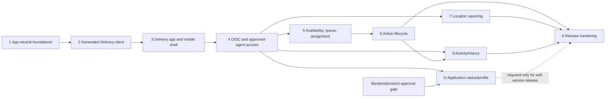

# Talabat Delivery Frontend Roadmap

**Status:** implementation-ready for the current approved-agent contract; self-service approval/profile work is explicitly gated

**Scope:** Delivery application only, from the repository state inspected on 2026-08-10 to the supported production milestone

**Architectural context:** `../talabat-angular-plan-v2.md`, `../talabat-angular-foundation-guide-phases-1-4.md`, and `talabat-angular-roadmap-phases-5-to-completion.md`

Repository and generated-contract reality overrides those older documents where they differ.

> **Status update (2026-10-13).** This roadmap was written against backend `5537331`. Backend
> commits `216dd9c`, `9b29fff` and `333bb1d` have since added the applicant application/profile
> contract (`GET /api/agent/me/application`, `GET|PUT /api/agent/me/profile`), the authoritative
> agent status read (`GET /api/agent/status`), a production-authorized Admin approval API, and
> restaurant name/pickup address on pending and active deliveries. The corresponding "blocked"
> rows in §1 are resolved, and Phase G can proceed. `openapi/delivery-api.json` has been re-synced
> with that contract; the deterministic Delivery fixtures (backend readiness Phase 5) are still
> outstanding. See `talabat/PROJECT_STATUS_REPORT.md`.

## 1. Current-state assessment

### Evidence snapshot

- Frontend: `master` at `389f254`; the worktree contains unrelated modified and untracked Customer release-hardening work. Delivery implementation must preserve or first stabilize that work.
- Backend: `feature/user-aggregate-refactor` at `5537331`; it also contains unrelated uncommitted Identity/E2E provisioning work that is not a committed Delivery contract.
- `talabat-web/openapi/delivery-api.json` byte-matches `Talabat.Delivery.API/openapi/delivery-api.json` (SHA-256 `D0D6016EC3F652335204BD4E02BD2481549991BB5EB2BA115FEE590FA59397F8`).
- The current Delivery document is OpenAPI 3.0.4 and exposes 13 secured operations, three tags, and eight schemas.

### Frontend reality

Already present:

- Angular 22.1 standalone, zoneless applications; strict TypeScript with `noUncheckedIndexedAccess`; Vitest; lazy Customer feature routing.
- Tailwind v4, Angular CDK, `oidc-client-ts`, generated Customer client tooling, runtime config, correlation IDs, Problem Details normalization, OIDC/PKCE auth, shared UI primitives, shared formatting utilities, and Customer functional features through checkout/account/order work.
- The Delivery OpenAPI file is copied by the existing contract-copy tool.

Missing or not safely reusable as-is:

- No `delivery` Angular application, `api-delivery` library, Delivery generator config/scripts, Delivery runtime config, routes, shell, state, features, tests, or build budget.
- `core-config` requires a Customer-named `customerApiBaseUrl` key.
- `core-auth` is operationally sound but its runtime type and token interceptor are Customer-specific and only protect `/api/me`.
- `core-http` owns Customer domain error codes, which violates the rule that shared libraries remain domain-independent once Delivery is added.
- Shared component TypeScript is domain-independent, but most `.tal-*` primitive CSS lives in the Customer application's global stylesheet; another app cannot consume the components with the same contract without copying Customer CSS.
- Customer global CSS imports Google Fonts remotely. Delivery should use approved self-hosted assets or an approved system-font fallback; it must not silently inherit a production availability/privacy dependency.
- Existing Customer layout, profile, cart, checkout, catalog, order, and onboarding code is Customer domain code, not a Delivery starting point.

### Backend capability assessment

| Journey capability | Current evidence | Assessment for Delivery frontend |
|---|---|---|
| Authentication | Identity registers `talabat-delivery-spa` for code + PKCE, port 4300 callbacks, `openid profile roles delivery.api offline_access`, 900-second access tokens, and refresh claim updates. | Supported. Reuse the OIDC infrastructure with Delivery configuration. |
| Agent registration | Identity Razor `/auth/register` derives the Delivery variant from the OIDC client and collects full name, email/password, optional phone, and `Bike`/`Motorcycle`/`Car`; tests cover pending-applicant creation. | Supported only as an Identity-owned redirect flow. Do not create a SPA registration form or call Identity's ad hoc account JSON endpoints. |
| Agent profile | Registration persists profile/application data, but the Delivery OpenAPI has no authenticated self-profile read or update operation. Identity `account/me` returns only ID/email and is not a Delivery contract. | Blocked for profile display/edit. |
| Pending/approved/rejected states | Domain states exist. Approval/rejection HTTP operations are unauthenticated, Development-only, absent in staging/production, and marked for replacement. No authenticated operation exposes the current applicant state. | True blocker for truthful pending/rejected/approved UI and the complete onboarding journey. Absence of the `DeliveryAgent` role cannot distinguish pending, rejected, or unrelated users. |
| Authorization | Every Delivery operation requires an authenticated token, `delivery.api` scope, and `DeliveryAgent` role. Controllers also resolve the current `sub` against persisted `UserType.DeliveryAgent`; role-only drift is forbidden. | Supported. Client guards improve UX only; the API remains authoritative. |
| Availability | `GoOnline` and `GoOffline` commands exist. Assignment requires the agent to be `Available`; assignment sets `Busy`; terminal completion returns the agent to `Available`. | Command path supported. No read operation exposes `Offline`/`Available`/`Busy`/`Suspended`, so a truthful persistent toggle/status after reload is blocked. |
| Pending queue and assignment | `GetPendingDeliveries` returns the global FIFO pending set with delivery/order/restaurant IDs, city, status, and creation time; `AssignDelivery` claims a delivery if the agent is available. | Supported. Race/conflict recovery is required. Do not expose customer PII in the queue. |
| Active delivery/details | `GetActiveDelivery` returns the current agent's one active delivery with IDs, status, delivery address, and assigned time. Other agents' deliveries are ownership-scoped to not-found. | Partially supported. There is no arbitrary detail operation, restaurant address/name/coordinates, customer contact, order items, or navigation data. |
| Lifecycle transitions | `Assigned -> ArrivedAtRestaurant -> PickedUp -> OutForDelivery -> Delivered`. Cancel is allowed before pickup; fail accepts a required reason and can terminate any active stage. Terminal operations release the agent. | Supported. UI actions must be derived from the returned status and refetched after every mutation. |
| Location updates | `UpdateLocation(latitude, longitude)` returns 204 and accepts updates for approved agents. | Write supported. There is no location read, tracking cadence, accuracy rule, foreground/background policy, or retention/privacy contract. Automatic tracking is product-gated. |
| Delivery history | `GetDeliveryHistory` returns every delivery assigned to the current agent, newest first, with status/address/timestamps. The repository does not restrict it to terminal deliveries. | Supported as “assigned delivery activity.” Do not label it “completed only” or filter active entries without a contract/product decision. |

### Blocker classification

True blockers:

- Production approval mechanism and authenticated applicant-state/profile contract: blocks pending/rejected/approved journeys and profile UI.
- An approved test agent plus deterministic pending-delivery provisioning: blocks live auth/operational E2E, but not foundation/client/shell work.
- Product location policy: blocks automatic/continuous location reporting, but not geolocation permission infrastructure or an explicitly approved foreground update.

Not blockers to an approved-agent operational milestone:

- Missing arbitrary delivery details, restaurant/customer contact, maps, order items, and pagination. The UI can expose only current response fields.
- Missing availability read. The UI can use explicit commands and an `Unknown` startup state without pretending a persisted toggle is authoritative.
- Missing applicant-state contract. Approved-agent features can proceed behind a generic “Delivery access unavailable” state for authenticated users lacking access.

Decision gates that can change scope:

- If product requires self-service onboarding in the Delivery release, the gated expansion in this roadmap becomes mandatory before release.
- If product requires automatic/background tracking or turn-by-turn navigation, the current web/API contract is insufficient and Phase 7 cannot close.
- If agents require restaurant/customer contact or order-content verification to complete a delivery, the active-delivery contract must expand before Phase 6 is production-complete.

## 2. Delivery architecture

The workspace remains Angular CLI, not Nx. Delivery is a second standalone application, not a clone or child feature of Customer.

```text
projects/delivery/        -> @talabat/core-* + @talabat/api-delivery + @talabat/shared-*
projects/customer/        -> @talabat/core-* + @talabat/api-customer + @talabat/shared-*
projects/core-*           -> infrastructure only; no app, feature, or domain imports
projects/shared-*         -> domain-independent presentation/utilities only
projects/api-delivery/    -> generated; depends on nothing in this workspace
projects/api-customer/    -> generated; depends on nothing in this workspace
```

Delivery app ownership:

```text
projects/delivery/src/app/
|-- app.config.ts
|-- app.routes.ts
|-- core/                 # Delivery-only access/session/geolocation/error boundaries
|-- layout/               # operational shell and navigation
|-- ui/                   # Delivery-only visual compositions
`-- features/
    |-- auth/
    |-- queue/
    |-- active-delivery/
    `-- history/
```

Architecture rules:

- Keep standalone + zoneless Angular 22, signals/computed/resource-based reads, functional interceptors/guards, Signal Forms, Vitest, and lazy feature routes.
- Use no NgRx unless measured complexity later proves the existing signal-store model inadequate and an architecture decision explicitly approves it.
- All HTTP uses `api-delivery`; features never inject `HttpClient`. Generated source is committed, deterministic, never hand-edited, and regenerated from the copied backend document.
- Generalize runtime config to public, app-neutral fields: `identityAuthority`, `apiBaseUrl`, `clientId`, and `scopes`. `BASE_PATH` is supplied per app from that config.
- Generalize auth token scoping through an app-supplied protected path prefix: `/api/me` for Customer and `/api/agent` for Delivery. Require exact origin plus path-boundary matching.
- Keep OIDC tokens in the existing in-memory user store. Session storage is limited to transient PKCE transaction state owned by the OIDC library; application code must never persist tokens.
- Move domain error interpretation out of `core-http`. The core normalizer may preserve a backend code as untrusted data; Customer and Delivery each map owned codes to app-specific typed unions and safe messages.
- Pages own resources/stores; presentational components accept inputs and emit intents. Delivery features do not import each other's components. Cross-feature coordination belongs in a narrow Delivery app-core service/store, not `shared-*`.
- Preserve unknown enum/error values safely: show the data, suppress unsafe lifecycle actions, and refetch/report rather than guessing a transition.

## 3. Customer vs Delivery reuse

| Classification | Pieces | Rule |
|---|---|---|
| Reuse unchanged | Angular workspace/compiler conventions; zoneless bootstrap pattern; correlation-ID interceptor; OIDC adapter/store/callback mechanics; return-URL validation; shared component TypeScript; CDK dialog service; generic date formatting; OpenAPI custom generator and templates | Reuse only the domain-independent behavior and retain its tests. |
| Reuse with configuration/theme | Runtime config loader; auth provider/interceptor/guard; Problem Details transport normalizer; shared primitive stylesheet; Tailwind token foundation; Button/Card/Input/StatusChip/Spinner/EmptyState/ErrorState; Playwright accessibility/network helpers if their pending Customer work is stabilized | Supply Delivery API origin/path, client/scopes, teal skin, 56px targets, 64px primary actions, 16px body text, and Delivery-specific test topology. |
| Delivery-specific | Delivery application, route map, operational shell, `deliveryAccessGuard`, agent session/availability state, queue, assignment, active lifecycle mapping, geolocation adapter/reporter, history, Delivery error codes/messages, operational E2E fixtures | Keep under `projects/delivery`; promote nothing merely because Customer has a similarly named store/page. |
| Must not be shared | Customer profile/onboarding/cart/checkout/catalog/orders/layout; Delivery queue/lifecycle/history UI; Customer `ProfileStore` and guards; Delivery agent/application store; generated DTOs/services across API libraries; lifecycle state machines; combined multi-audience config/token services | Similar screen shapes do not justify a shared domain abstraction. Never let one app import the other app or its generated client. |

## 4. Delivery UX baseline

- Treat Delivery as mobile-first operational software for approximately 320–430px primary widths; wider screens center a constrained handset-style work surface rather than becoming a Customer desktop layout.
- Use the FoodDash semantic foundation, but set a visibly distinct Delivery accent (planned teal `#0F766E`, subject to product sign-off), 56px minimum touch targets, 64px primary lifecycle actions, 16px body text, high contrast, visible focus, safe-area padding, and outdoor-readable status hierarchy.
- Keep the next safe lifecycle action singular and prominent. Destructive cancel/fail actions are secondary, confirmed, and never adjacent in a way that invites accidental taps.
- Every server view explicitly renders loading, retryable error, empty/not-found, and data states. Prevent duplicate mutations and announce confirmed status changes without noisy live regions.
- Do not imply maps, ETA, customer calling, restaurant details, order contents, automatic tracking, approval state, or availability state that the contract cannot supply.
- Use semantic status text plus color. Preserve direction-safe logical CSS, reduced motion, keyboard access, 200% zoom, and screen-reader labels even though the primary use is touch.

## 5. Roadmap overview

| Phase | Outcome | Gate profile |
|---|---|---|
| 1 | Shared foundations are app-neutral without Customer regression | Executable now |
| 2 | Deterministic generated Delivery client and tooling | Executable after Phase 1 |
| 3 | Delivery app boots at port 4300 with runtime config and mobile skin | Executable after Phase 2 |
| 4 | OIDC sign-in/out and approved-agent access boundary work safely | Requires approved test agent for live exit |
| G | Truthful application status/profile experience | Backend/product blocked; parallel branch after Phase 4 |
| 5 | Approved agent can establish availability, inspect queue, and claim work | Requires Phase 4 and deterministic pending delivery |
| 6 | Agent can execute the supported active-delivery lifecycle | Requires Phase 5 |
| 7 | Product-approved foreground location reporting works safely | Requires Phase 4 and location policy; may run parallel with Phases 5–6 |
| 8 | Assigned-delivery activity/history is usable and resilient | Requires Phase 4; may begin parallel with Phase 5 |
| 9 | Integrated approved-agent product passes release gates | Requires Phases 5–8; Phase G only if self-service onboarding is release scope |

## 6. Phased implementation roadmap

### Phase 1 — App-neutral shared foundation

#### Purpose/outcome

Make the existing config, auth, HTTP error, and shared-style boundaries safe for two applications while preserving Customer behavior.

#### Scope

- Rename the runtime API field to app-neutral `apiBaseUrl` and migrate Customer config/provider use.
- Parameterize auth with API base URL and protected path prefixes instead of Customer names or `/api/me` constants.
- Keep transport error normalization in `core-http`; move Customer domain codes/mapping into Customer app-core and define the future Delivery mapping boundary.
- Extract shared primitive CSS into one library-owned stylesheet imported by each app; leave app tokens/skin in app global CSS.
- Preserve existing Customer public APIs where a short compatibility adapter avoids a disruptive flag day, then remove the adapter in this phase.

#### Dependencies

- Current core/shared source and targeted Customer tests.
- Ownership decision for the existing dirty frontend worktree before edits begin.

#### Architecture/technical decisions

- `AppConfig` contains only `identityAuthority`, `apiBaseUrl`, `clientId`, and `scopes`.
- Auth accepts an app-supplied list of protected route prefixes and validates exact URL origin and path boundaries.
- `core-http` exposes transport status/network state plus nullable untrusted backend code; app adapters return typed domain errors.
- Shared CSS defines component structure against semantic variables; Customer and Delivery define the variable values.

#### Main files/folders affected

- `talabat-web/projects/core-config/src/lib/`
- `talabat-web/projects/core-auth/src/lib/`
- `talabat-web/projects/core-http/src/lib/`
- `talabat-web/projects/shared-ui/src/`
- `talabat-web/projects/customer/src/app/core/errors/`
- `talabat-web/projects/customer/src/styles.css`
- `talabat-web/projects/customer/public/assets/config.json`

#### Implementation sequence

1. Record current targeted config/auth/error/shared tests and import consumers.
2. Generalize config names and strict validation; migrate Customer runtime JSON and `BASE_PATH` wiring.
3. Generalize auth runtime types and request eligibility; retain Customer `/api/me` behavior with exact-origin tests.
4. Separate transport and Customer domain error mapping; migrate Customer feature branches without raw code/status checks.
5. Extract shared primitive CSS and prove the Customer skin renders unchanged.
6. Run affected library tests plus Customer production build; inspect the diff for unrelated dirty-worktree overlap.

#### API/contracts involved

- No Delivery operation. Customer generated client behavior must remain unchanged.

#### Auth/security considerations

- No token may become eligible for both APIs. Customer keeps `customer.api` and `/api/me`; Delivery configuration is not added to the Customer app.
- Reject malformed/extra runtime keys and preserve transient-only OIDC transaction storage.

#### Important UX/mobile requirements

- No intended Customer UX change.
- Shared structural CSS must allow Delivery target sizes/skin through semantic variables without variant inputs.

#### Targeted testing/verification

- Config parser/failure tests; auth origin/path adversarial tests; 401/403 handling; Problem Details unknown-code tests; shared primitive tests.
- Targeted Customer auth/resource regression tests and `ng build customer --configuration production`.

#### Exit criterion

Core/shared libraries contain no Customer domain names or Customer error enum, Customer behavior remains green, and a second app can supply an isolated API origin/path/theme.

#### Blockers/decision gates

- Resolve or isolate overlapping uncommitted Customer edits first. No backend decision blocks this phase.

#### Recommended commit message

`refactor(core): make shared foundations app-neutral`

### Phase 2 — Generated Delivery API client

#### Purpose/outcome

Create a committed, reproducible `api-delivery` library from the exact current OpenAPI document.

#### Scope

- Add Delivery generator config and Angular library scaffolding.
- Parameterize the existing launcher/verification tooling for explicit Customer and Delivery targets with safe clean-path checks.
- Generate Delivery services/models; add path alias, build target, package scripts, and generated-code warning.
- Keep Customer generation deterministic and unchanged.

#### Dependencies

- Phase 1 app-neutral boundary.
- Byte-matched current Delivery OpenAPI document.

#### Architecture/technical decisions

- Reuse the checked-in custom `talabat-typescript-angular` generator/templates; do not create a second generator.
- Target `projects/api-delivery/src` and npm name `@talabat/api-delivery`.
- Verification is contract-derived but keeps explicit approved counts/names so unexpected contract drift fails visibly.

#### Main files/folders affected

- `talabat-web/openapi/delivery.config.json`
- `talabat-web/projects/api-delivery/`
- `talabat-web/tools/api-generator.mjs`
- Delivery verification tooling/tests under `talabat-web/tools/`
- `talabat-web/package.json`, `angular.json`, and `tsconfig.json`

#### Implementation sequence

1. Add Delivery config using the same pinned generator settings as Customer with Delivery npm/output names.
2. Refactor generator target selection and validate that clean operations can only touch the selected generated `src` directory.
3. Generate and register `api-delivery`; add public barrels and generated-source README.
4. Extend temporary-regeneration verification for Delivery without weakening Customer checks.
5. Review generated method signatures, enum/nullability, imports, and 204 responses; commit generated output separately from later feature code.

#### API/contracts involved

- Services: `DeliveriesApiService`, `AgentLocationApiService`, `AgentStatusApiService`.
- Models: `ActiveDeliveryResponse`, `DeliveryHistoryResponse`, `DeliveryIdResponse`, `DeliveryStatus`, `FailDeliveryBody`, `PendingDeliveryResponse`, `ProblemDetails`, `UpdateLocationRequest`.
- All 13 current operations; `UpdateLocation`, `GoOnline`, and `GoOffline` must generate `Observable<void>` for 204.

#### Auth/security considerations

- Generation consumes OAuth metadata but owns no token storage or interceptor.
- Generated source must not contain credentials, handwritten auth, or app config.

#### Important UX/mobile requirements

- None; this phase creates no Delivery UI.

#### Targeted testing/verification

- Generator tooling tests; Delivery structural check for three services/eight schemas/13 operations; temporary regeneration diff; `ng build api-delivery`.
- Confirm `DeliveryStatus` remains the generated string-valued contract and numeric fields remain numeric.

#### Exit criterion

`@talabat/api-delivery` builds, deterministic regeneration matches committed source, Customer verification still passes, and no generated file was manually edited.

#### Blockers/decision gates

- Any backend/checked-in contract mismatch stops generation until the backend document is recopied and reviewed.

#### Recommended commit message

`feat(api): generate Delivery API client`

### Phase 3 — Delivery application and mobile shell

#### Purpose/outcome

Boot a distinct Delivery app on port 4300 with runtime configuration, lazy routing, shared primitives, and the operational mobile visual foundation.

#### Scope

- Add standalone, zoneless `delivery` application, config asset, app/bootstrap failure view, lazy routes, not-found route, and placeholder operational shell.
- Wire Delivery `BASE_PATH`, correlation/error interceptors, production budgets, test target, and Delivery serve/build scripts.
- Apply Delivery theme variables and shared primitive stylesheet; add Delivery-only shell/navigation compositions.

#### Dependencies

- Phases 1–2.
- Identity/CORS registrations already configured for `http://localhost:4300` and Delivery callbacks.

#### Architecture/technical decisions

- Runtime config is `{ identityAuthority, apiBaseUrl, clientId, scopes }` with Delivery values; no `environment.ts` URLs.
- Global Delivery CSS owns teal accent, 56px targets, 64px primary action, 16px body, safe areas, and constrained wide-screen layout.
- Use approved system fonts until self-hosted font source/licensing is supplied; do not add a remote font dependency.
- Shell owns navigation/layout only and imports no Delivery feature store yet.

#### Main files/folders affected

- `talabat-web/projects/delivery/`
- `talabat-web/angular.json`, `package.json`, and `tsconfig.json`
- Shared stylesheet import/export location from Phase 1

#### Implementation sequence

1. Scaffold Delivery app without SSR and remove zone-based artifacts if generated.
2. Configure port 4300, runtime asset, production budgets, and TypeScript references.
3. Wire config, HTTP transport interceptors, generated `BASE_PATH`, router, and bootstrap failure handling.
4. Add Delivery theme/global styles and shell with lazy placeholder routes.
5. Verify direct navigation, config failure, narrow/wide layout, and no Customer app imports.

#### API/contracts involved

- Delivery API base `https://localhost:7225`; no business call is required in this phase.
- Identity authority `https://localhost:7237`, client `talabat-delivery-spa`, scopes `openid profile roles delivery.api offline_access`.

#### Auth/security considerations

- Runtime config contains public identifiers/URLs only.
- Do not register Customer `BASE_PATH`, Customer scope, or a combined two-API interceptor.

#### Important UX/mobile requirements

- Usable at 320px with safe-area insets, visible keyboard focus, reduced motion, 200% zoom, and no horizontal scroll.
- Delivery is visually distinguishable from Customer before auth is added.

#### Targeted testing/verification

- Delivery bootstrap/config failure tests; route lazy-load/not-found tests; shared primitive theme checks; `ng build delivery --configuration production`.
- Manual port/origin check at `http://localhost:4300` without calling secured endpoints.

#### Exit criterion

Delivery boots independently at port 4300 from runtime config, uses the generated Delivery base path and mobile skin, and builds within its approved budget.

#### Blockers/decision gates

- Product sign-off on teal accent is needed before visual freeze, not before scaffold work.
- Font licensing is non-blocking if the system fallback is explicitly accepted.

#### Recommended commit message

`feat(delivery): scaffold mobile operational shell`

### Phase 4 — OIDC authentication and approved-agent access

#### Purpose/outcome

Allow approved agents to sign in/out safely and ensure Delivery tokens reach only Delivery agent routes, while handling unsupported applicant states honestly.

#### Scope

- Configure shared OIDC provider/store for Delivery; add sign-in/sign-out callbacks and auth status views.
- Add `deliveryAccessGuard` for the `DeliveryAgent` role and a generic access-unavailable page.
- Add Delivery header/session controls and protected lazy route composition.
- Support registration only through the Identity-owned login/register journey.

#### Dependencies

- Phase 3.
- Trusted local certificates and a provisioned approved DeliveryAgent for live verification.

#### Architecture/technical decisions

- Guard order is `authGuard`, then `deliveryAccessGuard`; the role guard is UX, never an authorization substitute.
- Configure token eligibility for the Delivery API origin plus `/api/agent` only.
- A role-less authenticated session maps to `Unavailable/Unknown`, not `Pending` or `Rejected`.
- Keep OIDC callback transaction state transient and user/token state in memory as currently designed.

#### Main files/folders affected

- `talabat-web/projects/delivery/src/app/features/auth/`
- `talabat-web/projects/delivery/src/app/core/guards/`
- `talabat-web/projects/delivery/src/app/layout/`
- Delivery `app.config.ts`, `app.routes.ts`, and runtime config
- Generalized `core-auth` tests/configuration points from Phase 1

#### Implementation sequence

1. Supply Delivery auth runtime values and `/api/agent` eligibility.
2. Add callback/logout routes and safe return navigation.
3. Add role-based Delivery access guard and generic unavailable state with sign-out/retry actions.
4. Protect all operational feature routes and prove callbacks cannot loop into guards.
5. Verify live approved-agent login, refresh/session failure, logout, wrong-role behavior, and request headers.

#### API/contracts involved

- Identity OIDC discovery/authorize/token/logout flows.
- A generated Delivery request such as `GetPendingDeliveries` may be used for live authorization proof; it is not an application-status probe.

#### Auth/security considerations

- Require code + PKCE, state/nonce validation, internal return URLs, refresh rotation, and no application-owned token persistence.
- 401 clears the local session once; 403 shows access unavailable/forbidden and must not cause a login loop.
- Never send the Delivery token to Identity, Customer API, assets, or foreign origins.

#### Important UX/mobile requirements

- Redirect actions are single-fire and busy-disabled; callback pages are concise and accessible.
- The unavailable screen must not claim pending/rejected status or promise an approval time.

#### Targeted testing/verification

- Delivery config mapping, callback pages, guard matrix, role parsing, return URL validation, exact origin/path interceptor tests, 401/403 behavior, and token-leak negatives.
- Live browser proof with approved and non-agent identities.

#### Exit criterion

Approved agents reach protected Delivery routes; anonymous/wrong-role users follow deterministic safe paths; tokens never leave the Delivery API agent boundary.

#### Blockers/decision gates

- Approved test identity is required for live exit.
- Truthful applicant-state UX remains Phase G and must not be approximated from role absence.

#### Recommended commit message

`feat(delivery-auth): add approved-agent OIDC access`

### Phase G — Agent application state and profile integration (contract-gated)

#### Purpose/outcome

Complete the self-service registration-to-approval experience only after production backend/product contracts make each state observable and actionable.

#### Scope

- Keep registration on the existing Identity Razor flow.
- After approved contracts exist, render the authenticated applicant's actual pending, approved, or rejected state and contract-supported profile fields/actions.
- Refresh auth claims after approval only according to documented Identity semantics.
- Do not add approval controls to the Delivery agent app.

#### Dependencies

- Phase 4.
- A published, authenticated contract for the current applicant/profile state.
- A production-authorized approval/rejection workflow owned outside this Delivery agent UI.
- Product rules for rejection messaging, reapplication/editing, support/escalation, and status refresh.

#### Architecture/technical decisions

- Exact endpoint paths, DTOs, polling, and mutation rules are intentionally unspecified until backend OpenAPI defines them.
- Regenerate the relevant client before UI work; never handwrite a substitute status/profile DTO.
- Keep applicant/profile state in Delivery app-core only if it gates multiple features; otherwise keep it in the auth feature.

#### Main files/folders affected

- Future approved OpenAPI document and regenerated client
- `talabat-web/projects/delivery/src/app/features/auth/`
- `talabat-web/projects/delivery/src/app/core/agent-access/` only if cross-feature state is justified

#### Implementation sequence

1. Review the published contract and product state-transition rules; record all supported fields/actions.
2. Copy/regenerate the client and add typed Delivery application/profile mapping.
3. Replace the generic unavailable state with contract-driven pending/rejected/approved views.
4. Implement documented claim refresh/re-auth behavior after approval without inventing polling cadence.
5. Verify registration return, pending, rejection, approval, stale token, refresh failure, and logout/relogin paths.

#### API/contracts involved

- Currently none in Delivery OpenAPI. Use only future backend-approved operations; this roadmap does not invent their paths or bodies.
- Existing Identity Razor registration remains the only approved registration surface.

#### Auth/security considerations

- Applicant state/profile is sensitive and must be current-user scoped.
- Approval operations require production admin authorization and are explicitly outside the Delivery agent app.
- Role/scope/claims remain server-issued; never promote a user client-side.

#### Important UX/mobile requirements

- Clearly distinguish pending, rejected, approved, and recoverable service errors only when the contract proves the state.
- Avoid approval-time promises; expose only product-approved support/reapplication actions.

#### Targeted testing/verification

- Contract regeneration; state store/guard tests for each actual state; stale-token/refresh tests; registration-to-state integration; production authorization negative tests for approval operations.

#### Exit criterion

An agent can register through Identity, return to Delivery, see the true application/profile state, and gain access after real approval/claim refresh without manual database actions.

#### Blockers/decision gates

- Hard blocked by missing self-state/profile contract and production approval workflow.
- Rejected-user and reapplication business rules must be decided before implementation.

#### Recommended commit message

`feat(delivery-auth): integrate agent application status`

### Phase 5 — Availability, queue, and assignment

#### Purpose/outcome

Let an approved agent deliberately start accepting work, inspect the contract-supported pending queue, and claim one delivery safely.

#### Scope

- Add Delivery app-core agent session store with `Unknown`, session-known `Offline`/`Available`, and active-implied `Busy` states.
- Implement explicit online/offline commands, pending queue resource/reload, and assignment mutation.
- Probe active delivery before offering assignment and route an existing active delivery to Phase 6's boundary.
- Handle queue/assignment races and stale responses without optimistic authority.

#### Dependencies

- Phase 4.
- Approved test agent and deterministic pending delivery for live exit.

#### Architecture/technical decisions

- Never render an authoritative persisted availability toggle: no status read exists. Startup is `Unknown` unless active delivery proves `Busy`.
- `GoOnline`/`GoOffline` are explicit commands. Successful commands update only session-known state; logout/reload resets it.
- Queue reads use a resource owned by `features/queue`; mutations live in a queue/agent store and refetch server state.
- Serialize assignment and online/offline mutations; no duplicate claim requests.

#### Main files/folders affected

- `talabat-web/projects/delivery/src/app/core/agent-session/`
- `talabat-web/projects/delivery/src/app/features/queue/`
- Delivery shell status/action area and routes

#### Implementation sequence

1. Define agent session state and active-delivery startup probe semantics.
2. Implement online/offline commands with unknown, pending, success, conflict, and retry states.
3. Build pending queue loading/error/empty/data views using response fields only.
4. Add assignment confirmation/single-flight mutation and refetch on success/conflict.
5. Route successful assignment or discovered active work to the active-delivery feature boundary.
6. Verify reload/logout/reset and race behavior.

#### API/contracts involved

- `GetActiveDelivery`, `GoOnline`, `GoOffline`, `GetPendingDeliveries`, `AssignDelivery`.
- Owned backend codes include `DeliveryNotFound`, `AgentNotAvailableException`, `DeliveryAlreadyAssignedException`, concurrency/conflict variants, and unknown fallback; confirm wire serialization before final copy.

#### Auth/security considerations

- All calls require Delivery auth/access guards; agent ID comes only from server identity, never route/body state.
- Queue cards expose no customer ID/address beyond the contract's city field.

#### Important UX/mobile requirements

- Use “Start accepting deliveries”/“Stop accepting deliveries,” not a misleading restored toggle.
- Queue cards emphasize city, age, and identifiers; provide large refresh/claim controls and clear claim-in-progress feedback.
- On claim race, explain that another agent took the delivery and refresh the queue without blaming the user.

#### Targeted testing/verification

- Session state transitions/reset; active-first routing; resource states; duplicate claim prevention; stale response ordering; 204 commands; 404 active; 409 assignment/availability conflicts.
- Live two-agent race where deterministic test support exists.

#### Exit criterion

An approved agent can establish session-known availability, see the pending queue, claim one delivery once, and recover safely from races without false persisted-status claims.

#### Blockers/decision gates

- A future status-read contract should replace `Unknown`; do not block this command-based milestone on it.
- If product requires queue visibility only while online, confirm that rule because the backend currently authorizes queue reads while offline.

#### Recommended commit message

`feat(delivery): add availability queue and assignment`

### Phase 6 — Active delivery details and lifecycle

#### Purpose/outcome

Provide a high-confidence operational screen for the one active delivery and execute every supported lifecycle transition safely.

#### Scope

- Build active-delivery resource, address/identifier/status presentation, lifecycle action mapping, refetch/reconciliation, and terminal handoff.
- Implement arrived, picked-up, out-for-delivery, delivered, cancel, and fail operations.
- Add confirmation for destructive actions and a Signal Form for required failure reason.
- Exclude unsupported contact, map, ETA, order-item, restaurant-detail, proof-of-delivery, and arbitrary-delivery detail features.

#### Dependencies

- Phase 5 assignment/session boundary.
- Product acceptance that the current active response contains enough operational detail; otherwise backend expansion is required.

#### Architecture/technical decisions

- Central Delivery-specific pure mapping defines allowed UI actions from generated `DeliveryStatus`:
  `Assigned -> ArrivedAtRestaurant -> PickedUp -> OutForDelivery -> Delivered`.
- Cancel is shown only for `Assigned` or `ArrivedAtRestaurant`; fail remains available for active stages. Backend remains authoritative and every success refetches.
- Unknown/future status renders read-only with reload/support action; never guess the next transition.
- Terminal success clears active state, marks session-known `Available`, and reloads queue/history boundaries.

#### Main files/folders affected

- `talabat-web/projects/delivery/src/app/features/active-delivery/`
- `talabat-web/projects/delivery/src/app/core/agent-session/`
- Delivery-specific dialog/sheet compositions under app `ui/` where reusable within Delivery

#### Implementation sequence

1. Implement status-to-action mapping and active resource states.
2. Render only IDs, assigned timestamp, status, and delivery address supplied by `ActiveDeliveryResponse`.
3. Add each forward transition as a single-flight mutation followed by active refetch.
4. Add cancel confirmation with status eligibility and conflict recovery.
5. Add fail-reason Signal Form; enforce required text only because no other constraint is contracted.
6. Reconcile terminal success, invalid transition, ownership/not-found, concurrency, and network ambiguity.

#### API/contracts involved

- `GetActiveDelivery`, `ArrivedAtRestaurant`, `PickUpOrder`, `OutForDelivery`, `DeliverOrder`, `CancelDelivery`, `FailDelivery`.
- Relevant typed application mappings include `DeliveryNotFound`, `InvalidDeliveryStatusTransitionException`, `DeliveryTerminalStateException`, ownership/not-found behavior, `AgentNotAvailableException`, and unknown fallback.

#### Auth/security considerations

- Delivery ID comes from the current server response; do not accept agent IDs.
- Ownership-scoped 404 must not disclose another agent's delivery.
- Do not automatically retry lifecycle mutations after ambiguous network failure; refetch active state first.

#### Important UX/mobile requirements

- One dominant next action in the thumb zone; status and address remain visible without scrolling past critical context.
- Cancel/fail use clear destructive wording and confirmation; failure input preserves text after safe server rejection.
- Announce confirmed transitions, disable duplicate taps, and maintain focus after dialogs/refetch.

#### Targeted testing/verification

- Pure status/action matrix; all forward transitions; cancel eligibility; required fail reason; duplicate taps; 404/409/unknown status; ambiguous network refetch; terminal queue/history reconciliation.
- Manual sunlight/high-contrast review, 320px layout, one-handed reach, keyboard, reduced motion, and 200% zoom.

#### Exit criterion

An approved agent can complete the exact supported state machine or safely cancel/fail where allowed, with server-refetched state and no unsupported operational claims.

#### Blockers/decision gates

- If restaurant/contact/order/map data is a release requirement, this phase is backend-blocked until the active contract supplies it.
- Product must confirm whether cancel should be exposed to agents despite the endpoint permitting it before pickup.

#### Recommended commit message

`feat(delivery): implement active delivery lifecycle`

### Phase 7 — Location permission and reporting

#### Purpose/outcome

Send agent coordinates only under an explicit, product-approved foreground policy with clear permission and failure behavior.

#### Scope

- Add a Delivery-only browser geolocation adapter, permission/reporting state, and one in-flight update pipeline.
- Wire the product-approved foreground trigger/cadence to `UpdateLocation`.
- Handle unsupported browser, denied permission, unavailable position, timeout, invalid coordinates, network failure, and session loss.
- Exclude map SDKs, background/PWA tracking, offline queues, route navigation, location history, and client persistence.

#### Dependencies

- Phase 4 auth boundary.
- Written product/privacy decision on when updates begin/end, whether the first update is user-triggered, foreground cadence if any, accuracy/timeout expectations, and user disclosure.

#### Architecture/technical decisions

- Geolocation is Delivery domain infrastructure under the app, never `shared-util`.
- Send only latitude/longitude to the configured Delivery API; do not log, persist, or attach coordinates elsewhere.
- Stop watchers on logout, access loss, policy-defined offline transition, and app teardown. No background claim is made by a browser SPA.
- Automatic retry must be bounded and policy-approved; permission denial is never retried silently.

#### Main files/folders affected

- `talabat-web/projects/delivery/src/app/core/geolocation/`
- Delivery session/shell integration points
- Location permission/status app UI

#### Implementation sequence

1. Record approved trigger/cadence/privacy copy and browser support boundary.
2. Implement adapter and deterministic fakes without network or real device dependency.
3. Add permission/accuracy/loading/error state and obtain a valid coordinate.
4. Call generated `UpdateLocation` with single-flight/cancellation behavior.
5. Wire lifecycle stop conditions and verify no update occurs before consent/auth.
6. Validate on representative mobile browsers while the app is foregrounded.

#### API/contracts involved

- `UpdateLocation(UpdateLocationRequest { latitude, longitude })` returning 204.
- Coordinate ranges are backend/domain validated; the frontend must reject non-finite browser results and map 400/409 safely.

#### Auth/security considerations

- Require approved-agent auth before requesting transmission.
- Location is sensitive: no storage, analytics, query strings, console logging, or Customer API transmission.

#### Important UX/mobile requirements

- Explain why location is requested and how to recover after denial through browser settings.
- Show reporting state without implying background tracking; failures must not obscure active lifecycle actions.

#### Targeted testing/verification

- Adapter fakes for granted/denied/prompt/unavailable/timeout/non-finite; 204/400/401/403/409/network; watcher cleanup; no pre-consent request; no token/location leakage.
- Manual foreground verification on supported mobile browsers.

#### Exit criterion

The approved foreground location policy is implemented and verified; coordinates are sent securely with truthful permission/reporting states and no unsupported background behavior.

#### Blockers/decision gates

- Hard blocked for automatic tracking until product/privacy cadence and trigger rules are written.
- If reliable background tracking is mandatory, a browser SPA/current API is not an approved solution and architecture must be revisited.

#### Recommended commit message

`feat(delivery): add consented location reporting`

### Phase 8 — Delivery activity/history and resilience

#### Purpose/outcome

Let agents review all server-returned assignments and complete the supported operational UI states without inventing detail or pagination capabilities.

#### Scope

- Add lazy history/activity resource and status/address/timestamp list presentation.
- Include loading, empty, retry, stale-session, not-found-safe, and network-unavailable behavior.
- Reconcile history after terminal lifecycle mutations and app navigation.
- Add no client filter that silently changes the backend meaning.

#### Dependencies

- Phase 4; integrate with Phase 6 terminal events before exit.

#### Architecture/technical decisions

- Treat the response as assigned-delivery activity because backend currently includes active and terminal records.
- Keep history as a page resource rather than global state; invalidate/reload after known terminal mutations.
- Render each returned record directly; there is no separate history-detail operation or pagination request contract.

#### Main files/folders affected

- `talabat-web/projects/delivery/src/app/features/history/`
- Delivery routes/shell navigation
- Narrow terminal invalidation hook from active-delivery/session core

#### Implementation sequence

1. Build history resource and explicit view states.
2. Render contract fields with accessible status/address/time hierarchy.
3. Handle nullable `assignedAt`/`deliveredAt` and every generated status without fabricating timestamps.
4. Add terminal invalidation/reload and safe rapid-navigation behavior.
5. Verify active records are not mislabeled completed and no unsupported detail/pagination UI appears.

#### API/contracts involved

- `GetDeliveryHistory` and `DeliveryHistoryResponse[]`.

#### Auth/security considerations

- Route requires approved-agent guards; response remains current-agent scoped.
- Avoid exposing customer IDs as prominent personal information; show only where operationally/product-required even though present in the contract.

#### Important UX/mobile requirements

- Accessible list/card hierarchy, readable status and timestamps, 320px no-overflow address rendering, useful empty/retry actions.
- Status meaning is textual, not color-only; null timestamps render as unavailable, not inferred.

#### Targeted testing/verification

- Empty/populated/error/retry; active plus terminal records; null timestamps; future status fallback; terminal invalidation; logout/session loss; narrow/zoom/keyboard checks.

#### Exit criterion

Agents can review the complete current-agent assignment response accurately, including active/terminal distinctions, with resilient mobile states.

#### Blockers/decision gates

- Product/backend must decide whether “history” should become terminal-only or paginated; current UI must follow the response until then.

#### Recommended commit message

`feat(delivery): add assigned delivery activity history`

### Phase 9 — Release hardening and supported completion

#### Purpose/outcome

Prove the integrated approved-agent application is deployable, secure, accessible, mobile-usable, and truthful about current contract limits.

#### Scope

- Add Delivery production build/verification scripts, deterministic E2E topology/data, accessibility/security checks, runtime-config deployment checks, and operator handoff.
- Exercise one complete approved-agent flow and high-risk negative paths.
- Measure and fix in-scope bundle, lazy-routing, race, error, accessibility, and mobile defects.
- Do not add missing business capabilities as “hardening.”

#### Dependencies

- Phases 5–8.
- Approved isolated E2E identity, deterministic pending delivery, backend health/cleanup support, and product-approved location mode.
- Phase G only when self-service onboarding/profile is declared part of this release.

#### Architecture/technical decisions

- Reuse generic Playwright accessibility/network helpers only after the current uncommitted Customer harness is stabilized; use a separate Delivery config/topology for port 4300 and API 7225.
- Keep every business feature lazy; retain measured Delivery production budgets.
- Runtime config is deployment-owned and contains no secret. Contract regeneration remains a separate review/commit.

#### Main files/folders affected

- Delivery-specific E2E config/spec/support under `talabat-web/e2e/`
- `talabat-web/package.json`, `angular.json`, Delivery build verification tooling
- Delivery specs and a concise Delivery release/operator runbook

#### Implementation sequence

1. Stabilize E2E provisioning for an approved agent plus pending delivery and cleanup; fail preflight clearly when unavailable.
2. Add approved-agent happy path: sign in, establish availability, report location per approved policy, view/claim queue item, complete lifecycle, verify activity, go offline, sign out.
3. Add deterministic negatives: wrong role/scope, claim race or invalid transition, permission denial, and token-origin leakage.
4. Run targeted unit/integration suites, both generated-client verifiers, and Delivery production build/budget inspection.
5. Audit all routes at mobile widths, keyboard-only, 200% zoom, reduced motion, contrast/outdoor readability, and screen-reader landmarks/status.
6. Exercise missing/malformed runtime config, API/Identity outage, refresh failure, logout/back button, and ambiguous lifecycle network recovery.
7. Document current-contract exclusions and deployment/CORS/redirect/runtime-config requirements.

#### API/contracts involved

- All 13 Delivery operations and Identity OIDC flow.
- Delivery OpenAPI copy/regeneration/verification must be drift-free at release.

#### Auth/security considerations

- Verify audience/scope/role/capability failures, exact token origin/path boundary, callback validation, memory-only user store, transient transaction state, and no coordinate/token/error-detail leakage.
- Production Identity must replace Development-only approval endpoints; they are never an E2E production dependency.

#### Important UX/mobile requirements

- No blank/stranded state; no accidental duplicate/destructive action; 56px controls and 64px primary lifecycle CTA; safe areas; readable outdoors; stable focus and announcements.
- Explicitly disclose that the web app reports location only under the approved foreground policy.

#### Targeted testing/verification

- Delivery/library affected Vitest suites; Customer regression smoke after shared changes; API tooling tests/verifiers; Delivery production build; Playwright approved-agent happy/negative paths; targeted accessibility/manual mobile acceptance.
- No broad suite was run while authoring this roadmap; these are implementation exit checks.

#### Exit criterion

The current-contract completion milestone below is demonstrated in a production-like environment, all targeted gates pass, and no unresolved Phase 1–8 defect or undocumented capability claim remains.

#### Blockers/decision gates

- Deterministic approved-agent/delivery provisioning and cleanup are required.
- Phase G is mandatory only if product defines “complete” as self-service registration through approval; without its backend gate, that broader release cannot be claimed.

#### Recommended commit message

`chore(delivery): harden approved-agent release gates`

## 7. Final dependency/order graph



- Phases 1–4 are sequential because each establishes a lower architectural/security boundary.
- After Phase 4, Phase 7 may run in parallel with Phases 5–6 once location policy is approved. Phase 8 can start in parallel with Phase 5, but must integrate Phase 6 terminal invalidation before exit.
- Phase G is independently backend/product-blocked. It does not block implementation of approved-agent operations, but it blocks any claim that the full registration/approval/profile journey is complete.
- Phase 9 waits for Phases 5–8 and for Phase G only when self-service onboarding is a release requirement.

## 8. Completion milestone

Based only on capabilities supported today, **Delivery frontend complete** means:

- A provisioned, approved DeliveryAgent can authenticate through Identity with code + PKCE and a correctly scoped token.
- The app never sends that token outside the configured Delivery API `/api/agent` boundary and never persists it in application-owned browser storage.
- The agent can explicitly establish session-known online/offline intent, see the pending queue, safely claim one delivery, view the active delivery fields actually supplied, execute the exact lifecycle or permitted cancel/fail path, send coordinates under the approved foreground policy, and review all server-returned assigned-delivery activity.
- Every operation has explicit mobile loading/error/empty/conflict/duplicate-action behavior, ownership remains server-enforced, and generated clients/runtime config/lazy routes/shared dependency rules are preserved.
- Targeted unit/integration/contract/build/E2E/accessibility/security/mobile checks pass in a production-like environment with deterministic approved-agent data.

This milestone explicitly excludes truthful pending/rejected/approval state, agent profile read/edit, production approval administration, background location tracking, maps/navigation, customer contact, restaurant details, order contents, proof of delivery, ETA/notifications, and arbitrary delivery details because the current contracts do not support them.

A broader **complete self-service delivery-agent journey** cannot be declared until Phase G's backend/product gate is resolved and Phase 9 is rerun with registration-to-approval coverage.

## 9. Implementation start recommendation

Start with **Phase 1 — App-neutral shared foundation**. It is fully executable without backend changes and removes real Customer coupling that would otherwise be copied into Delivery. Phase 2 can follow immediately.

Before any code change, assign ownership of or commit/stash the current unrelated frontend worktree changes so Delivery edits do not overwrite them. Before Phase 4 live exit, provide an approved test agent. Before Phase 5 live exit, provide deterministic pending-delivery data. Before Phase 7, approve location/privacy rules. Before promising self-service onboarding or a broader production release, resolve the production approval and applicant/profile-state contract gate.
