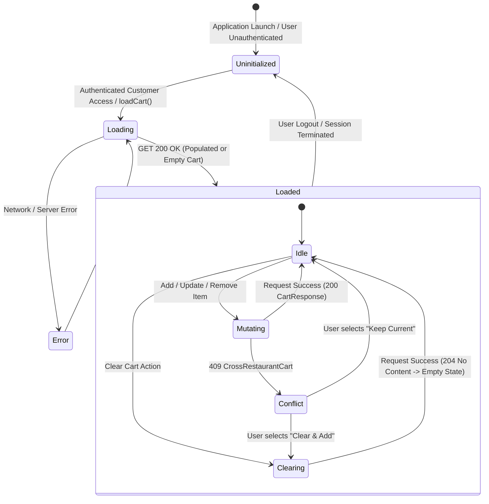

# Data Model: Server-Backed Customer Cart

**Feature Branch**: `002-server-backed-customer-cart`  
**Date**: 2026-08-06  
**Spec**: [spec.md](./spec.md)

---

## 1. Domain Entities & Value Objects (API Mappings)

### Cart (`CartResponse`)

Represents the customer's active shopping basket on the server.

| Field | Type | Required | Description |
|---|---|---|---|
| `id` | `number \| null` | Yes | Unique cart ID (`null` when empty/no cart created). |
| `customerId` | `number` | Yes | Identifier of the customer owner. |
| `restaurantId` | `number \| null` | Yes | Identifier of the associated restaurant (`null` when empty). |
| `status` | `string` | Yes | Cart status string (e.g. `"Active"`, `"Empty"`, `"Cleared"`, `"CheckedOut"`). |
| `items` | `Array<CartLineItemDto>` | Yes | List of line items currently in the cart. |
| `total` | `MoneyDto` | Yes | Authoritative total price object from server. |

---

### CartLineItem (`CartLineItemDto`)

Represents an individual line item inside a cart.

| Field | Type | Required | Description |
|---|---|---|---|
| `productId` | `number` | Yes | Identifier of the menu product. |
| `productName` | `string` | Yes | Name of the menu product. |
| `unitPrice` | `MoneyDto` | Yes | Unit price value object. |
| `quantity` | `number` | Yes | Current quantity (integer >= 1). |
| `lineTotal` | `MoneyDto` | Yes | Calculated line total value object (`unitPrice * quantity`). |

---

### Money (`MoneyDto`)

Value object representing monetary amounts.

| Field | Type | Required | Description |
|---|---|---|---|
| `amount` | `number` | Yes | Decimal monetary amount. |
| `currency` | `string` | No (default `"EGP"`) | Currency code symbol. |

---

## 2. Application Store State (`CartStoreState`)

Represented in `projects/customer/src/app/features/cart/cart.store.ts`:

```typescript
export type CartStatusState = 'uninitialized' | 'loading' | 'loaded' | 'error';

export interface CartStoreState {
  readonly status: CartStatusState;
  readonly cart: CartResponse | null;
  readonly error: AppError | null;
  readonly isMutating: boolean;
  readonly mutatingProductId: number | null;
  readonly conflictAddRequest: AddCartItemRequest | null;
}
```

### Derived Readonly Signals

- `cart`: `Signal<CartResponse | null>`
- `items`: `Signal<Array<CartLineItemDto>>` (returns `cart().items` or `[]`)
- `total`: `Signal<MoneyDto | null>` (returns `cart().total` or `null`)
- `totalItemCount`: `Signal<number>` (computed sum of quantities across items or `0`)
- `isEmpty`: `Signal<boolean>` (computed `items().length === 0`)
- `restaurantId`: `Signal<number | null>` (returns `cart().restaurantId`)
- `isMutating`: `Signal<boolean>`
- `mutatingProductId`: `Signal<number | null>`
- `conflictAddRequest`: `Signal<AddCartItemRequest | null>`

---

## 3. Cart Lifecycle & State Transitions



---

## 4. Validation Rules & Constraints

1. **Quantity Constraints**:
   - Add item: `quantity >= 1` (integer).
   - Update item quantity: `quantity >= 1` (integer). Decrementing below 1 invokes `removeCartItem`.
2. **Single Restaurant Constraint**:
   - `cart.restaurantId` MUST match the incoming `AddCartItemRequest.restaurantId`.
   - Backend enforces single restaurant restriction; frontend handles `CrossRestaurantCart` (409) conflict dialog.
3. **Product Availability**:
   - Add controls are disabled for products where `isAvailable: false`.
