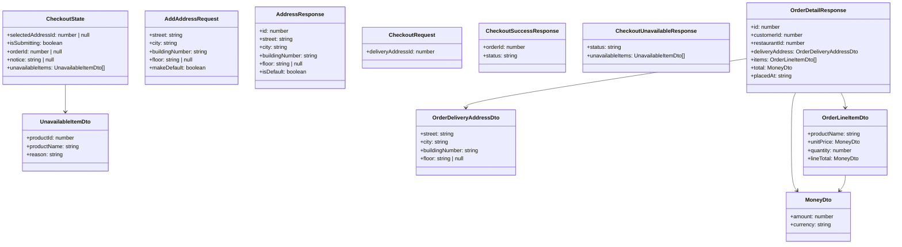

# Data Model: Checkout and Order Confirmation (Phase 9)

## 1. Domain Entities & State Structures



---

## 2. In-Memory Store Definitions

### `CheckoutStore` (`projects/customer/src/app/features/checkout/checkout.store.ts`)
- **State Signals**:
  - `selectedAddressId`: `Signal<number | null>` (tracks customer's currently selected address ID)
  - `isSubmitting`: `Signal<boolean>` (locks submission controls during flight, sets `aria-busy="true"`)
  - `orderId`: `Signal<number | null>` (stores newly created order ID upon HTTP 201)
  - `notice`: `Signal<string | null>` (stores domain error notices)
  - `unavailableItems`: `Signal<UnavailableItemDto[]>` (stores items unavailable upon HTTP 422)

- **Actions**:
  - `selectAddress(addressId: number)`: Updates `selectedAddressId`.
  - `submitOrder()`: Validates `selectedAddressId`, sets `isSubmitting = true`, calls `CheckoutApiService.checkout({ checkoutRequest: { deliveryAddressId } })`.
    - **On 201 Created**: Invokes `CartStore.applyEmptyCart()`, sets `orderId = response.orderId`, resets `isSubmitting = false`, navigates to `/orders/:orderId`.
    - **On 422 Unprocessable Entity**: Inspects `appError.rawError as CheckoutUnavailableResponse`, sets `unavailableItems`, triggers `CartStore.loadCart()`, resets `isSubmitting = false`, navigates to `/cart`.
    - **On Other Errors**: Sets `notice = appError.title`, resets `isSubmitting = false`.

---

## 3. Form Models

### Address Creation Form Model (`AddressFormModalComponent`)
```typescript
export interface AddressFormValue {
  street: string;
  city: string;
  buildingNumber: string;
  floor: string | null;
  makeDefault: boolean;
}
```
- **Validation Rules**:
  - `street`: Required, minLength(3), maxLength(200).
  - `city`: Required, minLength(2), maxLength(100).
  - `buildingNumber`: Required, minLength(1), maxLength(50).
  - `floor`: Optional string or null.
  - `makeDefault`: Boolean, defaults to `true`.
