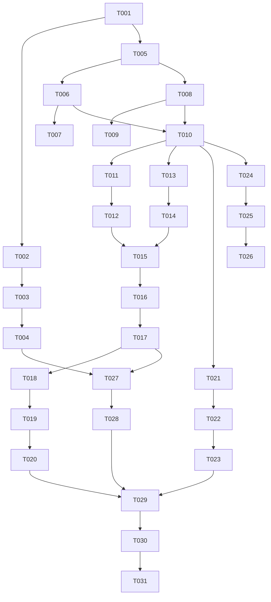

# Tasks: Checkout and Order Confirmation (Phase 9)

**Input**: Approved specification from `specs/003-checkout-order-confirmation/spec.md`, technical plan from `plan.md`, research from `research.md`, data model from `data-model.md`, and contracts from `contracts/`.

**Prerequisites**: Phase 8 cart baseline passing clean (103/103 tests passing, working tree clean).

---

## Phase 1: Setup & Core Interceptor Infrastructure

**Purpose**: Update `@talabat/core-http` to preserve raw HTTP error bodies (`rawError?: unknown`) for non-ProblemDetails payloads (such as HTTP 422 `CheckoutUnavailableResponse`) while maintaining 100% backward compatibility for all existing consumers.

- [x] T001 Verify Phase 8 clean baseline by running `npx ng test customer` and inspecting Git status.
- [x] T002 Update `AppError` interface in `projects/core-http/src/lib/app-error.ts` to add `readonly rawError?: unknown;`.
- [x] T003 Update `problemDetailsInterceptor` in `projects/core-http/src/lib/problem-details.interceptor.ts` to attach `rawError: e.error` when mapping `HttpErrorResponse` to `AppError`.
- [x] T004 Create unit tests in `projects/core-http/src/lib/problem-details.interceptor.spec.ts` verifying that:
  - HTTP 422 `CheckoutUnavailableResponse` body survives on `AppError.rawError`.
  - Normal RFC 9457 `ProblemDetails` error codes are mapped correctly.
  - Unknown 422 bodies remain safe without runtime exceptions.
  - Existing `AppError` properties (`status`, `code`, `title`, `detail`, `isNetworkError`) behave identically.
- [x] T005 Create feature directory structure for `checkout` and `orders` in `projects/customer/src/app/features/checkout/` and `projects/customer/src/app/features/orders/`.

---

## Phase 2: Foundational Infrastructure

**Purpose**: Core guards, stores, and route definitions that block user story implementation.

**⚠️ CRITICAL**: All tasks in this phase must complete before user story implementation begins.

- [x] T006 Create `checkoutGuard` in `projects/customer/src/app/core/guards/checkout.guard.ts` verifying authenticated user profile and non-empty `CartStore` (`CartStore.isEmpty() === false`), redirecting empty carts to `/cart`.
- [x] T007 Create unit tests for `checkoutGuard` in `projects/customer/src/app/core/guards/checkout.guard.spec.ts` verifying empty cart redirects and non-empty cart activation.
- [x] T008 [P] Implement `CheckoutStore` in `projects/customer/src/app/features/checkout/checkout.store.ts` using Angular Signals to manage address selection, `isSubmitting` lock, `orderId`, `notice`, and `unavailableItems` state.
- [x] T009 [P] Create unit tests for `CheckoutStore` in `projects/customer/src/app/features/checkout/checkout.store.spec.ts` verifying address selection, submission locks, HTTP 201 cart reset (`CartStore.applyEmptyCart()`), and HTTP 422 typed `unavailableItems` extraction from `appError.rawError`.
- [x] T010 Configure route definitions in `projects/customer/src/app/features/checkout/checkout.routes.ts` and `projects/customer/src/app/features/orders/orders.routes.ts`, and register `/checkout` and `/orders/:orderId` in `projects/customer/src/app/layout/routes.ts`.

**Checkpoint**: Foundation ready - user story implementation can now begin.

---

## Phase 3: User Story 1 — Checkout Summary & Delivery Address Selection (Priority: P1) 🎯 MVP

**Goal**: Enable authenticated customers with items in cart to select a saved delivery address, review server-authoritative line items and totals, and view "Cash on Delivery" payment method.

**Independent Test**: Navigate to `/checkout` with a non-empty cart and saved addresses, verify default address pre-selection, review server line items and totals, and switch addresses.

### Implementation & Testing for User Story 1

- [x] T011 [P] [US1] Create unit tests for `AddressSelectorComponent` in `projects/customer/src/app/features/checkout/components/address-selector.component.spec.ts` testing address card rendering (`street`, `buildingNumber`, `city`, `floor`), radio selection, default address highlighting (`isDefault`), and focus ring styling.
- [x] T012 [P] [US1] Implement `AddressSelectorComponent` in `projects/customer/src/app/features/checkout/components/address-selector.component.ts` rendering saved addresses from `ProfileStore.profile().addresses` with radio inputs and minimum 42px touch targets.
- [x] T013 [P] [US1] Create unit tests for `CheckoutSummaryComponent` in `projects/customer/src/app/features/checkout/components/checkout-summary.component.spec.ts` testing line items rendering, subtotal/total display from `CartStore`, and "Cash on Delivery" payment method badge.
- [x] T014 [P] [US1] Implement `CheckoutSummaryComponent` in `projects/customer/src/app/features/checkout/components/checkout-summary.component.ts` displaying server-authoritative cart line items, quantities, unit prices, delivery fee, and grand total.
- [x] T015 [US1] Implement primary `CheckoutPage` component in `projects/customer/src/app/features/checkout/pages/checkout.page.ts` assembling address selector, checkout summary, and "Place Order" trigger button.
- [x] T016 [US1] Create unit tests for `CheckoutPage` in `projects/customer/src/app/features/checkout/pages/checkout.page.spec.ts` verifying component lifecycle, cart store integration, address selection state binding, and layout responsiveness.

**Checkpoint**: User Story 1 (MVP) fully functional and testable independently.

---

## Phase 4: User Story 2 — Order Submission & Duplicate Prevention (Priority: P1)

**Goal**: Process order submissions reliably via `CheckoutApiService.checkout({ checkoutRequest: { deliveryAddressId } })`, locking submit triggers during flight, resetting cart state on HTTP 201 success (`{ orderId }`), and redirecting to `/orders/:orderId`.

**Independent Test**: Click "Place Order" on `/checkout`, verify submit button enters loading state (`aria-busy="true"`), inspect HTTP 201 response, verify cart badge count resets to 0, and confirm automatic redirect to `/orders/:orderId`.

### Implementation & Testing for User Story 2

- [x] T017 [US2] Implement order submission workflow in `CheckoutStore` (`projects/customer/src/app/features/checkout/checkout.store.ts`) invoking `CheckoutApiService.checkout({ checkoutRequest: { deliveryAddressId } })`, setting `isSubmitting = true`, and handling HTTP 201 success by invoking `CartStore.applyEmptyCart()`.
- [x] T018 [US2] Wire submission trigger in `CheckoutPage` (`projects/customer/src/app/features/checkout/pages/checkout.page.ts`) linking "Place Order" button to `CheckoutStore.submitOrder()`, setting `aria-busy="true"`, and disabling button during flight.
- [x] T019 [US2] Add unit tests in `projects/customer/src/app/features/checkout/pages/checkout.page.spec.ts` verifying rapid click protection, button disabled states, ARIA live loading announcements, and navigation to `/orders/:orderId` upon HTTP 201 response.
- [x] T020 [US2] Configure zero automatic retries policy for ambiguous network failures in `CheckoutStore` (`projects/customer/src/app/features/checkout/checkout.store.ts`), displaying a retryable modal dialog instructing the user to check their order history before re-submitting.

**Checkpoint**: User Story 2 complete with zero duplicate submission risk and immediate cart reset.

---

## Phase 5: User Story 3 — Order Confirmation View & Reload Safety (Priority: P1)

**Goal**: Render authoritative order confirmation page at `/orders/:orderId` via `OrdersApiService.getOrderDetails()`, guaranteeing 100% reload safety and bookmark integrity using exact `OrderDetailResponse` fields (`id`, `placedAt`, `deliveryAddress`, `items`, `total`).

**Independent Test**: Navigate to `/orders/1042`, verify order ID, placement timestamp, delivery address snapshot, line items, and totals are rendered. Refresh browser page (F5) and confirm page re-renders safely via HTTP GET read request with 0 side effects.

### Implementation & Testing for User Story 3

- [x] T021 [P] [US3] Create unit tests for `OrderConfirmationPage` in `projects/customer/src/app/features/orders/pages/order-confirmation.page.spec.ts` testing route parameter extraction, HTTP GET API fetching, loading skeleton display, order details rendering (`id`, `placedAt`, `deliveryAddress`, `items`, `total`), and HTTP 404 error handling.
- [x] T022 [US3] Implement `OrderConfirmationPage` in `projects/customer/src/app/features/orders/pages/order-confirmation.page.ts` reading `:orderId` param, fetching order details via `OrdersApiService.getOrderDetails({ orderId })`, and rendering order ID (`id`), placement timestamp (`placedAt`), delivery address (`street`, `buildingNumber`, `city`, `floor`), line items (`productName`, `quantity`, `unitPrice`, `lineTotal`), grand total (`total`), and COD payment method.
- [x] T023 [US3] Add reload-safety verification in `projects/customer/src/app/features/orders/pages/order-confirmation.page.spec.ts` proving that page refresh re-issues GET requests exclusively without POST side effects.

**Checkpoint**: User Story 3 complete with 100% reload-safe order confirmation views.

---

## Phase 6: User Story 4 — Address Gaps, Unavailable Items, & Recovery (Priority: P2)

**Goal**: Provide clear feedback and recovery flows when a customer has no saved delivery addresses or when order submission fails due to unavailable items (HTTP 422 `CheckoutUnavailableResponse`).

**Independent Test**: (1) Access `/checkout` with 0 saved addresses, open inline address dialog, submit new address (`AddAddressRequest`), verify auto-selection and profile refresh; (2) Trigger HTTP 422 unavailable item response during checkout, verify domain error alert, cart reload (`CartStore.loadCart()`), and redirect to `/cart`.

### Implementation & Testing for User Story 4

- [x] T024 [P] [US4] Create unit tests for `AddressFormModalComponent` in `projects/customer/src/app/features/checkout/components/address-form-modal.component.spec.ts` testing Reactive Form controls (`street`, `city`, `buildingNumber`, `floor`, `makeDefault`), focus trap, `AddressesApiService.addAddress()` invocation, server error preservation, and focus restoration.
- [x] T025 [P] [US4] Implement `AddressFormModalComponent` in `projects/customer/src/app/features/checkout/components/address-form-modal.component.ts` as an accessible inline dialog using `AddressesApiService.addAddress({ addAddressRequest: { street, city, buildingNumber, floor, makeDefault } })`. Upon creation success, invokes `ProfileStore.refreshAfterCreation()`, auto-selects the new address `id`, and closes the modal.
- [x] T026 [US4] Integrate `AddressFormModalComponent` into `CheckoutPage` (`projects/customer/src/app/features/checkout/pages/checkout.page.ts`) showing an "Add Delivery Address" trigger button when saved addresses count is 0 or when user wants to add an address inline.
- [x] T027 [US4] Implement HTTP 422 `CheckoutUnavailableResponse` recovery handler in `CheckoutStore` (`projects/customer/src/app/features/checkout/checkout.store.ts`) parsing `appError.rawError as CheckoutUnavailableResponse`, extracting `unavailableItems`, triggering `CartStore.loadCart()`, and navigating user back to `/cart` with an informative toast notice.
- [x] T028 [US4] Add unit tests in `projects/customer/src/app/features/checkout/checkout.store.spec.ts` proving HTTP 422 response processing, typed `unavailableItems` extraction from `appError.rawError`, cart reload triggering, and navigation to `/cart`.

**Checkpoint**: User Story 4 complete with inline address creation and HTTP 422 cart recovery.

---

## Phase 7: Polish, Accessibility, & End-to-End Verification

**Purpose**: Cross-cutting quality, WCAG 2.1 AA accessibility validation, and build checks.

- [x] T029 Audit WCAG 2.1 AA keyboard focus rings (`--tal-focus-ring`), ARIA live regions (`role="status"`, `role="alert"`), modal focus traps, and minimum 42px touch target heights across `CheckoutPage`, `AddressSelectorComponent`, `AddressFormModalComponent`, and `OrderConfirmationPage`.
- [x] T030 Run quickstart end-to-end validation scenarios documented in `quickstart.md` and execute full test suite via `npx ng test customer` and `npx ng test core-http` to confirm 100% passing rate with 0 regressions.
- [x] T031 Run production build check via `npx ng build customer` to verify zero TypeScript or bundle compilation errors.

---

## Dependencies & Execution Order

---

## Parallel Execution Opportunities

- **Stage 1 (Core HTTP & Store)**: T002/T003/T004 (`@talabat/core-http` `AppError.rawError`) and T006/T008 (`checkoutGuard` & `CheckoutStore`) can proceed in parallel.
- **Stage 2 (US1 UI Components)**: T011/T012 (`AddressSelectorComponent`) and T013/T014 (`CheckoutSummaryComponent`) can proceed in parallel.
- **Stage 3 (US3 & US4)**: US3 (`OrderConfirmationPage`) and US4 (`AddressFormModalComponent`) can proceed in parallel after foundational setup completes.

---

## Implementation Strategy & MVP

1. **MVP Scope**: Complete Phase 1 through Phase 4 (Setup, Core HTTP, Foundation, US1, US2). This delivers a fully functional, testable checkout flow from cart review to order submission and cart reset.
2. **Incremental Enhancements**:
   - Add Phase 5 (Order Confirmation Detail Page).
   - Add Phase 6 (Inline Address Creation Dialog & HTTP 422 Unavailable Items Recovery).
3. **Completion Gate**: Full pass on `npx ng test customer`, `npx ng test core-http`, and `npx ng build customer`.
