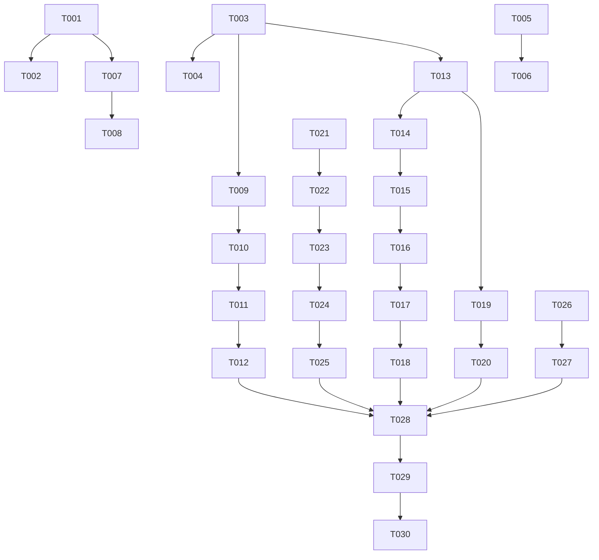

# Tasks: Account, Addresses, and Orders (Phase 10)

**Input**: Design documents from `/specs/004-account-addresses-orders/` (`spec.md`, `plan.md`, `research.md`, `data-model.md`, `contracts/ui-contracts.md`, `quickstart.md`)

**Prerequisites**: plan.md, spec.md, data-model.md, contracts/ui-contracts.md, quickstart.md

**Organization**: Tasks are grouped by foundational infrastructure and user story phases to enable incremental, modular implementation and testing.

## Format: `- [ ] [ID] [P?] [Story] Description with exact file path`

- **[P]**: Can run in parallel (different files, no blocking dependencies)
- **[US#]**: Maps task to User Story 1–5 from spec.md

---

## Phase 1: Setup & Structural Relocation

**Purpose**: Reconcile and decouple existing Phase 9 address components before expanding profile and order features.

- [ ] T001 Move `AddressFormModalComponent` from `projects/customer/src/app/features/checkout/components/address-form-modal.component.ts` to `projects/customer/src/app/ui/address-form-modal.component.ts` and remove `CheckoutStore` dependency, closing dialog with `AddressResponse` result.
- [ ] T002 Move `AddressFormModalComponent` test from `projects/customer/src/app/features/checkout/components/address-form-modal.component.spec.ts` to `projects/customer/src/app/ui/address-form-modal.component.spec.ts` and update mocks to test dialog result emission without `CheckoutStore`.

---

## Phase 2: Foundational State & Checkout Safety

**Purpose**: Extend core profile aggregate state management and reinforce reactive checkout safety before UI integration.

- [ ] T003 Extend `ProfileStore` in `projects/customer/src/app/core/profile/profile.store.ts` with `updateProfile()`, `addAddress()`, `setDefaultAddress()`, and `removeAddress()` mutation methods incorporating backend-authoritative state reconciliation rules.
- [ ] T004 Add unit tests for `ProfileStore` mutations in `projects/customer/src/app/core/profile/profile.store.spec.ts` verifying state replacement on update/setDefault, and profile re-probing on add/remove.
- [ ] T005 Update `CheckoutStore.selectedAddressId` computed signal in `projects/customer/src/app/features/checkout/checkout.store.ts` to validate override existence against current profile addresses, falling back to `defaultAddressId()`.
- [ ] T006 Add unit test for dangling override address fallback in `projects/customer/src/app/features/checkout/checkout.store.spec.ts`.
- [ ] T007 Update `CheckoutPage` in `projects/customer/src/app/features/checkout/pages/checkout.page.ts` to import `AddressFormModalComponent` from `app/ui/` and handle created address selection from `dialogRef.closed`.
- [ ] T008 Update import path and dialog mock in `projects/customer/src/app/features/checkout/pages/checkout.page.spec.ts`.

---

## Phase 3: User Story 1 — View and Edit Profile (Priority: P1) 🎯 MVP

**Goal**: Authenticated customer can view their profile data and perform inline editing using Signal Forms.

**Independent Test**: Navigate to `/profile`, verify `fullName`, `age`, `phoneNumber`; activate edit mode, submit valid updates, verify view mode reflects updated server state; verify validation errors on invalid inputs preserve form state.

- [ ] T009 [US1] Implement inline View/Edit mode state and Signal Form model in `projects/customer/src/app/features/profile/pages/profile.page.ts` for `fullName`, `age`, and optional `phoneNumber`.
- [ ] T010 [US1] Add form validation logic (`required` fullName, `positive integer` age) and accessible error linking (`aria-invalid`, `aria-describedby`) in `projects/customer/src/app/features/profile/pages/profile.page.ts`.
- [ ] T011 [US1] Wire form submission to `ProfileStore.updateProfile()`, handling busy state, server error banner, and successful transition back to read mode in `projects/customer/src/app/features/profile/pages/profile.page.ts`.
- [ ] T012 [P] [US1] Add unit tests in `projects/customer/src/app/features/profile/pages/profile.page.spec.ts` for profile view rendering, edit toggle, form validation, successful save, and server error handling.

**Checkpoint**: User Story 1 (Profile View/Edit) is fully functional and testable independently as an MVP.

---

## Phase 4: User Story 2 — Manage Delivery Addresses (Priority: P1)

**Goal**: Customer can view saved delivery addresses, launch the shared address creation modal, set default address, and remove non-default addresses.

**Independent Test**: Navigate to `/profile`, view address list, add a new address via `app/ui/address-form-modal.component.ts`, set it as default, and remove a non-default address after confirmation prompt.

- [ ] T013 [US2] Implement saved delivery address card list rendering in `projects/customer/src/app/features/profile/pages/profile.page.ts` showing `street`, `buildingNumber`, `floor`, `city`, and "Default" badge.
- [ ] T014 [US2] Wire "Add address" action in `projects/customer/src/app/features/profile/pages/profile.page.ts` to launch `AddressFormModalComponent` via `DialogService`.
- [ ] T015 [US2] Implement "Set as default" action invoking `ProfileStore.setDefaultAddress()` in `projects/customer/src/app/features/profile/pages/profile.page.ts`.
- [ ] T016 [US2] Implement intentional removal confirmation dialog and "Remove" action invoking `ProfileStore.removeAddress()` in `projects/customer/src/app/features/profile/pages/profile.page.ts`.
- [ ] T017 [US2] Add empty state rendering when no saved addresses exist in `projects/customer/src/app/features/profile/pages/profile.page.ts`.
- [ ] T018 [P] [US2] Add unit tests in `projects/customer/src/app/features/profile/pages/profile.page.spec.ts` for address list rendering, add modal launch, set default, removal confirmation, and empty state.

**Checkpoint**: User Story 2 (Address Management) is fully functional and testable independently.

---

## Phase 5: User Story 5 — Address Consistency with Checkout (Priority: P3)

**Goal**: Validate seamless address synchronization between profile address mutations and checkout selection.

**Independent Test**: Add an address via `/profile`, navigate to `/checkout`, verify new address is available; change default address in `/profile`, navigate to `/checkout`, verify default address is pre-selected.

- [ ] T019 [US5] Verify reactive profile address synchronization in `projects/customer/src/app/features/checkout/checkout.store.ts` ensuring newly added/defaulted addresses reflect in checkout selection without page refresh.
- [ ] T020 [P] [US5] Add integration unit test in `projects/customer/src/app/features/checkout/pages/checkout.page.spec.ts` verifying address list and default pre-selection reactivity from `ProfileStore`.

**Checkpoint**: User Story 5 (Cross-feature Address Sync) is verified.

---

## Phase 6: User Story 3 — View Order History (Priority: P2)

**Goal**: Customer can view a paginated list of past orders with order ID, placed date, item count, and total amount, navigating to order details.

**Independent Test**: Navigate to `/orders`, verify orders list loads from `OrdersApiService.getOrders()`, test previous/next pagination controls, and click an order row to navigate to `/orders/:orderId`.

- [ ] T021 [US3] Implement server resource and signal-based page state (`currentPage`, `pageSize=10`) calling `OrdersApiService.getOrders()` in `projects/customer/src/app/features/orders/pages/orders.page.ts`.
- [ ] T022 [US3] Render order summary cards displaying `id` (#ID font-mono), `placedAt` (formatted via `formatDateTime`), `itemCount`, and `total` (formatted via `MoneyPipe`) in `projects/customer/src/app/features/orders/pages/orders.page.ts`.
- [ ] T023 [US3] Add 4-state presentation (loading spinner, empty state with "Browse restaurants" link, retryable error state, populated list) in `projects/customer/src/app/features/orders/pages/orders.page.ts`.
- [ ] T024 [US3] Add responsive pagination controls (Previous/Next buttons, page context "Page X of Y", boundary disabled states) in `projects/customer/src/app/features/orders/pages/orders.page.ts`.
- [ ] T025 [P] [US3] Create comprehensive unit tests in `projects/customer/src/app/features/orders/pages/orders.page.spec.ts` testing resource loading, 4-state presentation, pagination calculation, and order detail navigation links.

**Checkpoint**: User Story 3 (Order History) is fully functional and testable independently.

---

## Phase 7: User Story 4 — View Order Details (Priority: P2)

**Goal**: Customer can view complete details of a specific order via canonical `/orders/:orderId` route from post-checkout or order history navigation.

**Independent Test**: Navigate to `/orders/7`, verify order detail rendering, "Back to orders" navigation link, page refresh safety, 404 not-found handling for `/orders/99999`, and invalid parameter handling for `/orders/abc`.

- [ ] T026 [US4] Refactor heading text to "Order Details" and add "Back to orders" navigation link alongside "Back to restaurants" in `projects/customer/src/app/features/orders/pages/order-confirmation.page.ts`.
- [ ] T027 [P] [US4] Update existing unit tests in `projects/customer/src/app/features/orders/pages/order-confirmation.page.spec.ts` asserting "Order Details" heading and navigation link.

**Checkpoint**: User Story 4 (Canonical Order Detail) is refined and testable independently.

---

## Phase 8: Polish & Verification Gates

**Purpose**: Execute full verification suite and validate quickstart manual scenarios.

- [ ] T028 Run full customer unit test suite (`npx ng test customer --watch=false`) and fix any regressions across profile, checkout, and orders.
- [ ] T029 Execute production build (`npx ng build customer --configuration=production`) and verify zero build or bundle budget errors.
- [ ] T030 Perform manual acceptance validation following `specs/004-account-addresses-orders/quickstart.md` Scenarios 1–8.

---

## Dependencies & Execution Order

### Story Completion Order
1. **Setup & Foundational**: T001–T008 (Must complete first)
2. **User Story 1 (Profile Edit - P1 MVP)**: T009–T012
3. **User Story 2 (Address Management - P1)**: T013–T018
4. **User Story 5 (Address Sync - P3)**: T019–T020
5. **User Story 3 (Order History - P2)**: T021–T025
6. **User Story 4 (Order Detail - P2)**: T026–T027
7. **Polish & Verification**: T028–T030

---

## Parallel Execution Opportunities

- **Setup & Foundational**: T001/T003/T005 can be started in parallel once project context is loaded.
- **After Foundational Phase**:
  - Developer/Agent A: User Story 1 (Profile Edit: T009–T012)
  - Developer/Agent B: User Story 3 (Order History: T021–T025)
  - Developer/Agent C: User Story 4 (Order Detail Refinement: T026–T027)
- **Unit Tests**: All unit test tasks marked `[P]` (T004, T006, T012, T018, T020, T025, T027) can be executed alongside implementation.

---

## Implementation Strategy & MVP Scope

- **MVP Target**: Complete Phases 1, 2, and 3 (Tasks T001–T012). This enables full Profile Viewing and Editing independently.
- **Incremental Delivery**:
  1. MVP (Profile View/Edit) → Verify independently
  2. Increment 2 (Address Management & Checkout Sync) → Verify independently
  3. Increment 3 (Order History & Detail Refinement) → Verify independently
  4. Final Polish & Build Gate
